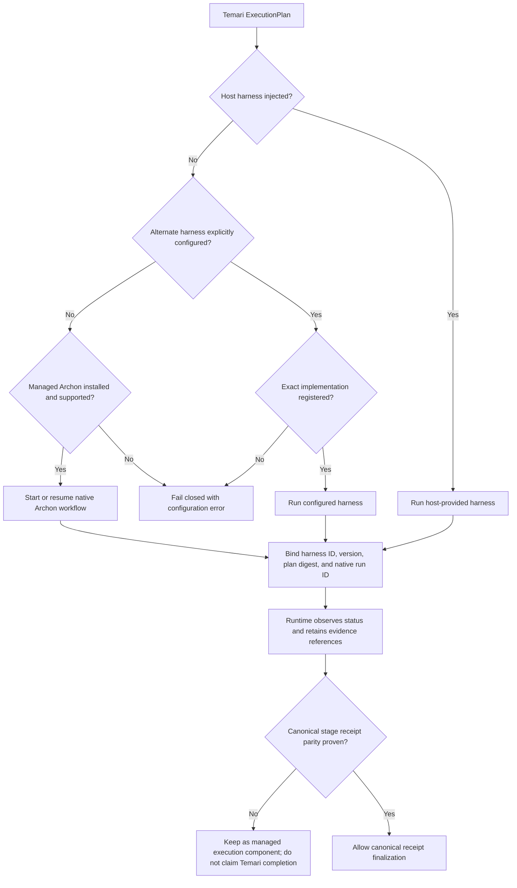

# Decision: managed Archon behind a replaceable harness port

**Status:** Accepted for the first managed-runtime increment; execution
conformance remains a promotion gate.

## Context

Temari's plan, workflow engine, host-capability adapters, and runtime are
separate Nx projects. `HostAdapter` describes host facilities; it is not an
execution scheduler. The current stage engine accepts an injected handler, but
there is no named, versioned run-level harness contract. The v4.1 Archon
integration is useful migration evidence, not a drop-in adapter: it uses an
older receipt model and its live pilot is macOS-only.

The requirement is to provision Archon as a first-party Temari component while
allowing a host or a different harness to take its place without changing
`ExecutionPlan` or importing Archon into the workflow engine.

## Decision

Add `ExecutionHarness` to `@temari/contracts`. It is a run-level control port:
`start`, `status`, and exact-run `resume`. The reference binds a Temari run ID,
revision, canonical plan digest, harness identity/version, and native run ID.
Runtime selects one implementation; the workflow engine and plan contracts do
not depend on a vendor package. Host APIs/capabilities remain an independent
boundary.

Register `@temari/archon-harness` as a separate Nx library. It owns the pinned
release metadata and native CLI adaptation. The initializer coordinates the
installation and records its executable path, release, platform, and SHA-256
in the install receipt. The binary is versioned under Temari's user-local
cache, not installed globally and not resolved by trusting `PATH`.

Selection precedence is explicit host harness, explicitly configured alternate
harness, then managed Archon. Missing explicitly requested implementations fail
at configuration lookup; they do not silently fall back. Runtime exposes
start, status, and resume dispatch through that selected implementation and
binds the returned reference to the requested Temari run, revision, workspace,
entrypoint, and plan digest. The existing serial stage engine remains the
default canonical path; a native Archon run is not yet promoted to Temari
completion until stage outcomes and receipts have proven parity.

## Interface sketch

```ts
interface ExecutionHarness {
  readonly id: string;
  readonly version: string;
  start(request: HarnessRunRequest): Promise<HarnessRunRef>;
  status(reference: HarnessRunRef): Promise<HarnessRunSnapshot>;
  resume(reference: HarnessRunRef): Promise<HarnessRunSnapshot>;
}
```

The request carries a Temari plan, workspace, entrypoint, and string inputs.
It never carries credentials. The selected adapter owns provider-specific
configuration, CLI invocation, native run IDs, and status translation.
Runtime callers use `startExecutionHarness`, `getExecutionHarnessStatus`, and
`resumeExecutionHarness`. These native snapshots remain distinct from
`WorkflowReceipt` and cannot independently authorize closeout.

## Component and decision path



## Provisioning and provenance

- Pin [Archon v0.10.1](https://github.com/coleam00/Archon/releases/tag/v0.10.1),
  commit `9820785c`, exact release asset, byte count, and
  SHA-256 for each supported OS/architecture. Do not query `latest` at install
  time.
- Stream each asset into a private same-directory temporary file, validate
  byte count and hash, then publish it atomically into the versioned cache.
- Reuse only an existing regular file whose bytes match the pin. Refuse a
  symlink, non-regular file, or mismatching cached binary; never overwrite it
  silently.
- Keep the verified executable path explicit. Do not prepend it to `PATH`.
- Record release, commit, platform, source URL, expected/observed digest, and
  managed path in the local initializer receipt. Do not record credentials.
- Do not claim upstream signing/authenticity beyond the pinned HTTPS source and
  hash check.

Windows currently has an upstream x64 executable, not an ARM64 asset. Workflow
nodes using `bash:` need Git for Windows; the adapter selects a known Git Bash
path or requires `ARCHON_BASH_PATH`, rather than trusting an arbitrary `bash`
earlier on `PATH`.

## Alternatives and synthesis

1. **Put everything in the initializer and leave execution callbacks unnamed.**
   This was smaller and reused existing cache code, but did not provide the
   requested host/other-harness replacement seam. The initializer remains the
   install coordinator; binary acquisition is owned by the dedicated Archon
   component.
2. **Make Archon a host capability or a second semantic coordinator.**
   Rejected because workflow scheduling is not proof of host subagents,
   credentials, model diversity, forge access, or semantic approval.
3. **Create a general dynamic plugin marketplace.** Rejected as unnecessary for
   the first registered-component boundary.

Two independently authored architecture sketches were compared. The
cross-judge recommended the run-level port, separate host boundary, and a
managed versioned binary. Its grafts were: reuse the initializer's platform and
receipt lifecycle, and do not promote Archon into the canonical engine until
receipt parity is proven. Both are included. The initial design is grounded in
current Nx contracts and the existing v4.1 integration; implementation details
that disagree with this sketch must be reconsidered rather than hidden in a
vendor-specific special case.

## Promotion and rejection criteria

Keep Archon as a managed but non-authoritative execution component until a
conformance journey demonstrates that it runs engine-authored stages, resumes
the exact native run, and yields the same revision-bound Temari receipt
semantics as the serial path. A Windows `version` or workflow-validation check
proves only binary startup and CLI validation, not workflow execution,
host-stage invocation, process-tree cleanup, or live model behavior.

Reject promotion if Archon cannot honor the engine-authored stage contract and
receipt boundary without adding competing semantic stages or impersonating
host capabilities. Existing v4.1 sealed-evidence and review-boundary behavior
remains migration material; it does not authenticate actors or prove a
sandbox.
