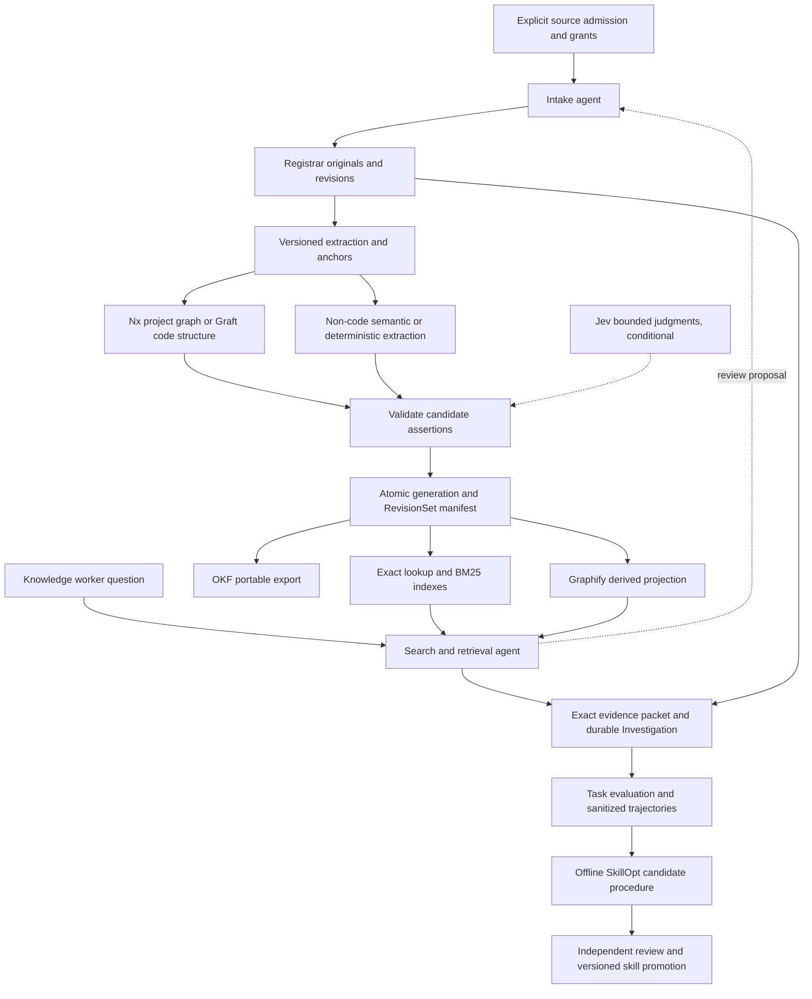

# Durable knowledge for Temari

Status: **proposed architecture; documentation and scoped design graph delivered**.
Baseline: Temari `664144d17272697d68e045143f0ede0458ee6eca`, reviewed 2026-09-29.
Audience: the Temari owner implementing and evaluating the next knowledge increment.
The reader owns deployment policy and promotion decisions; this document supplies
boundaries, compatibility requirements, evidence gates and an implementable order.

## Outcome and recommendation

Keep standalone Python Content Registrar as the source, index and evidence authority.
Keep versioned contracts, host adapters, two agents and evaluation in Temari's Nx monorepo.
Use Nx for project/task structure, Graft for non-Nx code, Graphify for non-code
relationships, OKF for portable representations, BM25 for lexical ranking, and Jev
for bounded judgments.
The two agents are intake and search/retrieval; the existing runtime remains their
execution and persistence owner. A second scheduler would create duplicate authority.

The lossless objective means recovering the exact successfully captured, admitted original
versions under an explicit retention policy, accounting for every admitted asset, and tracing every
derived assertion to evidence. It does not mean perfect recall of every possible
meaning. Measure semantic retrieval and complete-task success separately.

This increment writes no application runtime, installs no tools, reads no credentials,
activates no schedules and sends no private corpus to a model. The graph is a design
synthesis, not a populated product knowledge base or proof of semantic correctness.
The [evidence ledger](knowledge-system/evidence.json) preserves source-backed points,
conditions, limitations, decisions and relationship rationale. The
[graph report](knowledge-system/GRAPH_REPORT.md) records the actual local projection.

## Decisions, uncertainty and lineage

The latest request selects two agents, continual relationship improvement and the
named tool roles. It supersedes the earlier undecided agent topology in the
[preserved memory discussion](https://github.com/randydinh/temari-v4.1/blob/0d0d7d8/docs/content-registrar-memory-discussion-2026-09-20.md)
and the [Registrar reconciliation handoff](https://github.com/randydinh/content-registrar/blob/3d593500783dadac09a9fd207dee342aa5ed2a11/docs/handoffs/persistent-knowledge-retrieval-reconciliation-2026-09-21.md).
Those records remain useful for provenance, alternatives and unresolved policy.
The [recovered retrieval design](https://github.com/randydinh/temari-v4.1/blob/0d0d7d8/docs/recovered-content-registrar-buildout.md)
retains exact lookup, sparse challengers, progressive reading and complete-task evaluation.
Historical [knowledge decisions](https://github.com/randydinh/temari-v4.1/blob/0d0d7d8/docs/cutover-handover/thread-decisions/knowledge-graph-and-indexing.md)
retain tool separation and non-destructive identity. Latest instructions refine code
routing: use Nx first where present, without treating Nx as a symbol graph.

### Reconciliation with the supplied Content Registrar guide

The user supplied an [earlier consolidated guide](knowledge-system/sources/content-registrar-guide-received-2026-09-29.md),
described as written about one week earlier. Its exact authoring date is unverified;
the archived bytes and original locator are recorded in the source ledger. This is
historical design evidence, not new instructions or proof of current runtime behavior.

| Guide point | Standing in this design |
| --- | --- |
| Independent Python Registrar; source authority; derived Graphify and OKF views | Preserved. Reconcile the existing implementation and candidate branches. |
| Two responsibility groups, exact agent organization unresolved | Newer user instruction selects intake and search/retrieval agents. Process placement and final domain-assessment ownership remain open. |
| BM25 proposed challenger, adoption unresolved | Newer user instruction selects BM25. Backend choice and rollout evaluation remain open. Preserve the guide's granularity, diversity and reproducibility checks below. |
| Source history plus investigation history | Both remain necessary. Immutable concept records alone do not establish original-version recovery. |
| Existing local TF-IDF/SVD provider and caller-declared relationship traversal | Guide-reported bounded implementations; this reconciliation does not verify those providers or imply integration with persistent concept generations. |
| Reported extraction/connector coverage, generation caps and historical test counts | Historical reports; recheck the selected code revision before implementation claims. The OpConnect/OCPP scenario remains an example, not an adopted benchmark or corpus grant. |

The guide reinforces the refactor recommendation. Preserve its checks while retaining
the current design's explicit capture gaps, distinct evidence-progress sets and conditional
model roles. It neither settles the Jev-only scope nor authorizes hosted data access.

The phrase “only Jev” remains unresolved. Recommended **conditional** interpretation:
Jev owns Registrar decision/reranking judgments; existing generative agents may write
answers, propose semantic extractions and make SkillOpt text edits. This is not approved
by assumption. If Jev is the only model everywhere, deterministic extraction and
closed candidate judgments remain possible; defer free-form semantic extraction and
SkillOpt optimization. Human-authored text and templates remain available in that fork.
A saved API key establishes neither integration nor permission for hosted data use.

| Decision | Standing | Consequence |
| --- | --- | --- |
| Intake plus retrieval agents | Selected direction | Separate grants and queues; deployment topology remains open. |
| BM25 lexical ranking | Selected by the user | Rank text candidates alongside exact lookup and graph context; validate quality before runtime rollout. |
| Registrar authority; Temari orchestration | Recommended | Preserve independent releases and version the interface. |
| Directed, reified Graphify projection | Selected preservation approach | Verify IDs, attributes and edges after every projection. |
| Jev judgment plus generative workers | Conditional | Do not start dependent model work until scope is resolved. |
| No automatic purge for admitted local pilot | Proposed policy | Owner must select retention before live admission. |
| SkillOpt across Temari | Proposed platform capability | Manual, one-skill experiments first; no automatic adoption. |

## What exists and what must be reconciled

| Boundary | Evidence and exact standing | Remaining gap |
| --- | --- | --- |
| Temari knowledge adapter | Merged at the pinned baseline: `KnowledgeProvider`, actual Registrar CLI calls, exact evidence, bounded investigations and immutable checkpoints | Generic worker publication candidate is separate; no Jev call. |
| Registrar remote main | `dfdb9882f814df05354a74b7ab1f72d78d7acc2c`: pagination, generation-bound cursors, coverage, transitive required-context repair and six-tool source-read-only MCP profile | Semantic recall and full consumer journeys still need evaluation. |
| Temari worker candidate | Local-only/unpushed, unmerged `a2c80bcf98442700289cea090d0ff90bdd59dd27`: explicit UTF-8 intake/publication, pinned reader, generic bounded retrieval and continuation | Not deployed or integrated with persistent concept generations. |
| Registrar generation candidate | Unmerged `3d593500783dadac09a9fd207dee342aa5ed2a11`, implementation `b56d8a8ee46c4d5139a9466753451d09cd10f9be`: immutable concepts/assertions and checked Graphify projection | One source and contiguous anchor per record; no all-version byte archive, default retrieval integration or generation OKF export. |
| This increment | Design, ledger, local Graphify projection and artifact readback | Runtime behavior below is proposed unless explicitly identified above. |

Read the merged [knowledge contract](../libs/contracts/src/lib/knowledge.ts),
[adapter](../libs/knowledge/src/lib/registrar.ts), and [knowledge README](../libs/knowledge/README.md).
Candidate records are the [archived worker design](knowledge-system/sources/knowledge-workers-design-a2c80bc.md)
and [generation design](https://github.com/randydinh/content-registrar/blob/3d593500783dadac09a9fd207dee342aa5ed2a11/docs/design/persistent-knowledge-generations.md).
The worker snapshot is an archived source candidate, not implemented by this PR; its
original commit is local-only/unpushed and unavailable on GitHub. See the
[snapshot provenance](knowledge-system/README.md#archived-worker-source).
Characterize compatibility before combining them; do not blindly cherry-pick repairs
already present in Registrar main. Historical test counts and a prior Graphify 0.9.63
roundtrip are reported history, not tests run on this combined design. The earlier
MCP comparison was inconclusive and supports no superiority claim.

The pinned Registrar `discover()` lexical route uses token-set overlap plus filename-stem
weighting; it does not implement BM25. This was checked directly at the pinned Registrar
revision above. Selecting BM25 in the design therefore does not make it a shipped provider.

Registrar's `coverage.consumed` means enumeration offset plus returned documents.
It does **not** mean passages fetched, supplied to the reader or semantically assessed.
Preserve existing API semantics; add separate sets for those operations in Investigation.
Neither enumeration exhaustion nor a model score establishes semantic completeness.

Static inspection of [Registrar retrieval.py](https://github.com/randydinh/content-registrar/blob/dfdb9882f814df05354a74b7ab1f72d78d7acc2c/src/knowledge_agent/retrieval.py)
shows `discover()` calls `_corpus()` before ranking and again to recheck the snapshot.
`read_document()` also builds the selected source corpus. That work verifies/extracts
chunks, creates token sets and rehashes local bytes. Temari's `implementationDigest()`
walks the provider source tree and hashes package/lock files and Python executable;
`invoke()` pins before and after calls. These checks supply real integrity properties.
They are plausible scale costs, not measured latency or grounds to remove checks.

## Component comparison and ownership

| Component | Advantage in this design | Cost or limitation | Recommendation |
| --- | --- | --- | --- |
| Nx | Existing project dependencies, targets and affected-project navigation | Project/task graph misses many symbol, call and behavioral relationships | Use first for Nx repositories, then scoped AST/LSP and exact source. |
| Graft | Deterministic tree-sitter structure and code impact navigation | Language fidelity varies; unsupported files and generated summaries need separate handling | Default structural candidate for non-Nx code; benchmark target languages before integration. |
| Graphify | Useful non-code concept navigation and derived views | Semantic extraction needs a host/generative model; default graph/dedup can conflate identity | Feed checked source-scoped records through a directed projection with assertion nodes. |
| OKF | Human-readable Markdown/YAML and portable concept packages | Path IDs and prose links do not supply archive, ACL or typed query infrastructure | Export a Registrar profile with immutable identity and evidence extensions. |
| Registrar | One authority for sources, hashes, citations and versioned evidence | More lifecycle work than a simple search cache; current scans can be costly | Keep independent Python service/library, add explicit archive and serving manifests. |
| BM25 | Lexical candidate ranking without a model request | Term matching can miss relevant paraphrases; rank does not establish evidence support or completeness | Include in candidate retrieval, then combine exact matches and graph context before conditional Jev reranking. |
| Jev | Typed judgments fit candidate relevance, support and equivalence review | Cannot generate prose or recover candidates never retrieved; confidence needs local evaluation | Bounded shadow reranking/judgment after cheap candidate selection. |
| Two agents | Separate read authority from publication; durable handoffs | Queues, failure handling and consistency add complexity | Existing runtime owns jobs; one publisher per manifest, no shared mutable graph editing. |
| Continual graph improvement | Repairs stale links and missed relationships | Popularity feedback can amplify false claims; audits cost effort | Source refresh, reviewed query feedback and blind audits are distinct inputs. |
| SkillOpt | Reusable procedure improvement across Temari without weight training | Generative edits, leakage and evaluator gaming; default gate is too weak alone | Offline evaluation adapter, reviewed patch and controlled promotion. |

[Nx's graph documentation](https://nx.dev/docs/features/explore-graph) describes
project/task navigation. [Graft](https://github.com/trailhq/Graft/tree/d34c115155f4d3cd0debe3f60a7edb3120981bbb)
separates deterministic structure from optional summaries and now documents
`graft blast --base` and optional LSP. The old “no diff impact” comparison is stale.
A Markdown file inside an Nx repository still routes to non-code extraction.
Common Registrar asset identity must join all tool outputs without duplicating authority.
No Graft initialization, hooks or host-global wiring are prerequisites for this design.

## Proposed architecture

Registrar owns originals, anchors, assertion lifecycle and publication manifests.
Temari owns requests, agent grants, task checkpoints and reviewed skill versions.
Graphify and OKF are disposable/rebuildable views; source-backed IDs survive exporters.
Begin with SQLite/WAL plus content-addressed files and existing Registrar retrieval.
A separate graph database or vector service is justified only by measured needs.

## Lossless preservation contract

The admitted universe is an explicit manifest, not “everything accessible to this host.”
Record asset identity, expected inventory, source scope and acquisition permission.
Capture original bytes before extraction; retain upstream version and byte digest.
The recovery guarantee covers successfully captured versions only. Upstream revisions
between observations may be absent unless the connector can backfill source history.
Track capture times, upstream watermarks, history availability and explicit capture gaps;
never imply recovery of versions never observed or captured through backfill.
For remote sources whose original binary is unavailable, state exactly what representation
was captured; do not claim original-byte preservation from a normalized API response.

A successful generation must account for each admitted file, attachment, table, image,
media object and embedded asset as captured, omitted, unsupported or failed, with reasons.
Preserve raw bytes even when OCR, table structure or media extraction is unavailable.
Store a format-aware extraction coverage receipt: pages/regions, sheets/cells, tracks/time
ranges, errors and lossy transformations. Extracted text alone cannot certify completeness.

Recovering a successfully captured, retained version v1 means reproducing its byte hash
after v2 is published, without requiring the original source to still exist. Preserve extraction recipes and identities;
deterministic views must rebuild equivalently. For model-derived views retain exact
outputs, prompts/configuration hashes and provenance: regeneration may not be identical.
Compact summaries are expandable entry points and never substitutes for retained originals.

Before production claims, require backups of original byte objects, publication/revision
manifests, retained extraction outputs and provenance, and access/retention state. Restore
must verify hashes, rebuild and check derived views, and reconcile current revocation and
erasure so stale backups cannot restore forbidden access or erased material. Exercise
backup/restore and retain a recovery receipt covering those checks. Select and test recovery
point and recovery time objectives (RPO/RTO) before production claims; this design supplies
no numeric guarantee. These are proposed requirements, not executed infrastructure.

Retention is a deployment decision. Proposed synthetic/local pilot policy: no automatic
purge of admitted fixtures. This does not select an account-wide private retention policy.
Deletion at origin creates an observation/tombstone; loss of access revokes reads and
invalidates derived access; deliberate purge erases retained material under policy.
A purged version cannot remain advertised as recoverable. Retain a non-sensitive purge
receipt where policy allows. Unknown or unavailable roots must not be reported as deleted.
Historical recovery always checks current authorization, including for cached answers.

Authorization follows derivation into summaries, graph assertions, indexes and exports.
A cross-source assertion requires access to every support needed to disclose it; otherwise
return a permitted gap rather than leaking an inaccessible source's label or existence.
Separate user task notes from shared source facts and human-approved decisions.
Retrieved instructions remain untrusted source data and cannot widen grants.

## Proposed typed records and invariants

This logical schema extends existing contracts; it is not a shipped database migration.
The [schema reference](knowledge-system/schema.md) defines cardinalities, ranges,
compatibility rules and the distinct implemented design-ledger format.
Use opaque immutable IDs, schema versions and canonical serialization at boundaries.
All byte digests name the algorithm. Timestamps have timezone and observation meaning.

| Record | Required payload and invariant |
| --- | --- |
| Source | Stable source ID, kind, upstream namespace, admitted scope, policy reference; path is a locator, never universal identity. |
| AccessPolicy | Versioned principal/scope/operation rules, grant epoch, revocation state and retention classification; enforced before retrieval. |
| SourceRevision | Source ID, upstream version, captured-at, original URI, SHA-256, byte length, inventory receipt, previous revision; immutable. |
| Extraction | Revision ID, extractor and schema versions, configuration/content hashes, modality, transforms, coverage and errors. |
| Anchor | Revision and extraction IDs, exact byte or Unicode-codepoint unit/range; optional symbol, page/region, cell or timestamp coordinate plus mapping. |
| Mention | Local occurrence ID and anchor, display label and type; same label never implies identity. |
| Entity | Stable opaque identity independent of file path; entity kind and creation provenance, no destructive source-ID fusion. |
| IdentityLink | Mention/entity or entity/entity endpoints, alias/rename/equivalence type, supporting anchors, origin, lifecycle and reversible adjudication. |
| Assertion | Subject, predicate, object, support and contradiction anchor arrays, applicable revision constraints, origin, model/rubric/extractor identity and lifecycle. |
| Generation | Canonical payload digest, parent generation, record inventory, schema/provider identities, validation receipt and publication state. |
| RevisionSet | Immutable source-to-revision/generation manifest, capture times, builds/protocol/configuration/test-run identities and known consistency gaps. |
| Investigation | Question, scope/grant identity, pinned RevisionSet, routes, candidates, separate evidence progress sets, gaps/conflicts, budgets and checkpoint chain. |
| EvaluationCase | Task ID, source family/time partition, sealed expected evidence/outcomes, rubric version, permissions, execution receipts and review. |
| SkillVersion | Exact text hash, parent, optimizer/target identities, patch, evaluation cohort/receipt, reviewer and deployment/rollback status. |

Assertion origin is `source-observed`, `model-inferred` or `human-adjudicated`.
Keep support status, freshness, relevance and usage utility as independent fields.
Model confidence is nullable and tied to its rubric and calibration cohort; do not
invent a confidence value for deterministic facts or Noul responses.
Lifecycle events append new revisions: proposed, supported, disputed, superseded,
retracted. A supported assertion can later be stale or contradicted; retain both facts.
Every support or contradiction anchor names its own source revision, not one convenient
anchor for a multi-source conclusion. An inferred relationship must expose its inference.

Existing candidate concept IDs include source identity, path and local key; renames can
change them. Preserve these record IDs and introduce Entity/Mention/IdentityLink above
them. Link old and new occurrences only with evidence; same-name collisions stay distinct.
Historical anchors remain bound to old bytes even after a rename is reconciled.

A RevisionSet is a coherent declared selection, not a globally atomic capture of unrelated
systems. Validate compatibility rules and list unresolved skew. “Code at commit A, document
at revision B, tests on build C” is useful only when applicability is checked or unknown.
No join silently upgrades snapshots into current-original evidence.

## Intake agent lifecycle

The intake grant allows acquiring explicitly admitted sources and writing Registrar state;
it excludes editing originals, widening scope and publishing human approval as a model fact.
Use bounded jobs in the existing runtime; one logical owner publishes each generation.
Independent extraction partitions may run concurrently and meet at a compare-and-swap
manifest publication. The retrieval agent cannot become a second graph writer.

1. Observe an admitted change; record discovered identity and acquisition attempt.
2. Capture and hash bytes, inventory attachments, preserve revision; mark `captured`.
3. Extract supported modalities and route by asset type; mark `extracted` with gaps.
4. Normalize source-scoped IDs; propose assertions and reversible identity links.
5. Validate schema, scope, anchors, versions and topology deterministically.
6. If permitted, ask Jev narrow candidate questions; retain unknown and conflicting results.
7. Produce a validation receipt and complete immutable manifest; mark `validated`.
8. Atomically publish the generation; invalidate dependent views/caches and mark `published`.

Failed and unsupported states retain reason, retryability and asset inventory. Idempotency
keys bind source revision, extractor configuration and intended publication. Retry reuses
verified captured bytes; failure before final publication never exposes a ready generation.
A crash after a publication winner is selected must rediscover that winner safely.
Out-of-order source events cannot replace a newer head without an explicit reconciliation.
Source and authorization changes trigger reverse-dependency invalidation before reuse.

## Search and retrieval agent lifecycle

The read grant admits discover/read/revalidate on a bounded source scope; query results
cannot widen it. The agent writes its Investigation and feedback proposals, not source facts.
Distinguish quick lookup from comprehensive investigation in the request and result.
Quick lookup can return a useful answer with explicit limits; audit mode tracks required
unreviewed work until assessed or visibly deferred, across bounded resumable passes.

1. Resolve question, scope, requested time/currentness and task budget; pin a RevisionSet.
2. Consult a compact corpus map and exact IDs/phrases; rank lexical candidates with BM25.
3. Traverse typed graph edges only where dependencies, contradictions or identities matter.
4. Optionally add semantic candidates after an allowed model and measured recall gap exist.
5. Fuse candidates with route provenance and document diversity; preserve duplicate lineage.
6. Optionally use Jev on a bounded shortlist; never discard required dependencies or contrary evidence by score.
7. Outline, read and expand exact anchors; revalidate selected versions and current authorization.
8. Save a bounded evidence packet, assessment progress, gaps and continuation outside conversation context.

BM25 is a selected component of this design, as recorded in the
[user clarification](knowledge-system/sources/bm25-selection-2026-09-29.md). It ranks
keyword matches; [the BM25 reference](https://sqlite.org/fts5.html#the_bm25_function)
describes lexical match scoring. The search backend remains an implementation choice.
Combine BM25 candidates with exact matches and relevant graph context before conditional
Jev reranking. Retain required context and contrary evidence regardless of lexical rank.
BM25 scores are ranking signals, not confidence in a claim or proof of complete retrieval.

Carry forward the guide's BM25 evaluation details: compare document-level, section-level
and fielded ranking across path, title, headings and body. Group or cap repeated sections
from one document for candidate diversity, while retaining required-context expansion.
Preserve the incumbent route for comparison and rollback; tune supported controls on a
development partition, then evaluate complete tasks on held-out cases.

The proposed index receipt records tokenizer and normalization revisions, scoring variant
and actual parameters, field weights, implementation version and source generation.
Record engine-fixed parameters as such; do not imply every backend exposes the same knobs.
These are implementation/evaluation details retained from the guide, not a backend choice,
executed ranking experiment or measured improvement.

Each evidence packet includes citation IDs, exact excerpts, applicability, origin, support
and contradiction anchors, freshness mode, omission reasons and the next useful action.
A no-answer outcome distinguishes unavailable, unsearched, not-understood and genuinely
unsupported within a checked scope. A missing search hit alone is not a verified absence.
Reserve budget for final revalidation rather than spending everything on candidate discovery.

Investigation tracks `enumeratedDocuments`, `fetchedAnchors`, `suppliedEvidence` and
`assessedEvidence` as separate sets with counts and checkpoint references. Assessment
records the question/rubric and disposition; fetching a passage does not assess it.
Also retain matched/returned/remaining discovery counts with original provider semantics.
A cursor pins scope, query, generation, policy and provider identity. Resume preserves old
artifacts; changed authority requires reauthorization or a new investigation, never an
implicit latest-state substitution. Failed saves cannot report durable completion.

Preserve the existing consumer's save-before-assessment behavior: first persist retrieved
evidence and pending work, then assess, and save the resulting findings or failure gap.
The [pinned investigation implementation](../libs/knowledge/src/lib/investigation.ts)
also skips a completed assessment when its recorded input key is unchanged. These are
static source observations, not new executions here. Revalidate on resume and after
assessment; changed evidence can invalidate findings. Retained completed work does not
establish exactly-once external actions or remove independent semantic review.

## Efficient serving without weakened integrity

Start with exact and metadata lookup; many identifier questions need no model call.
Partition BM25 indexes by source/access scope, revision and asset type; precompute term postings
and outlines at publication. Fetch spans lazily instead of sending whole corpora to Jev.
Block relationship candidates by compatible types, structured IDs and alias neighborhoods;
avoid quadratic all-pairs comparisons. Batch only independent judgments sharing safe state.

Propose two explicit assurance modes. **Published snapshot** validates an immutable archive,
generation receipt and pinned provider artifact, then reads selected retained bytes.
**Current original** additionally rechecks admitted upstream originals/sync state and reports
observation time; keep the slower live-mutable route when that assurance is required.
Session/admission integrity checks may replace repeated executable-tree hashing only after
an immutable executable/artifact identity and invalidation mechanism preserve the chosen
assurance. Merely caching a mutable path's old digest is insufficient.

| Cache | Key and invalidation |
| --- | --- |
| Extraction | Original hash + extractor/schema/configuration versions; retain originals independently. |
| Candidates/results | Query + scope/grant epoch + RevisionSet + provider/index version + currentness mode. |
| Jev judgments | Evidence/query hashes + resolved model + question/rubric/policy versions. |
| Graph/OKF | Canonical generation + projection/profile version; invalidate from changed anchors and ACLs. |
| Investigation resume | Task/authority/request + publication/provider identities; retain history, revalidate current claims. |

Measure corpus enumeration, hashing, receipt validation, ranking, span reads and model
latency separately. Compare total task cost, not one fast query that causes ten retries.
Bound lanes, fan-out, retries, response bytes and model costs; timeout falls back with an
explicit omission. Propose numeric SLOs only after observing corpus size and task budgets.
No p95, token-saving or “instant recall” guarantee is established here.

## Jev's narrow role and model fork

[Jev](https://docs.typesafe.ai/introduction) evaluates supplied text with Choice, Score
and Noul; it does not write new prose. Candidate uses are relevance, supported/contradicted/
insufficient classification and possible entity equivalence. A reranker cannot rescue
missing candidates. Original bytes, ACLs, equality, arithmetic and dates stay code checks.

[Model docs](https://docs.typesafe.ai/models) list `jev-1.13.0` and moving aliases.
Pin the resolved model, question/rubric/policy and evidence hashes for trials and caches.
[Confidence](https://docs.typesafe.ai/confidence) is distribution-derived for Choice/Score;
Noul has no separate confidence property. Calibrate thresholds on held-out task families,
retain abstention and avoid destructive entity merges even on a confident judgment.
TypeSafe's [reranking](https://docs.typesafe.ai/cookbooks/rerank_typesafe) and
[entity-alignment](https://docs.typesafe.ai/cookbooks/entity_alignment) examples justify
experiments, not local guarantees.

Direct TypeSafe transport fits the requested key; a Vercel gateway is optional.
Use existing secure runtime secret configuration when an integration is authorized.
No key belongs in graph nodes, prompts, logs, exported OKF or SkillOpt trajectories.
Text-only input requires independently admitted modality extraction; Jev supplies no OCR.
The pending all-Temari Jev-only fork blocks generative optimization/extraction, not this
design or deterministic synthetic preservation and retrieval work.

## Continual graph quality and portable views

Maintain three improvement inputs: source-driven refresh; reviewed query failures and
corrections; and blind audits including rare or low-traffic topics. The first invalidates
outdated assertions; the second proposes missing links; the third counters popularity bias.
Clicks, repeated answers and useful-query feedback are utility signals, never truth labels.
A model answer cannot become evidence for itself through graph feedback.

Build structural links deterministically where possible. Review inferred candidates against
actual anchors; preserve contradiction and uncertainty. Validate entity uniqueness, allowed
predicate types, revision compatibility and missing dependencies before promotion. Track
false merges and relationship precision/recall by type. Replay held-out tasks against the
candidate generation; rollback the serving pointer if quality or access checks regress.

Graph paths do not establish transitive support. Requirement → behavior → implementation
→ test assertion → execution result needs an independently anchored link at every step.
A matching test name or executed function is weaker than an assertion checking the behavior.
Missing links remain unknown; do not manufacture a coverage verdict from graph connectivity.

[Graphify's builder](https://github.com/Graphify-Labs/graphify/blob/1cd9a36c0c57a661d2d2234bc3207e887e1ba104/graphify/build.py)
uses an undirected graph by default; `directed=True` uses a DiGraph, still without parallel
edges. Project `subject → assertion-ID → object` and retain each assertion's source data.
The active full-build deduplicator is `deduplicate_entities`, not the dormant label helper.
Avoid uncontrolled semantic merging in this projection; use unique ID-qualified labels
and exact post-build checks. Reification protects repeated endpoints and opposite claims.
Projection success establishes identity/topology integrity, not truth of the input claims.

[OKF v0.2](https://github.com/GoogleCloudPlatform/open-knowledge-format/blob/ad30107c31c06aec8a7d5636e0d1058118604e6f/SPEC.md)
provides Markdown/YAML concepts, path identity and universally required `type`.
Propose a namespaced `registrar` frontmatter extension: immutable record ID, generation,
RevisionSet, anchor references, origin and assertion IDs. Include a versioned manifest and
lifecycle/omission receipts alongside concept files; relative links support navigation.
Import validates every extension and source mapping; imported `verified` is a declaration,
not locally earned verification. Reject or quarantine missing revisions and unsupported
profiles. Roundtrip must preserve IDs, assertions, anchors and uncertainty, not just titles.
OKF exports cannot replace the original archive or grant access independently of policy.

## SkillOpt as a Temari platform proposal

Use SkillOpt for offline improvement of procedures across Temari: retrieval first, then
planning, implementation review and verification skills one at a time. Registrar facts,
authorization, scheduling and task persistence remain owned by their existing components.
Graph evolution changes source-backed records; skill evolution changes how an agent works.
They share evaluation cases and telemetry without sharing authority over truth.

At pinned [SkillOpt source](https://github.com/microsoft/SkillOpt/tree/79124b37e9a6371e13b753f8bcd7adb1e493ade1),
rollout → reflect → aggregate → propose → validate changes skill text, not model weights.
Its add/delete/replace edits require text generation. Jev cannot be the unchanged optimizer.
A session handoff can use an existing generative agent without a second API key, but still
requires the broader model-role permission. Under Jev-only everywhere, defer optimization.

Propose a Temari evaluation adapter around [EnvAdapter](https://github.com/microsoft/SkillOpt/blob/79124b37e9a6371e13b753f8bcd7adb1e493ade1/skillopt/envs/base.py):
create train/eval environments from admitted fixtures, execute `rollout`, return task IDs
and hard/soft outcomes, and route reflection to reviewed patch proposals. A Sleep backend
integration uses `attempt`, `judge`, `reflect` and actual tool receipts. Its default
[`attempt_with_tools`](https://github.com/microsoft/SkillOpt/blob/79124b37e9a6371e13b753f8bcd7adb1e493ade1/skillopt_sleep/backend.py)
can recognize a `TOOL_CALL` text marker without executing the tool. That is insufficient
for Temari: replay must run permitted tools and validate returned citations and scope.

[Sleep defaults](https://github.com/microsoft/SkillOpt/blob/79124b37e9a6371e13b753f8bcd7adb1e493ade1/skillopt_sleep/config.py)
include `test_fraction=0.0` and `gate_no_regression=false`. The
[core gate](https://github.com/microsoft/SkillOpt/blob/79124b37e9a6371e13b753f8bcd7adb1e493ade1/skillopt_sleep/gate.py)
accepts a strictly better aggregate score; this is neither a statistical significance test
nor a complete regression guard. Sleep's [paired evalkit](https://github.com/microsoft/SkillOpt/blob/79124b37e9a6371e13b753f8bcd7adb1e493ade1/docs/sleep/evalkit.md)
provides paired binary comparisons and bootstrap intervals separately from that gate.

Temari's proposed gate uses immutable baseline/candidate skill hashes and sanitized,
explicitly admitted trajectories. Separate development/tuning, validation and sealed final
test by source family and time; near-duplicate tasks and revisions stay in one partition.
Never expose final labels to reflection or repeatedly tune against final-test failures.
Require no source, access, retention or citation regression, targeted task benefit within
cost/latency budgets, repeated paired outcomes and independent review. Reject missing or
non-finite results. Document uncertainty when sample size cannot establish improvement.

Begin with manual invocation and a draft skill patch/PR, not auto-adoption or nightly jobs.
The [Sleep guide](https://github.com/microsoft/SkillOpt/blob/79124b37e9a6371e13b753f8bcd7adb1e493ade1/docs/sleep/README.md)
describes transcript harvesting and provider-dependent replay; redaction is not a guarantee.
Do not harvest broad personal history by default. Approved corrections become reviewed
cases, never immediate skill changes or graph facts. Pin deployed skill versions and keep
a rollback pointer. Promotion cannot modify the runtime's permission or policy contracts.

## Proposed evaluation gates

These are acceptance requirements, not results from this documentation increment.
Build cases before tuning and retain incumbent-route fallback through shadow trials.
Use synthetic fixtures first, then a specifically admitted representative task corpus.

| Gate | Observable requirement |
| --- | --- |
| Preservation | Every successfully captured, admitted retained original roundtrips byte/hash exactly; capture times, upstream watermarks/history availability, capture gaps, unsupported assets and deliberate purge are visible. Before production claims, exercise backup/restore of bytes, manifests, extraction outputs/provenance and access/retention state; retain hash, derived-view and current revocation/erasure checks in a recovery receipt, with selected and tested RPO/RTO. |
| Identity/provenance | All anchors resolve; equal names stay separate; repeated and reversed assertions survive projection/export. |
| Access/lifecycle | No unauthorized disclosure; revoke, delete, rename, stale, unavailable and purge are distinct; dependent caches obey changes. |
| Publication/recovery | Crash, replay and concurrent publish cannot expose partial generations; v1 resumes after v2 without false currentness. |
| Retrieval | Recall of all required evidence per task; required-context completeness; contradiction recall; false gap reports. |
| Semantic judgment | Citation precision/support, answer correctness, appropriate abstention, false entity merges and relation precision/recall by type. |
| Operations | p50/p95 task latency, time to first evidence, model requests/input tokens, total context/tool calls, update lag, index/storage costs. |
| Promotion | Hard invariants pass; targeted benefit survives held-out paired runs, independent review and cost budget; rollback demonstrated. |

Ablate exact versus BM25 versus graph versus Jev with equal source/evidence budgets.
Include paraphrases, rare concepts, identifier variants, duplicate documents, long-file
crowding, multiple sources, conflicts, Unicode/CRLF, tables/media gaps and no-answer cases.
Measure enumeration, fetching, supplying and assessment independently. Report denominators,
omissions and uncertainty; no arbitrary top-k result can claim full audit completion.

### Corpus validation matrix

The [user's validation request](knowledge-system/sources/validation-coverage-2026-09-29.md)
selects Nx, non-Nx code and varied documentation coverage, with image-bearing documents
suggested. The concrete fixtures below are proposed test cases. All are **planned / not
run**; listing a format does not claim current extractor or provider support.

| Case | Proposed fixture | What the implementation must demonstrate |
| --- | --- | --- |
| `EVAL-NX` | Small Nx monorepo with applications, shared libraries, cross-project imports, tests and in-repo Markdown | Nx resolves project/task dependencies; scoped code inspection resolves symbols and citations. Documentation still follows the non-code route. Detect a changed dependency without treating project edges as proof of calls or test coverage. |
| `EVAL-GIT` | Ordinary Git monorepo with multiple packages and no Nx; add a standalone-repository variant | Graft provides supported structural navigation with source/commit anchors. Cross-package links and identical symbol names stay distinct; unsupported languages produce explicit gaps. The consumer works without assuming Nx metadata. |
| `EVAL-DOC` | Markdown, plain text, HTML, searchable PDF, DOCX and ODT containing headings, tables, lists, code blocks and cross-references | Preserve exact originals, extract supported structures and report omissions. Retrieve rare identifiers and relevant sections with valid anchors. PDF/Office/normalized HTML offsets identify their extracted representation and mapping, never invented original-file line numbers. |
| `EVAL-IMAGE` | PDF/DOCX with embedded screenshots, Markdown/HTML with linked PNG/JPEG files, scanned PDF pages, and a diagram/chart containing essential information | Account for each known asset and recover retained bytes. Separately assess available text, OCR and visual meaning. Include a question answerable only from the image, misleading captions, and a missing/out-of-scope linked image; never infer full visual coverage from captions or OCR text. |
| `EVAL-MIX` | One synthetic requirement spread across documentation, implementation, a test assertion, execution evidence and an image | Retrieve all required sources, report contradictions and applicability, and expose any visual evidence gap. A source path through the graph must not manufacture requirement coverage or an execution result. |

For image-bearing documents, report **preservation**, **text extraction**, **OCR**,
**visual interpretation** and **retrieval/answer support** independently. A correct
unsupported-capability report may pass the gap-reporting check while visual-answer
coverage remains unsupported. Aggregate results must keep that gap in the denominator.
Retaining the container proves recovery of embedded bytes; separately extracting each
asset requires its own inventory/mapping check. Do not claim complete asset enumeration
when internal structure is unknown. Linked assets require explicit admission; a link
inside a document does not grant access or authorize a fetch.

Jev's selected text-judgment role supplies neither OCR nor image understanding. Until
separately admitted preprocessing exists, retain the original/image and return the visual
gap. A caption is evidence for what the caption says, not proof of every fact in an image.
This matrix selects no additional model or OCR dependency.

Apply the existing v1/v2 recovery/resume/currentness journey to the core corpus families.
Include edits, renames, duplicate names/content, unavailable versus deleted sources,
revoked access, interrupted publication and assessment failure. Check that source changes
invalidate affected relationships and cached current answers while permitted historical
recovery still works. In a mixed query, a missing image-dependent fact remains a gap.

Freeze fixture manifests and expected evidence before tuning: original hashes, source
revisions, expected anchors/relationships, intentionally absent facts and known unsupported
regions. Keep those expectations outside the retrievable corpus; variants of the same
content, including exports to different formats, remain in one evaluation partition.
Compare incumbent lexical, BM25, graph expansion and conditional Jev on the same permitted
evidence budgets. Measure required-evidence and contradiction recall, citations, false
gap reports, abstention, complete-task correctness, latency, context and model cost per
family. Keep duplicate-document crowding and image-only answers visible in results.

Start with controlled synthetic fixtures so expected answers are known. Then validate
pinned snapshots of an admitted real Nx repository and non-Nx repository plus selected
documents. Temari is a possible Nx pilot; a real non-Nx corpus remains to be selected.
Real-corpus checks must not replace deterministic fixtures or silently expand source scope.
The preservation and omission checks start in increment 1; structural/relationship checks
complete as their adapters arrive, and ranking comparisons run in increment 3. Unsupported
lanes remain explicit coverage gaps until implemented and evaluated.

## Example journey: a changed requirement and a resumable audit

This is a synthetic acceptance scenario, not an executed customer investigation.
A knowledge worker asks whether requirement R-17 is covered in release B, using admitted
`requirements.md`, implementation snapshot and test-result document, plus an image attachment.
Intake preserves all v1 originals; unsupported image interpretation is recorded explicitly.
Each source contributes its own revision to RevisionSet A; build/protocol compatibility
is declared and any missing execution identity remains a gap.

Retrieval finds R-17 by exact ID, expands its required context and reads the linked test
assertion. It discovers an implementation symbol through Nx/scoped code navigation or
Graft, according to repository type. An inferred coverage link does not establish that
the assertion checked R-17. An unavailable result produces “execution evidence unknown.”
The packet cites exact anchors and lists enumerated, fetched, supplied and assessed work.
A budget pause stores Investigation A and its pending dependency reads.

The requirement changes to v2. Intake archives v2 without overwriting v1, publishes
Generation B and invalidates affected assertions and cached current answers. An explicit
recovery request must reproduce v1's byte hash. Historical resume of Investigation A
must continue against its pinned versions while reporting that a newer generation exists.
A current-original request starts a new compatible RevisionSet and cannot silently reuse
A's old verdict. A revoked source cannot be read through A's historical checkpoint.

The acceptance receipt must separately prove v1 recovery, v2 publication/invalidation,
historical resume and currentness reporting. Record the asset omitted from image
interpretation and any known region gaps; mark unknown internal structure explicitly
instead of claiming to enumerate it. Record unassessed evidence separately. Only then
compare new ranking/model routes on the same journey.

## Ordered implementation increments

| Order | Deliverable and dependency | Acceptance and stopping condition |
| --- | --- | --- |
| 0 — this increment | Design, reconciliation inventory, ledger and separate Graphify projection | Artifact readback/query and diff checks; no runtime readiness claim. |
| 1 — local preservation journey | Reconcile main plus both candidates behind versioned contracts; add explicit local revision archive and synthetic fixture workflow | Compatibility tests plus the four-part v1/v2/resume/currentness receipt above and explicit capture-gap cases; exercise synthetic backup/restore with hash, derived-view and revocation/erasure checks; scope stays deterministic/local while policy is unresolved. |
| 2 — relationship lifecycle | Multi-anchor/cross-source RevisionSet, reversible identity, invalidation, checked projection and OKF profile | Same-name/rename/conflict fixtures, exact topology/provenance and OKF roundtrip; failed publish rollback. |
| 3 — serving and judgment trial | Published-snapshot BM25 indexes, exact/BM25/graph ablations and conditional Jev adapter in shadow | Preserve assurance modes, required evidence and citations; measured complete-task benefit before default promotion. |
| 4 — one real connector | Selected admitted corpus with identity, freshness, retention and revocation decisions | Real end-to-end task, grants/withdrawal, capture watermarks/history availability, omissions and deletion/purge recovery; before production claims, satisfy the preservation gate with an exercised recovery receipt and selected/tested RPO/RTO; no broad corpus expansion by inference. |
| 5 — offline evolution | One retrieval skill through custom SkillOpt adapter; depends on model-role decision and stable evaluation | Sanitized replay with real tools, sealed final test, reviewed patch and rollback; broaden across Temari only on evidence. |

Evaluation starts in increment 1 and runs at every boundary; the corpus matrix above
tracks Nx, non-Nx, document and proposed image coverage through those increments.
Named tool roles remain roadmap obligations, even where unsupported modalities or
integration gaps prevent implementation in the first local increment.

Open deployment decisions: Jev-only scope; generative extraction/optimization permission;
first live corpus and modalities; per-agent grants; retention/erasure; original-currentness
policy; SDK retry/cost caps; task SLOs and owner of final domain assessment. Resolve each
before its dependent work. They do not block this design or the synthetic local journey.

## Readback and review

From the repository root, use an existing Python with Graphify installed to run
`python docs/knowledge-system/verify.py`; no installation or hosted calls are involved.
The script checks canonical evidence, exact IDs/topology/attributes and a bounded graph
query. `python docs/knowledge-system/project.py` rebuilds only this scoped projection
through `build_from_json(..., directed=True)` and `to_json`, without visualization.
Review the ledger's evidence classes and limitations alongside the rendered diagram.
Passing these artifact checks does not validate the architecture's semantic claims or
certify the combined runtime. The controller's independent review remains necessary.
