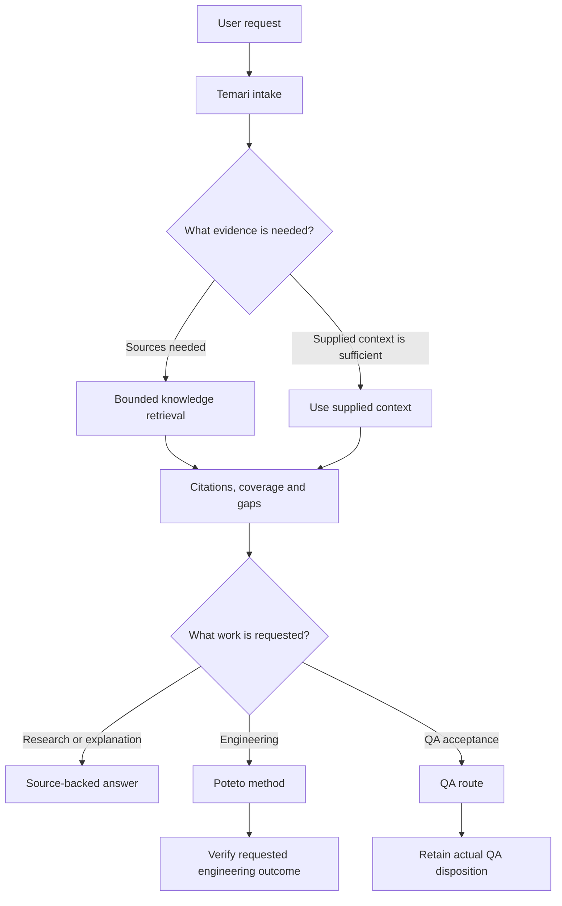

# Proposed Temari knowledge and engineering routing

Status: approach approved, first source increment implemented, 2026-10-09. Audience: the Temari maintainer deciding the next routing increment. Installed activation and automatic host-event binding remain pending; admission policy and provider selection are unchanged.

Temari should decide both what work the user wants and what evidence that work needs. Knowledge retrieval supplies evidence. Poteto supplies the engineering method. A request can need either responsibility, both, or neither. Users should not have to name either skill.

## Problem and observed boundary

The user wants knowledge worker flows to run when a request needs source-backed evidence. Charging-station uptime is the motivating example; its research has moved to a separate chat. This chat owns the retrieval and engineering routing decision.

Before this increment, the [public Temari skill](../../packages/workflow-runtime/public/skills/temari/SKILL.md) described bounded context intake after selecting a repository and candidate. The [Knowledge skill](../../packages/workflow-runtime/public/skills/temari-knowledge/SKILL.md) described explicit source plans and retrieval supporting an admitted task. Neither established a general research intake decision with retained execution evidence.

The [typed Temari classifier](../../libs/temari-core/src/lib/temari-core.ts) selects engineering, QA and planning-only program responsibilities. Its input already assumes an engineering work type; it is not a classifier for every conversational request. The [Poteto investigation playbook](../../packages/workflow-runtime/assets/v4.1/skills/poteto-mode/playbooks/investigation.md) produces a cited explanation or recommendation and is read-only.

Knowledge already has reusable operations. The [provider contract](../../libs/contracts/src/lib/knowledge.ts) covers discovery, read and revalidation. The [investigation implementation](../../libs/knowledge/src/lib/investigation.ts) checkpoints bounded evidence and assessments. The [archive journey](../../libs/knowledge/src/lib/archive-journey.ts) separates source intake from query and evaluated search through immutable handoffs. The [standalone plugin packager](../../tools/knowledge-plugin.mjs) projects the public Knowledge skill into the independent Knowledge plugin.

A live check in this chat verified that the connected Registrar could discover and read a local OCPP uptime document with source hash and generation checks. That is evidence of callable retrieval, not evidence that every eligible prompt selects it, that an archive worker ran, or that the returned evidence supports a complete uptime answer. Lexical retrieval was ready; semantic and graph providers were unavailable and selected source inventories had gaps.

## Recommended ownership and flow

Temari owns the outcome, source scope, evidence need, currentness requirement and work responsibility. The host executes exposed tools and records actual observations. Registrar owns source identity, indexes, retained versions and citation checks. Poteto owns engineering method selection. QA retains its acceptance responsibility. The runtime retains durable execution, recovery and evidence ownership.

The diagram describes responsibility, not a new admitted runtime profile. Provider discovery and required evidence gathering precede substantial planning or engineering execution. Missing evidence limits the claims and dependent work; independent work can continue. A scoped engineering investigation can use Poteto and knowledge retrieval together.

| Request | Evidence action | Work method |
| --- | --- | --- |
| Determine charging-station uptime | Relevant registered documentation, current authoritative web guidance, explicit definition gaps | Research; Poteto investigation if the request includes software design or current implementation |
| Explain how existing station status is calculated | Private navigation notes, bounded indexed context where available, current source inspection | Poteto investigation |
| Implement an uptime report | Requirements, applicable protocol guidance and verified implementation context | Poteto selects the appropriate engineering playbook; shared reporting semantics require more than task-size classification |
| Perform ticket QA acceptance | Product intent, selected ticket requirements and actual execution evidence | QA route; Poteto only for an authorized engineering subtask |
| Rewrite supplied text or perform a self-contained calculation | Use supplied material; external retrieval is unnecessary unless a factual premise needs verification | Direct response |
| Add or update a durable source collection | Explicitly scoped source registration or refresh and archive intake as needed | Knowledge maintenance; Poteto if software changes are requested |

## When retrieval is required

Require an evidence decision for each request handled through Temari. Select retrieval when the requested outcome depends materially on documents or data beyond the supplied context, current external facts, product requirements, existing code behavior, comparison of sources, or validation of a factual claim. Classify the responsibility and dependency; do not rely on the presence of words such as “research,” “OCPP” or “knowledge.”

Record a reason when retrieval is unnecessary. Relevant supplied evidence can satisfy the need without a redundant provider call. Reuse earlier retrieved evidence only when its source scope, identity, applicability and currentness meet the new question. Introduce a new decision when the request changes from explanation to implementation or QA.

For a source-dependent question, start with bounded discovery over relevant registered sources, read the necessary passages, and check current authoritative sources when currency matters. Current code remains necessary for claims about application behavior. A navigation note, lexical hit or graph edge alone cannot establish that behavior.

No relevant hits means that the bounded search found no relevant hits. It does not establish absence across unsearched files, unsupported formats, stale source membership or the internet. Report pagination, extraction, currentness and capability limits when they affect the answer.

## Retrieval and source intake are different operations

Ordinary questions should query existing evidence. Archive intake should run when the task needs a new captured source, a verified recapture, retained historical versions, or a durable handoff for resumable worker work. Reuse an applicable pinned handoff where one exists. Do not recapture every registered source on each question.

The intake and retrieval responsibilities do not require two model subprocesses for every answer. A dedicated worker is justified by an actual context or permission boundary, independent parallel work, long-running capture, or recovery requirements. Use the existing runtime child store and checkpoints when those needs apply; do not introduce a second scheduler.

Current authoritative web lookup can contribute citations without first importing the entire website into Registrar. Durable web intake is a separate scoped action when retention is needed. The first routing increment should not add a new web archiver or promise that web results already participate in Registrar's immutable handoff contract.

Honor disabled provider selection and existing source-sharing policy. A registered source is a discovery candidate, not permission to expand the task to every source. Missing or unavailable providers produce explicit gaps and an allowed bounded fallback. Local-only content remains local under the existing hosted-call rules; no replacement model or new source grant is inferred.

## Observable evidence decision

Retain one bounded record linked to the actual request or task. Reuse runtime/task persistence where present; add no new canonical task database. A proposed record should contain:

- The requested outcome, selected work owner and engineering method when applicable.
- Whether retrieval is required, satisfied by supplied or reusable evidence, or unnecessary, with a reason.
- Selected sources and domains, question, budgets and currentness requirement.
- The actual operations and resulting references, including source revisions or hashes where available.
- A result state of pending, retrieved, partial, blocked or not needed, with material coverage gaps.
- Claims supported by retrieved evidence and decisions that remain unresolved.

An intake announcement is not an execution record. A provider call is not proof of a sufficient answer. A completed knowledge query cannot accept engineering stages or turn QA into a pass. Host observation should bind actual tool results; caller-written claims alone cannot satisfy a future runtime gate.

## Alternatives and tradeoffs

| Option | Benefit | Limitation | Recommendation |
| --- | --- | --- | --- |
| Broaden skill instructions only | Small first change; reaches ordinary conversational research | Agent behavior remains variable; wording checks cannot prove invocation | Use as the first evaluated increment |
| Add a separate Knowledge work route | Makes knowledge work explicit | A competing route poorly represents engineering and QA that also need retrieval | Reserve for independently requested knowledge-maintenance jobs, not general context gathering |
| Compose an evidence decision with existing work routing | Handles research, engineering and QA consistently; can retain missing operations | Requires host integration before mechanical enforcement covers actual requests | Recommended design |
| Run the full archive journey for every prompt | Retains captured evidence for each question | Repeats capture, increases latency and exceeds the needs of self-contained requests | Do not use as the default |

## Next increment and acceptance evidence

The next increment should make general source-dependent research explicit in Temari and both installed Knowledge skill descriptions, connect Poteto's existing codebase intake to that rule, and retain a bounded evidence decision for the host path actually exercised. Reuse the existing provider, query, checkpoints and task controls. Do not change engineering/QA admission or claim arbitrary chat interception.

The public Knowledge skill is also the standalone packager's source. Update that source and verify both package projections; do not edit installed caches. Refresh the P-stack graph after any bundled skill or playbook change. Rebuild and verify the installed artifact before claiming the user's running plugin has acquired a source change.

Validate the policy with source tests where appropriate, package checks and live neutral prompts that do not explicitly ask the model to invoke Knowledge. Include:

1. A domain research question and paraphrases requiring local documents and current web evidence.
2. An existing-code explanation and an engineering request requiring knowledge plus Poteto.
3. A QA acceptance request that keeps its QA owner while retrieving requirements.
4. A self-contained rewrite and arithmetic request that correctly skip external retrieval.
5. A missing provider, a disabled provider, stale inventory, an unsupported document and a search with no useful hits.
6. A local-only source that remains protected and a prompt whose relevant source scope is ambiguous.
7. A research-to-implementation transition that preserves citations and selects the engineering method without treating research as permission to publish.

For each case, define the expected evidence action and work owner before execution. Inspect actual calls, selected scope, citations, gaps and completion claims. Report false negatives and false positives separately. A manually instructed successful lookup, typed classifier test or skill-text assertion alone does not prove default routing.

The first gate is demonstrated behavior for the selected installed host path. Mechanical enforcement is a later integration increment: an admitted host request must carry a checked evidence decision before dependent work or claims can complete. It can enforce a declared dependency, but live evaluations remain necessary to prove that natural-language requests declare the right dependency. Universal coverage requires all intended host entry paths to use that intake; the current packaged CLI does not intercept every chat.

## Continuation

The approved design is composed evidence and work routing, bounded retrieval by default, and conditional archive intake. The first source increment adds guidance, a shared evidence-decision reference, both package projections and neutral-prompt checks. Its [verification record](../evidence/knowledge-system/knowledge-routing-2026-10-09.md) distinguishes actual provider calls from model-authored context and records the remaining host/activation limits. The next increment is a versioned installed update and host-owned event binding, followed by the remaining live cases. No new lifecycle or general chat-interception guarantee is introduced.
