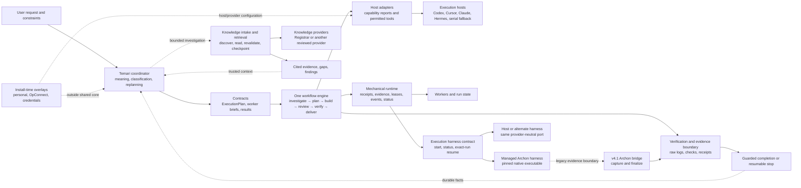

# Temari workflow platform

Temari is a portable conversational engineering partner and workflow control
plane. It turns a user request into an explicit set of obligations, an
`ExecutionPlan`, a verifiable run, and a closeout record.

Temari owns meaning and accountability. The host owns models, tools,
credentials, permissions, and provider-specific execution. That boundary keeps
the workflow portable across Codex, Cursor, Claude, Hermes, and a serial local
fallback.

This document is the orientation page for the Nx design. It is based on the
[Temari evaluation and Nx build design thread](codex://threads/01a0be5d-dfb5-7d11-874f-add60c4124b7),
the current Nx source, and the existing workflow-runtime evidence. It describes
the intended platform boundary as well as the currently implemented slice.

## What Temari is

Temari is the coordinator for conversational engineering work. It classifies a
request, preserves the user's constraints, decides which obligations the work
has, and builds a typed plan. The plan does not change the lifecycle. Every
route uses the same stage sequence.

The fixed lifecycle is:

`investigate → plan → build → review → verify → deliver`

The plan changes policy around that lifecycle. It can require delegation,
independent review, stronger evidence, or pull-request delivery. A small local
edit and a high-risk feature therefore produce the same kind of run receipt,
with different obligations and evidence depth.

Temari is not a model service, a credential store, or an autonomous scheduler.
It should not simulate a missing capability. When the host cannot prove a
required capability, Temari either degrades honestly or stops with a structured
gap.

## Design philosophies

### Semantic decisions belong to Temari

Temari decides what the request means, which constraints apply, what must be
verified, and whether completion is justified. Runtime services perform the
mechanical work of persistence, dispatch, leases, retries, reconciliation, and
status reporting.

### One engine, many plans

Lightweight engineering, full Poteto work, delegated work, and serial fallback
are plan policies over one engine. They are not separate workflow engines with
competing lifecycle rules.

### Honest capability boundaries

Capabilities are explicit. `subagents`, parallelism, model diversity, worktree
isolation, durable delivery, and forge access are requirements that a host must
report and eventually prove. A missing capability produces degradation or a
stop, never a fake worker or fake review.

### Evidence is part of the product

Workers return raw evidence references, not only summaries. Knowledge reads
carry hashes and exact spans. Verification produces receipts that bind the
work to a revision, a route, and its evidence. A receipt proves procedural
conformance for a run. It does not, by itself, prove that the product behavior
is correct.

### Knowledge is bounded and revalidated

Knowledge intake starts from an explicit scope, query, budget, and selection.
Discovery does not silently expand the read set. Retrieved material is
revalidated before it is trusted, and changed, unavailable, unknown, or
unsupported sources remain visible as gaps.

### Serial execution is a first-class mode

The platform must remain useful without subagents, parallelism, or a forge. A
serial host is a valid execution mode. Portability is achieved through typed
ports and adapters, not through pretending that every host has the same
runtime.

### Operational state is separate from shared semantics

The canonical Nx repository contains shared contracts, the coordinator, the
workflow engine, adapters, and verification fixtures. Personal skills,
OpConnect workspaces, credentials, model providers, and knowledge providers
remain external overlays or adapters.

## High-level architecture

## Major components at a glance

| Component                      | Primary responsibility                             | Decision it owns                                                             | Current Nx boundary                                                                                                                                   |
| ------------------------------ | -------------------------------------------------- | ---------------------------------------------------------------------------- | ----------------------------------------------------------------------------------------------------------------------------------------------------- |
| Temari core                    | Understand the request and create a plan           | Work type, obligations, policy, honest degradation                           | `libs/temari-core` and `libs/contracts`                                                                                                               |
| Knowledge intake and retrieval | Supply bounded, cited, revalidated context         | Whether evidence is usable, stale, missing, or blocked                       | `libs/knowledge` behind provider contracts                                                                                                            |
| Poteto mode                    | Apply the engineering method and choose a playbook | Lightweight versus full route, investigation depth, review expectations      | v4.1 packaged skills and playbooks; Nx engine consumes plan policy                                                                                    |
| Workflow engine                | Execute the fixed stage lifecycle                  | Stage order and stage transitions                                            | `libs/workflow-engine`                                                                                                                                |
| Orchestration and scheduling   | Perform mechanical run control                     | Persistence, dispatch, leases, retries, reconciliation, status               | `libs/runtime` persists receipts/evidence, owns basic leases/events, and exposes replaceable-harness dispatch; full lifecycle control remains planned |
| Archon                         | Provide the managed native execution harness       | Native workflow start/status/resume; never Temari meaning or host capability | `libs/archon-harness`; pinned runtime installed by `packages/initializer`                                                                             |
| Host adapters                  | Describe and expose host capabilities              | What the selected host can actually provide                                  | `libs/host-adapters`                                                                                                                                  |
| Verification                   | Test behavior and procedural conformance           | Pass, issues, blocked, or stale evidence                                     | Contracts, workflow checks, fixtures, and future evidence store                                                                                       |
| Provenance and security        | Make completion inspectable and limit trust        | Which artifacts, identities, hashes, and boundaries support a receipt        | Distributed across contracts, knowledge, adapters, and runtime boundaries                                                                             |

## What completion means

Completion is a guarded result, not a confident final sentence. A run is
complete only when its required stages have run, required capabilities were
available, verification evidence is associated with the active revision, and
the closeout facts can be inspected later.

If a required capability is missing, a source changed, a verification step is
blocked, or evidence is incomplete, the run remains resumable or explicitly
blocked. The system preserves the reason and the available artifacts.

## Current versus planned

The current Nx slice makes the plan boundary executable. It reconciles typed
obligations, checks host capabilities, and runs the fixed stages serially.
Knowledge investigation has a bounded provider contract and checkpointed
retrieval path. The managed Archon component has a replaceable run-level port
and pinned native asset. The existing v4.1 Archon integration proves
deterministic scheduling, capture, review-boundary enforcement, and ordinary
failed-node resume; it is migration evidence, not receipt parity for the new
Nx engine.

Local durable child leases/retries and the [task continuity inbox](task-continuity.md)
now have executable checks. The source-workspace Archon bridge produces
deterministic canonical evidence, and macOS smoke covers exact-run resume and
cancellation. Recurring scheduling, watchers, live host capability proofs,
Windows process-tree verification, and installed live Archon parity remain gated.
These concerns stay behind ports with one coordinator and lifecycle.

## Continue reading

- [Component deep dive](platform-components.md) explains responsibilities,
  decision paths, evidence, and security boundaries in more detail.
- [Verification matrix](verification-matrix.md) traces design claims to
  implementation, failure proofs, and retained evidence.
- [Architecture](architecture.md) records the current ownership split and
  design decisions.
- [Workflow](workflow.md) describes the executable serial slice.
- [Nx cutover plan](temari-nx-cutover-plan.md) records acceptance gates,
  unresolved questions, and migration evidence.
- [Overlays](overlays.md) describes what stays outside the canonical core.
