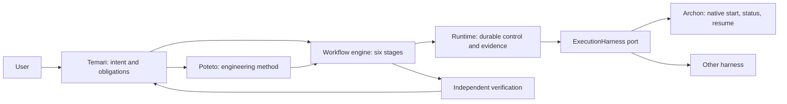

# P-stack capability index and ownership review

Reviewed 2026-09-30 against the bundled Temari v4.1 assets and the local
`plugins` checkout at `15a8ba8` (P-stack 0.15.2). This is a source and scenario
review, not evidence that every route ran against a live application, PR, or
external service. The bundled v4.1 tree has 52 skills, including 23 principles, and
24 playbooks. Before this ownership change, 42 skill entry files and 17 playbooks matched
the local upstream checkout byte for byte. Temari adds five skills and
Lightweight engineering, and adapts other entries. This branch additionally
changes program routing. Recheck counts after an import or concurrent change.

The companion [knowledge graph](graph.json) records every bundled skill and
playbook, source-linked references, the present ownership boundary, and
explicitly labeled remaining recommendations. The [program ownership decision](../decisions/2026-09-30-temari-program-ownership.md)
records the implemented route and the execution promotion gates. Run `python3 docs/pstack-audit/build_graph.py`
to refresh it after a source change. The workspace-root `graphify-out/graph.json` is a useful local code graph,
but it is ignored by Git and is not this catalog's durable source.

Graph edges distinguish `documented` or `source_reference` facts from
`review_recommendation` proposals. For example,
`jq '.edges[] | select(.from == "playbook:orchestrate")' docs/pstack-audit/graph.json`
shows the Orchestrate route, Temari program ownership, Poteto method
reference, and the legacy store relationship. Proposed mechanical changes
remain labeled as recommendations.

## Canonical public entries

The installed public bundle is a separate admission surface from the v4.1
source catalog below. Its [policy](../../packages/workflow-runtime/public/policy.json)
names three callable entries. The [Temari entry](../../packages/workflow-runtime/public/skills/temari/SKILL.md)
starts admitted engineering or QA work; the [Poteto Mode entry](../../packages/workflow-runtime/public/skills/poteto-mode/SKILL.md)
supplies engineering method; [Closeout](../../packages/workflow-runtime/public/skills/closeout/SKILL.md)
verifies a trusted invocation against the current candidate.
[QA verification](../../packages/workflow-runtime/public/skills/qa-review-verification/SKILL.md)
is a public supporting skill, invoked through Temari for QA deliverables rather
than a fourth `policy.entries` key.

For multi-unit work or a user stepping away, Temari should proactively offer
a [reviewable unattended work contract](../decisions/2026-09-30-temari-program-ownership.md#user-facing-priority)
with a finish line, scope, verification, gates, and recovery plan. Verify the
selected host before promising that agents will continue while the user is away.

The public policy currently admits lightweight engineering, host-proven full
feature work, and versioned QA. It has no standing-program execution entry.
The new typed `programKind` route records Temari ownership and is planning-only;
it does not silently widen public admission. The legacy v4.1 skills remain
source and compatibility material.

## Ownership model

| Layer | Decision it owns | Current source |
| --- | --- | --- |
| Temari | User intent, route responsibility, obligations, capability gaps, and closeout meaning | [`temari/SKILL.md`](../../packages/workflow-runtime/assets/v4.1/skills/temari/SKILL.md), [`temari-core.ts`](../../libs/temari-core/src/lib/temari-core.ts) |
| Poteto | Engineering method, proportional playbook, design and verification practice | [`poteto-mode/SKILL.md`](../../packages/workflow-runtime/assets/v4.1/skills/poteto-mode/SKILL.md) |
| Workflow engine and runtime | Stage order, durable records, child claims, leases, and evidence binding | [`platform-components.md`](../platform-components.md), `libs/workflow-engine`, `libs/runtime` |
| Archon | Replaceable native harness: start, status, exact-run resume | [`archon-harness.ts`](../../libs/archon-harness/src/lib/archon-harness.ts) |
| Host adapter | Actual models, tools, credentials, permissions, and capability proof | `libs/host-adapters` |

Temari submits engineering work to Poteto for method selection. Archon cannot
decide what a request means, choose acceptance criteria, approve a merge, or
turn a native status into a Temari completion receipt. The Nx Archon port is
currently optional. A model-free source-workspace conformance journey now
produces a canonical receipt; installed and live-model parity remain promotion
gates. Those are current boundaries, not a proposed relabeling.

## Playbook scenario review

Each row names the kind of observable output a representative scenario would
need. A source review can check the route and its contract; it cannot supply a
real PR, UI repro, trace, model comparison, or long-running outcome. `Poteto`
means engineering method ownership. `Temari program` is the current semantic
owner for multi-run work; Archon and runtime may execute its mechanical
portions after conformance.

| Playbook | Scenario and required observable output | Principle that changes the result | Ownership assessment |
| --- | --- | --- | --- |
| [Lightweight engineering](../../packages/workflow-runtime/assets/v4.1/skills/poteto-mode/playbooks/lightweight-engineering.md) | Local, reversible edit; exact diff and one direct check | Prove It Works prevents a compile-only claim | Poteto, keep |
| [Investigation](../../packages/workflow-runtime/assets/v4.1/skills/poteto-mode/playbooks/investigation.md) | Code question; cited `how` explanation and judgment | Guard the Context Window narrows reads | Poteto, keep |
| [Bug fix](../../packages/workflow-runtime/assets/v4.1/skills/poteto-mode/playbooks/bug-fix.md) | Reported symptom; same-surface failing then passing repro | Fix Root Causes rejects a masking guard | Poteto, keep |
| [Perf issue](../../packages/workflow-runtime/assets/v4.1/skills/poteto-mode/playbooks/perf-issue.md) | Measured slowness; baseline, changed value, trace | Build the Lever makes measurement repeatable | Poteto, keep |
| [Hillclimb](../../packages/workflow-runtime/assets/v4.1/skills/poteto-mode/playbooks/hillclimb.md) | Metric target; kept/reverted attempt log and final delta | Sequence Verifiable Units isolates each win | Poteto, keep |
| [Runtime forensics](../../packages/workflow-runtime/assets/v4.1/skills/poteto-mode/playbooks/runtime-forensics.md) | Live symptom; captured signal and mechanism, without an unsolicited fix | Prove It Works requires live observation | Poteto, keep |
| [Trace forensics](../../packages/workflow-runtime/assets/v4.1/skills/poteto-mode/playbooks/trace-forensics.md) | Supplied profile; source-linked reduced finding | Guard the Context Window favors the relevant slice | Poteto, keep |
| [Feature](../../packages/workflow-runtime/assets/v4.1/skills/poteto-mode/playbooks/feature.md) | New behavior; named shape, design choice, actual feature path | Model the Domain determines the data shape | Poteto, keep |
| [Refactoring](../../packages/workflow-runtime/assets/v4.1/skills/poteto-mode/playbooks/refactoring.md) | Structural change; behavior pin and equivalence proof | Subtract Before You Add removes dead paths first | Poteto, keep |
| [Prototype](../../packages/workflow-runtime/assets/v4.1/skills/poteto-mode/playbooks/prototype.md) | Empirical fork; variants and observed comparison | Exhaust the Design Space requires competing shapes | Poteto, keep |
| [Visual parity](../../packages/workflow-runtime/assets/v4.1/skills/poteto-mode/playbooks/visual-parity.md) | UI migration; per-component image diff | Prove It Works requires matching-surface evidence | Poteto, keep when visual control exists |
| [Authoring a skill](../../packages/workflow-runtime/assets/v4.1/skills/poteto-mode/playbooks/authoring-a-skill.md) | Skill edit; trigger boundary and link validation | Encode Lessons in Structure favors a reusable rule | Poteto toolmaking, keep |
| [Eval](../../packages/workflow-runtime/assets/v4.1/skills/poteto-mode/playbooks/eval.md) | Prompt or skill variant; blinded rubric, outputs, judge and own review | Test Behavior, Not Implementation checks actual agent behavior | Poteto toolmaking, keep |
| [Babysit](../../packages/workflow-runtime/assets/v4.1/skills/poteto-mode/playbooks/babysit.md) | PR status; blocker class, fixes, pending gate | Prove It Works requires forge state, not green-check inference | Keep quality policy in Poteto; move polling to host/runtime |
| [Shipping](../../packages/workflow-runtime/assets/v4.1/skills/poteto-mode/playbooks/shipping.md) | Stack landing; independent verdict for each current head | Sequence Verifiable Units limits the landing ceiling | Keep quality policy; move queue mechanics to runtime |
| [Autonomous run](../../packages/workflow-runtime/assets/v4.1/skills/poteto-mode/playbooks/autonomous-run.md) | One predicate; iteration trail and final check | Make Operations Idempotent shapes retries | Temari run policy, Poteto method |
| [Orchestrate](../../packages/workflow-runtime/assets/v4.1/skills/poteto-mode/playbooks/orchestrate.md) | Multi-day program; units, ledger, frontier, gates, status | Separate Before Serializing Shared State assigns writers | Temari program policy; retire duplicate store after runtime/Archon parity |
| [Autopilot-full](../../packages/workflow-runtime/assets/v4.1/skills/poteto-mode/playbooks/autopilot-full.md) | Independent PR queue; owner and independent verifier per head | Prove It Works gates every merge | Temari program policy, host/runtime execution |
| [Autopilot-stack](../../packages/workflow-runtime/assets/v4.1/skills/poteto-mode/playbooks/autopilot-stack.md) | One reviewable base-branch chain; exact head verdicts | Sequence Verifiable Units orders the stack | Temari program policy, host/runtime execution |
| [Session pickup](../../packages/workflow-runtime/assets/v4.1/skills/poteto-mode/playbooks/session-pickup.md) | Prior work; inherited state and safe resume point | Guard the Context Window avoids replaying whole history | Temari lifecycle, move |
| [Pause safely](../../packages/workflow-runtime/assets/v4.1/skills/poteto-mode/playbooks/pause-safely.md) | Interrupted work; durable resume note and first next action | Make Operations Idempotent protects resume | Temari lifecycle, move |
| [Multi-phase plan](../../packages/workflow-runtime/assets/v4.1/skills/poteto-mode/playbooks/multi-phase-plan.md) | Dependent phases/PRs; plan, gates, proof gaps | Sequence Verifiable Units shapes the plan | Temari program plan, Poteto technical content |
| [Worktree cleanup](../../packages/workflow-runtime/assets/v4.1/skills/poteto-mode/playbooks/worktree-cleanup.md) | Disk cleanup; before/after space and held worktrees | Prove It Works checks actual reclamation | Host operation, optional route |
| [Opening a PR](../../packages/workflow-runtime/assets/v4.1/skills/poteto-mode/playbooks/opening-a-pr.md) | Required PR; ordered commits and reviewable description | Minimize Reader Load improves delivery | Poteto delivery policy, host forge action |

## Skill index

The 23 `principle-*` skills have their own table below. These 29 remaining
entries are all accounted for. The stated output is what a representative
exercise should inspect; it is not a claim of live execution.

| Skill | Output to inspect | Assessment |
| --- | --- | --- |
| [`temari`](../../packages/workflow-runtime/assets/v4.1/skills/temari/SKILL.md) | Intent and responsibility route | Conversation entry, keep |
| [`poteto-mode`](../../packages/workflow-runtime/assets/v4.1/skills/poteto-mode/SKILL.md) | Proportional engineering route and evidence obligations | Engineering entry, keep |
| [`how`](../../packages/workflow-runtime/assets/v4.1/skills/how/SKILL.md) | Source-linked behavior walkthrough | Keep |
| [`why`](../../packages/workflow-runtime/assets/v4.1/skills/why/SKILL.md) | History and external-evidence rationale with gaps | Keep; optional providers only |
| [`teach`](../../packages/workflow-runtime/assets/v4.1/skills/teach/SKILL.md) | One explanation combining behavior and rationale | Keep as composition |
| [`recall`](../../packages/workflow-runtime/assets/v4.1/skills/recall/SKILL.md) | Bounded current-state brief | Temari knowledge/lifecycle candidate |
| [`blast-radius`](../../packages/workflow-runtime/assets/v4.1/skills/blast-radius/SKILL.md) | Affected callers and one proven safety fact | Keep |
| [`architect`](../../packages/workflow-runtime/assets/v4.1/skills/architect/SKILL.md) | Caller, types, and module shape | Keep |
| [`arena`](../../packages/workflow-runtime/assets/v4.1/skills/arena/SKILL.md) | Comparable candidates and judged grafts | Keep where host supports parallel agents |
| [`swarm`](../../packages/workflow-runtime/assets/v4.1/skills/swarm/SKILL.md) | Partitioned coverage and aggregate verdict | Keep where host supports parallel agents |
| [`interrogate`](../../packages/workflow-runtime/assets/v4.1/skills/interrogate/SKILL.md) | Skeptical findings grounded in the diff | Keep; do not claim model diversity without it |
| [`figure-it-out`](../../packages/workflow-runtime/assets/v4.1/skills/figure-it-out/SKILL.md) | One bespoke auditable playbook | Keep for bounded complex runs |
| [`tdd`](../../packages/workflow-runtime/assets/v4.1/skills/tdd/SKILL.md) | Cheap failing test followed by passing fix | Keep as conditional technique |
| [`no-comments`](../../packages/workflow-runtime/assets/v4.1/skills/no-comments/SKILL.md) | Accepted comment removals and retained exceptions | Consider folding into `deslop` after behavior eval |
| [`deslop`](../../packages/workflow-runtime/assets/v4.1/skills/deslop/SKILL.md) | Smaller task-owned diff with narrow checks rerun | Keep |
| [`unslop`](../../packages/workflow-runtime/assets/v4.1/skills/unslop/SKILL.md) | Clearer prose with claims preserved | Keep as writing guidance |
| [`technical-writing`](../../packages/workflow-runtime/assets/v4.1/skills/technical-writing/SKILL.md) | Audience-matched documentation or PR prose | Keep |
| [`typescript-best-practices`](../../packages/workflow-runtime/assets/v4.1/skills/typescript-best-practices/SKILL.md) | Type-safe TypeScript design and review | Keep as language specialist |
| [`create-verification-skill`](../../packages/workflow-runtime/assets/v4.1/skills/create-verification-skill/SKILL.md) | Project verification driver and feature map | Keep as project-local generator |
| [`maintain-verification-skill`](../../packages/workflow-runtime/assets/v4.1/skills/maintain-verification-skill/SKILL.md) | Evidence-backed corrections to that map | Keep |
| [`skill-authoring`](../../packages/workflow-runtime/assets/v4.1/skills/skill-authoring/SKILL.md) | Portable skill, validated triggers and links | Keep |
| [`show-me-your-work`](../../packages/workflow-runtime/assets/v4.1/skills/show-me-your-work/SKILL.md) | Reusable decision trail | Keep for unattended or consequential work |
| [`reflect`](../../packages/workflow-runtime/assets/v4.1/skills/reflect/SKILL.md) | Approved changes to existing skills | Optional improvement workflow |
| [`automate-me`](../../packages/workflow-runtime/assets/v4.1/skills/automate-me/SKILL.md) | Draft personal mode skill | Optional personal pack, not core routing |
| [`setup-pstack`](../../packages/workflow-runtime/assets/v4.1/skills/setup-pstack/SKILL.md) | Host model-role configuration | Host setup, optional outside Cursor |
| [`make-bot-ui`](../../packages/workflow-runtime/assets/v4.1/skills/make-bot-ui/SKILL.md) | Webhook-driven bot UI | Separate integration pack candidate |
| [`seq-log-review`](../../packages/workflow-runtime/assets/v4.1/skills/seq-log-review/SKILL.md) | Bounded read-only Seq finding or explicit gap | Domain specialist, separate entry |
| [`closeout`](../../packages/workflow-runtime/assets/v4.1/skills/closeout/SKILL.md) | Verified durable work and archive disposition | Temari lifecycle, move |
| [`bro`](../../packages/workflow-runtime/assets/v4.1/skills/bro/SKILL.md) | Plain-language restatement | Optional presentation helper |

## Principle-to-output index

These are effect statements for a scenario exercise. They do not imply that
every principle applies to every route. Read the named leaf skill when applying
it to a live task.

| Principle | Observable change in the output |
| --- | --- |
| [Attack the Premise](../../packages/workflow-runtime/assets/v4.1/skills/principle-attack-the-premise/SKILL.md) | Repeated failed fixes yield a written premise and actor census before another change. |
| [Boundary Discipline](../../packages/workflow-runtime/assets/v4.1/skills/principle-boundary-discipline/SKILL.md) | Validation appears at external edges; internal logic receives typed values. |
| [Build the Lever](../../packages/workflow-runtime/assets/v4.1/skills/principle-build-the-lever/SKILL.md) | A rerunnable tool or check accompanies nontrivial repeated work. |
| [Encode Lessons in Structure](../../packages/workflow-runtime/assets/v4.1/skills/principle-encode-lessons-in-structure/SKILL.md) | A recurring correction becomes a check, schema, or skill rule. |
| [Exhaust the Design Space](../../packages/workflow-runtime/assets/v4.1/skills/principle-exhaust-the-design-space/SKILL.md) | Novel designs include compared prototypes. |
| [Experience First](../../packages/workflow-runtime/assets/v4.1/skills/principle-experience-first/SKILL.md) | Product tradeoffs favor a narrower polished result. |
| [Fix Root Causes](../../packages/workflow-runtime/assets/v4.1/skills/principle-fix-root-causes/SKILL.md) | A repro and causal mechanism precede the fix. |
| [Foundational Thinking](../../packages/workflow-runtime/assets/v4.1/skills/principle-foundational-thinking/SKILL.md) | Core shape and shared-state decisions precede logic. |
| [Guard the Context Window](../../packages/workflow-runtime/assets/v4.1/skills/principle-guard-the-context-window/SKILL.md) | The report contains selected evidence and pointers, not bulk output. |
| [Laziness Protocol](../../packages/workflow-runtime/assets/v4.1/skills/principle-laziness-protocol/SKILL.md) | The diff removes unnecessary layers and keeps the smallest sufficient shape. |
| [Make Operations Idempotent](../../packages/workflow-runtime/assets/v4.1/skills/principle-make-operations-idempotent/SKILL.md) | Resume or retry converges after partial prior work. |
| [Migrate Callers Then Delete Legacy APIs](../../packages/workflow-runtime/assets/v4.1/skills/principle-migrate-callers-then-delete-legacy-apis/SKILL.md) | Caller migration and obsolete API removal ship together. |
| [Minimize Reader Load](../../packages/workflow-runtime/assets/v4.1/skills/principle-minimize-reader-load/SKILL.md) | Fewer layers and less hidden state make a change traceable. |
| [Model the Domain](../../packages/workflow-runtime/assets/v4.1/skills/principle-model-the-domain/SKILL.md) | A state shape or type carries rules formerly scattered in branches. |
| [Never Block on the Human](../../packages/workflow-runtime/assets/v4.1/skills/principle-never-block-on-the-human/SKILL.md) | Reversible work proceeds; genuine irreversible or preference gates remain visible. |
| [Outcome-Oriented Execution](../../packages/workflow-runtime/assets/v4.1/skills/principle-outcome-oriented-execution/SKILL.md) | A planned migration proves its final state at explicit gates. |
| [Prove It Works](../../packages/workflow-runtime/assets/v4.1/skills/principle-prove-it-works/SKILL.md) | A real artifact, behavior path, or value supports each pass claim. |
| [Redesign From First Principles](../../packages/workflow-runtime/assets/v4.1/skills/principle-redesign-from-first-principles/SKILL.md) | A new requirement reshapes the base design instead of adding a bolt-on. |
| [Separate Before Serializing Shared State](../../packages/workflow-runtime/assets/v4.1/skills/principle-separate-before-serializing-shared-state/SKILL.md) | Independent writers own separate branches, worktrees, or evidence areas. |
| [Sequence Verifiable Units](../../packages/workflow-runtime/assets/v4.1/skills/principle-sequence-verifiable-units/SKILL.md) | Each step has its own check and a reviewable order. |
| [Subtract Before You Add](../../packages/workflow-runtime/assets/v4.1/skills/principle-subtract-before-you-add/SKILL.md) | Dead or redundant structure leaves before new structure arrives. |
| [Test Behavior, Not Implementation](../../packages/workflow-runtime/assets/v4.1/skills/principle-test-behavior-not-implementation/SKILL.md) | Tests call the public behavior and assert literal observed results. |
| [Type System Discipline](../../packages/workflow-runtime/assets/v4.1/skills/principle-type-system-discipline/SKILL.md) | Invalid states are excluded by types and untrusted input is parsed once. |

## Move, keep, and retire

**Orchestrate is the main ownership overlap.** New program intent routes to
Temari through the skill and typed route table. The serial runtime rejects that
planning-only route before producing a receipt. The legacy playbook still runs a
second program store (`units.tsv`, `ledger.tsv`, `frontier.json`, `gates.md`)
through `orch`. The Nx runtime has revision-bound receipts, a child-task store,
leases, and evidence; Archon owns native run control. Orchestrate's program
framing, briefs, pilot, queue discipline, verification ledger, and failure
reconciliation remain useful to Temari. Archon does not own those semantic
decisions. Keep `orch` for recorded legacy programs while its packaged verifier
uses it. Before retiring that store, prove installed and live-model Archon
parity and a migration journey that preserves units, current-head verdicts,
restart state, and closeout.

**Other lifecycle moves.** The Temari skill now selects `pause-safely`,
`session-pickup`, and `closeout` across engineering domains. The existing
playbook files remain callable mechanics during migration. `autopilot-full`,
`autopilot-stack`, and `multi-phase-plan` are program policies; their
engineering quality gates remain useful while host/runtime mechanics await
admission. Babysit and Shipping keep human-readable quality rules while forge
polling and merge queue state move behind host/runtime adapters.

**Optional material.** `make-bot-ui` is a specific webhook product recipe;
`setup-pstack` is host configuration; `automate-me` and `reflect` change
personal or workflow policy; `bro` changes presentation. They need not load
for an ordinary engineering run. `no-comments` overlaps `deslop`; compare
their actual findings before consolidation. The external `third_party/`
marketplace integrations and standalone Ralph Loop plugin should remain
outside Temari core. Benny is an opt-in automation pack, not a general
engineering or QA route.

## Evidence and next gate

This audit and routing change read the bundled entry skills, all playbook names and step/reply
contracts, the 23 principle triggers, the Orchestrate source, the Archon port,
the Temari ownership documents, and the source differences from the local
P-stack checkout. The existing local Graphify code graph was queried, but it
predates current working-tree changes and does not establish these semantic
boundaries. No live multi-day program, external integration, UI, PR merge, or
model-panel eval was run. Such a run needs a concrete target, host capability,
and its own evidence; a scenario walkthrough cannot substitute for it.
