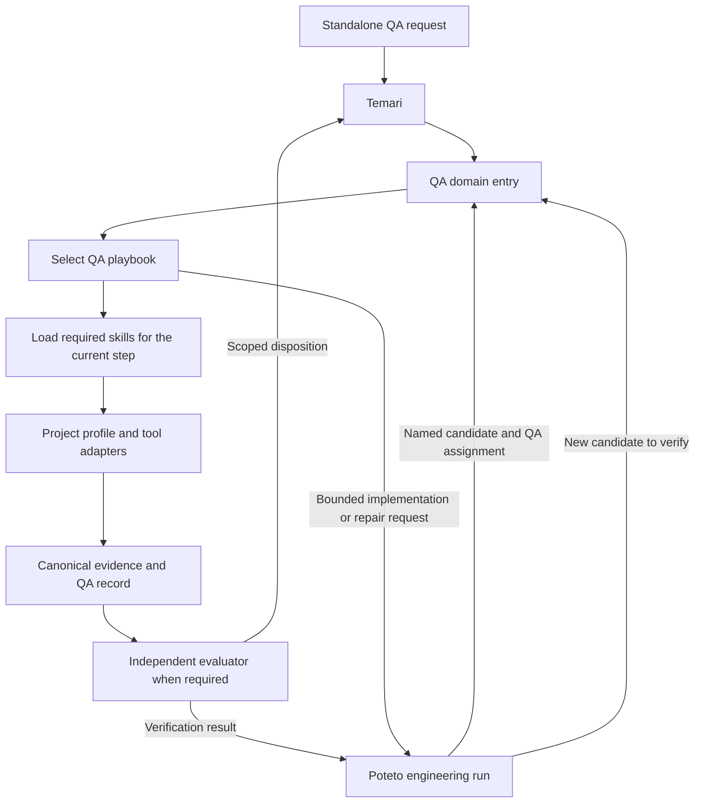

# QA playbooks for Temari

Design recommendation, 2026-09-29. This document proposes architecture and acceptance checks. It does not install a QA agent or admit a new runtime route. The user clarified that “workbooks” meant **playbooks**, organized like P-stack.

## Recommended architecture

Use one QA domain entry point that selects a task playbook. Each playbook loads reusable skills when its steps need them. Temari owns routing and the canonical run; Poteto owns engineering work. This follows P-stack's mode → playbook → situational skill structure.

The QA agent is the role executing this workflow. A playbook is an ordered task recipe with entry conditions, branches, outputs, and completion criteria. A skill is a reusable capability. An adapter connects that capability to a project or tool. These do not each require a separate autonomous agent.

### What follows P-stack

- A small entry point chooses an explicit playbook and records its steps.
- Each step names the skill or reference it needs, its expected output, and a meaningful skip condition.
- Shared principles and capabilities have one owner. Playbooks compose them instead of repeating instructions.
- Project knowledge lives in a bounded profile and feature map; control adapters supply actual execution.
- Completion depends on evidence for the requested outcome.

### What stays specific to Temari

Keep the existing six-stage runtime, admission policy, revision-bound evidence, QA disposition, and independent evaluation rules. Do not import Cursor automation APIs, model names, blanket external-write permission, or a second scheduler from upstream P-stack. Runtime stages organize the run; QA playbooks describe the domain work inside them.

## Initial playbook catalog

These are proposed families. Implement the first useful vertical slice and add another family when a real task needs it. A catalog entry does not imply executable support.

| Playbook                                   | Trigger and output                                                                                                                                                   | Skills needed                                                                                                       | Conditional work                                                                                                                                            |
| ------------------------------------------ | -------------------------------------------------------------------------------------------------------------------------------------------------------------------- | ------------------------------------------------------------------------------------------------------------------- | ----------------------------------------------------------------------------------------------------------------------------------------------------------- |
| **Test design and coverage review**        | Requirements or a ticket need reusable cases, coverage gaps, or a testability assessment. Output reviewed scenarios/cases and open questions.                        | Requirement and expected-behavior analysis; risk assessment; case design; existing Testmo guidance when applicable. | Source tracing for unclear behavior. Browser only if observed behavior is needed. No execution pass implied.                                                |
| **Ticket acceptance verification**         | Verify a named candidate against ticket requirements. Output scenario results and a scoped disposition.                                                              | Risk assessment; scenario selection; applicable execution adapter; failure triage; QA report.                       | Test implementation through Poteto; API/log checks; specialist audit when risk calls for it.                                                                |
| **Exploratory testing**                    | Investigate an unfamiliar feature or seek unknown failures. Output a bounded charter, session evidence, suspected/reproduced defects, and coverage follow-up.        | Charter/scenario design; execution; triage.                                                                         | Promote useful discoveries to reusable cases or automation. Do not claim exhaustive coverage.                                                               |
| **Issue triage and reproduction**          | A reported symptom needs classification, dedupe, reproduction, or ownership routing. Output a reproduction verdict with evidence and next owner.                     | Intake; source tracing; defect triage; applicable execution adapter.                                                | Tracker search if available; existing-fix verification if a patch exists; bounded Poteto repair if authorized.                                              |
| **Fix verification**                       | A concrete patch or revision claims to resolve a defect. Output baseline/candidate comparison and nearby regression results.                                         | Reproduction; change-impact assessment; execution; evidence review.                                                 | Test maintenance/creation through engineering. If baseline cannot run, retain that limitation and use another justified oracle; do not invent causal proof. |
| **Automation engineering and maintenance** | Implement tests, repair a test defect, investigate flakes, or curate a suite. Output reviewed test changes and evidence that assertions detect the intended failure. | Existing framework guidance; test-quality review; risk assessment.                                                  | CI, page objects, migration, or mutation testing only as needed. The engineering implementation runs under Poteto's owner and admission.                    |
| **Release and regression review**          | Assess a release across several tickets and dependencies. Output scoped coverage, risk decisions, execution results, and readiness recommendation.                   | Change-impact assessment; suite selection; execution aggregation; QA reporting.                                     | Cross-application integration, specialist checks, and broader regression according to changed risks.                                                        |
| **Focused audit**                          | An explicit accessibility, performance, visual, security, or SEO question. Output findings tied to that discipline's criteria.                                       | Only the requested audit skill and required execution/evidence adapter.                                             | Separate substantial disciplines into playbooks when their workflow actually differs. A generic checklist cannot replace specialist evidence.               |

Case authoring alone retains its existing direct skill route. Known-defect repair and test implementation retain engineering ownership. The QA entry can coordinate these as subtasks, but must not reclassify all testing-related requests into a full QA review. This preserves current route exclusions.

## Skill boundaries and loading

Skill names and descriptions are normally visible during selection; that does not mean every skill body, reference, or tool is initialized. Design and measure selective loading at those separate levels.

| Layer                   | Load policy                                                            | Content                                                                                                                                        |
| ----------------------- | ---------------------------------------------------------------------- | ---------------------------------------------------------------------------------------------------------------------------------------------- |
| QA entry contract       | For every QA-domain run                                                | Requested outcome, selected playbook, authority, scope, evidence rules, and completion semantics.                                              |
| Selected playbook       | One primary playbook; explicit branch to another when the task changes | Steps, dependencies, branch/stop conditions, outputs, and evaluation requirements.                                                             |
| Reusable capability     | At the first step that needs it                                        | Requirements/oracle analysis, risk/scope, case design, execution, failure triage, or evidence reporting. Reuse existing suitable skills first. |
| Tool/framework guidance | Only for the selected stack and operation                              | Playwright, API runner, mobile/station controls, Testmo, tracker, Seq, or CI.                                                                  |
| Project context         | Relevant profile/feature-map section                                   | Candidate/environment identity, permitted fixture actions, personas, feature behavior, test entry points, and cleanup.                         |
| Specialist references   | Only when the risk or explicit task requires them                      | Accessibility criteria, lab performance method, visual comparison, security checks, or migration details.                                      |

Keep scope and authority in the small shared contract. They must not depend on whether a leaf skill remembered to load a safety reference. Permission for test-data mutation is specific to the run/environment; a historical profile does not grant fresh permission. Authorized fixtures can be created and cleaned up when the selected task requires them.

Create a separate skill when it has a distinct trigger and output and at least two concrete consumers, or a significant tool/permission boundary. Keep a single-task substep as a playbook section or reference. Avoid a skill for every testing technique and avoid multiple routers matching the same request.

Reuse the available `assess-change-impact`, `testmo-test-cases`, `qa-review-verification`, and Playwright guidance. Candidate new capabilities are requirement/oracle analysis, exploratory scenario design, execution coordination, and defect triage. Final boundaries should follow pilot usage, not a target skill count.

## Playbook contract and example

Each playbook should state:

1. When to select it and when another owner applies.
2. Required inputs and information that may remain unknown.
3. Steps with conditional skill loads and expected artifacts.
4. Branches for failures, missing capabilities, existing work, or changes in scope.
5. What “done” means for this task and what it does not establish.
6. Evidence and evaluator requirements.

For **fix verification**:

| Step      | Action                                                                                                                                   | Load only what is needed                                                | Completion evidence                                                               |
| --------- | ---------------------------------------------------------------------------------------------------------------------------------------- | ----------------------------------------------------------------------- | --------------------------------------------------------------------------------- |
| Identify  | Bind reported behavior, source requirement, baseline, patch, environment, and fixture state. Check whether someone already owns the fix. | Project profile and report intake.                                      | Candidate references and agreed discriminating behavior.                          |
| Scope     | Select the original symptom and affected nearby behavior.                                                                                | Change-impact assessment.                                               | Required scenarios with rationale.                                                |
| Reproduce | Observe the baseline using the relevant user/API/system surface. Reset and repeat where useful.                                          | Selected execution adapter.                                             | Attempt records with expected/observed state; or an explicit baseline limitation. |
| Verify    | Exercise the patched candidate with equivalent inputs and run the selected regression checks.                                            | Same adapter; CI/test guidance only if needed.                          | Candidate-bound results. An old baseline pass cannot count for the patch.         |
| Judge     | Classify unresolved failures and evaluate the evidence.                                                                                  | Failure triage; independent evaluator required by admitted QA contract. | Confirmed resolution, remaining defect, or bounded inconclusive result.           |
| Deliver   | Produce the evidence-linked QA note and authorized external updates.                                                                     | QA reporting; tracker adapter only for an authorized write.             | Saved report and readback for actual writes.                                      |

Test generation may happen before execution or while reproducing a known defect. A sound regression test should fail on the broken baseline and pass on the fixed candidate. Never change an assertion merely to agree with current implementation or disable a test merely because a retry budget expired.

## Canonical records, not parallel ledgers

Use `QaAssignment` for scope/authority and `QaReviewRecord` for scenarios, coverage bindings, attempts, evaluation, and disposition. A human-readable playbook run report should be a view of those records. Testmo cases remain reusable case definitions; test attempts remain execution evidence.

The current record does not explicitly carry a QA playbook ID/version, loaded capability list, or profile revision. If needed, add the minimum versioned metadata at the canonical plan boundary or a referenced immutable artifact after checking its existing schema. Do not claim these are existing fields. Do not overload `reviewRevision` to mean the playbook version.

Design-only work can finish with reviewed cases. It must not manufacture browser attempts or a full QA pass to satisfy a generic template. The current full-assignment contract requires a ticket and revisions; release-wide and exploratory work may need a justified parent scope or a later schema extension. Do not hide that mismatch behind a fabricated ticket.

## How Benny fits

Upstream [Benny](https://github.com/cursor/plugins/tree/adf3218ca2f5b9971eedc07a76bef22df7701539/pstack/automations/benny) is a dormant Cursor automation pack. Its direct operational files implement Slack triage and reproduction with optional bounded repair. They are deliberately not registered slash skills. Local Temari host documents mention missing Benny dependencies; no executable Benny integration or installed policy entry was found in this review.

Adapt these parts:

- Triage distinguishes bugs, performance, feature requests, questions, and routing uncertainty.
- Search for duplicates and existing patches before creating competing work.
- Respect an existing fix owner. Verify an existing artifact instead of authoring over it.
- Use an explicit app-control contract and a project feature map.
- Observe the state that distinguishes broken from correct behavior and retain before/after evidence.
- Use stable source identity, idempotent writes, and saved-state readback in an eventual communications adapter.

Keep these conditional:

- Two independent UI reproductions, video, and media review are useful for UI defects when proportionate. API-only failures and test-design tasks require other evidence. Infrequent defects may need statistical or log evidence.
- A map gap should trigger bounded discovery or a scoped block for the affected action. It should not universally block safe exploratory learning.
- A missing baseline limits the claim that the patch caused the resolution; it does not erase useful observations of the patched candidate.
- A compensating tracker action after a failed message must be authorized and preserve audit history. Do not import blanket issue-deletion permission.

The future flow is **intake adapter → QA triage/reproduction playbook → bounded Poteto repair → QA fix verification**. Slack polling, markers, channel permissions, and notification rules belong to an optional adapter. They do not belong in every QA playbook. This review does not enable a Slack automation or authorize posting.

## Evaluation before admission

Compare the proposed playbooks against current practice on the same pinned tasks. Record quality, context/tool use, latency, human corrections, and maintenance cost. Fewer loaded instructions are a hypothesis for efficiency, not a measured improvement yet.

Required distinguishing examples:

- Case-only work selects case design and never starts a browser or tracker write.
- API-only verification avoids UI, SEO, and screenshot dependencies.
- A known broken candidate yields a valid failing regression test; the same test passes after the real repair.
- Test maintenance fixes a locator without weakening the business assertion. An application defect remains visible.
- Missing environment yields `Blocked`/`NotRun` evidence while independent planning can continue.
- Existing patch and ownership gates prevent competing repairs.
- Authorized fixture setup/cleanup works; unauthorized mutation is blocked at execution.
- Changed candidates invalidate affected prior conclusions.
- A false-positive demo finding is rejected when its expected behavior lacks support.
- A narrow outcome, procedural receipt, or green command exit cannot become a full QA pass.

Start with ticket acceptance and issue reproduction/fix verification. Reuse direct case-authoring skills immediately. Admit each executable playbook only when its adapters and evaluator contract have been demonstrated on the host. Add release-wide and specialist workflows as real needs justify them.
