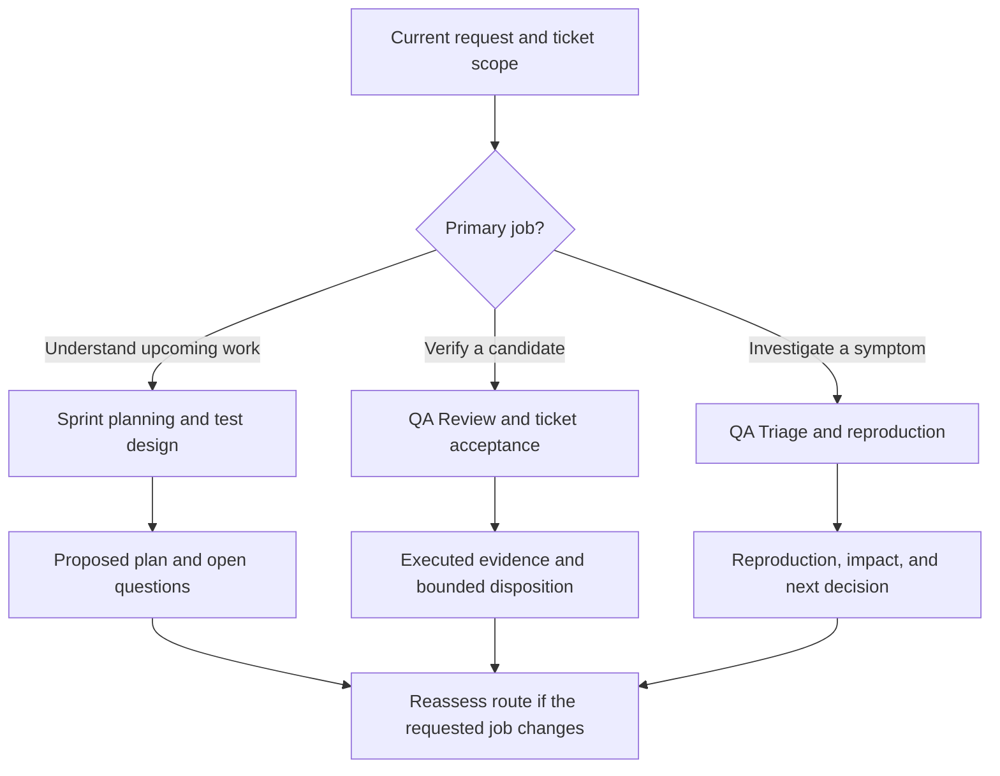
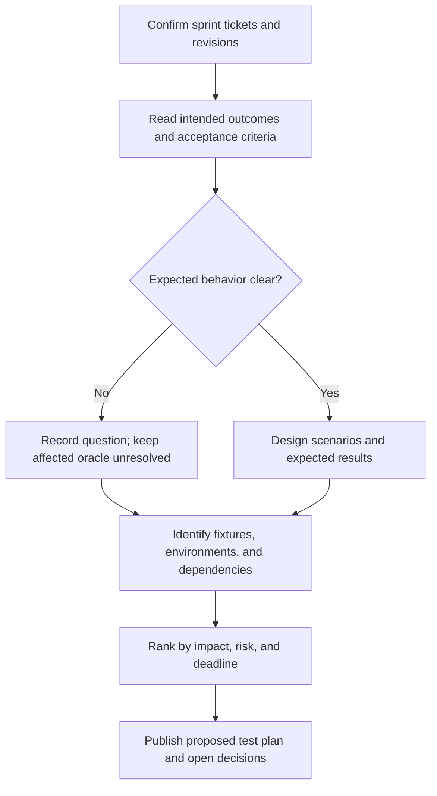
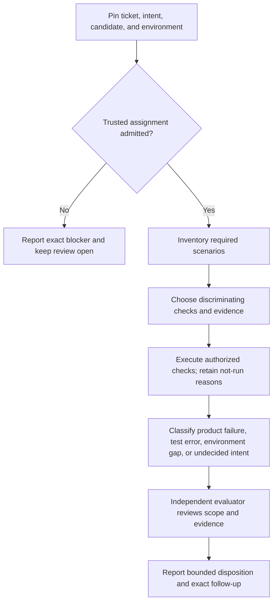
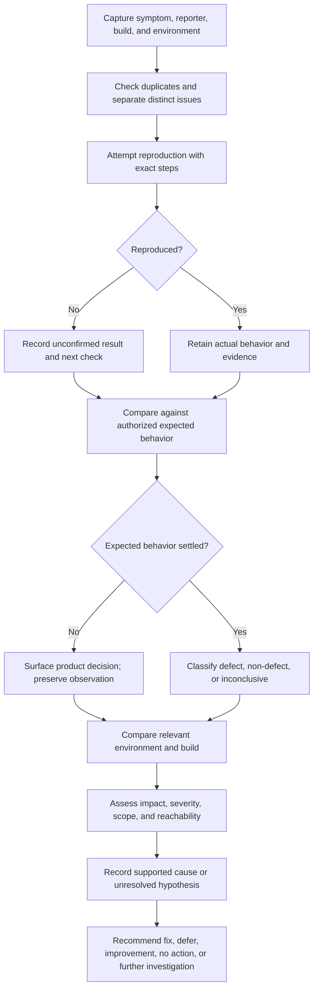

# QA workflow reference

User-confirmed working agreement, 2026-09-30. The primary reader is a QA lead
or workflow-aware tester deciding what Temari should do and how to interpret its
result. Temari maintainers can use the same flows to check routing behavior.

This document defines the requested work and its evidence boundaries. It does
not grant access to an application or install a runtime route. The public
artifact currently packages the ticket acceptance QA playbook and evaluator;
test design and issue triage are proposed playbook families in
[QA playbook design](qa-playbook-design.md). State that capability gap when one
of those workflows is requested.

## Choose the job and its scope

Derive the ticket set from the **current** request: named tickets, a sprint, a
column, a team, a label, a release, or all tickets in the requested set. No
reviewer or tracker filter carries into a later assignment. Confirm membership
in the tracker and record the selection and capture time.

| Request type                   | User's primary question                                                                        | Output                                                                                                                                                          | Execution claim                                                                          |
| ------------------------------ | ---------------------------------------------------------------------------------------------- | --------------------------------------------------------------------------------------------------------------------------------------------------------------- | ---------------------------------------------------------------------------------------- |
| Sprint planning / test design  | What is being asked, what is unclear, and which scenarios and resources will we need?          | Ticket-by-ticket intent, test plan, proposed scenarios, risks, dependencies, and open decisions.                                                                | Proposed work only. No ticket pass or fail.                                              |
| QA Review / ticket acceptance  | Does the named candidate satisfy the approved outcomes for the selected tickets?               | Requirement-to-scenario-to-attempt evidence and a scoped evaluator disposition.                                                                                 | Only at the boundary actually tested; missing required checks remain blocked or not run. |
| QA Triage / issue reproduction | What happened, can it be reproduced, how broad and harmful is it, and what should happen next? | Reproduction verdict, exact steps, actual and expected behavior, environment comparison, impact assessment, distinct issue reports, and next owner or decision. | A triage observation is not an acceptance pass or a proven root cause.                   |

For users who opt into workflow visibility, Temari should briefly announce the
inferred type, requested scope, intended playbook, and whether the route is
installed and admitted. Mark an uncertain choice provisional. If evidence
changes the route, state the correction and reason before switching. For other
users, describe the next action in ordinary language without internal route IDs.

For a mixed request, identify each distinct job and its scope. A reported bug
found during sprint planning can enter triage. A triaged fix creates a new
candidate for verification. Do not relabel planning or triage notes as completed
acceptance evidence.

## Shared judgment rules

**Expected behavior needs authority.** Use the applicable requirement, acceptance
criterion, domain rule, or approved product decision and its revision. Current
code, existing tests, the production behavior, and a developer's or Temari's
interpretation are observations or hypotheses. They do not settle what the
product should do. If authority is absent or conflicting, state the product
question and decision owner; continue checks that do not depend on that answer.
Do not call the disputed behavior a confirmed defect or silently make it a pass.
[Accepted QA decisions](decisions/2026-09-29-qa-review.md) give the source and
evidence rules for full review.

**Separate evidence from judgment.** Label a claim as reported, source-supported,
locally reproduced, observed on a named deployed build, or inferred. Record the
candidate, environment, persona, inputs, and observation boundary. An unavailable
fixture or unresolved product rule is a gap, not a product failure.

**Assess a finding along separate dimensions.** Do not collapse them into one
severity label or invent a project's severity thresholds.

| Dimension    | Record                                                                                                                                                                                                             |
| ------------ | ------------------------------------------------------------------------------------------------------------------------------------------------------------------------------------------------------------------ |
| Impact       | User or business outcome affected, affected actors, lost capability, data or operational consequence, and workaround.                                                                                              |
| Severity     | Degree of harm if the finding occurs, supported by observed behavior and applicable product criteria. Mark the level undecided when the project's scale or facts are missing.                                      |
| Scope        | Affected roles, tenants, workflows, builds, environments, and known frequency; distinguish confirmed coverage from suspected reach.                                                                                |
| Reachability | Happy path; ordinary user interface flow; unusual but user-reachable state; constructed setup or direct call only; or unproven. Say how that classification was established.                                       |
| Priority     | When to investigate, fix, defer, or accept risk, considering impact, likelihood, deadline, workaround, fix cost, and uncertainty. A named product or delivery owner makes the tradeoff under the project's policy. |

An ambiguous behavior with little user harm may need only a product decision or
documented no-action outcome. A small change with a credible user-experience
benefit may be an improvement opportunity even when no requirement is violated.
Neither outcome should be mislabeled as a confirmed defect. Record the rationale,
owner, and follow-up when a decision is made; do not infer consent from silence.

## Sprint planning flow

Input is the selected upcoming work and available product intent. The result is
a plan that a tester can execute later, not a QA disposition.

For each ticket, state the user outcome, intent source, proposed happy-path and
meaningful alternative scenarios, expected result or unresolved oracle, required
data/environment, likely cross-system effects, and estimated test risk. Mark
every scenario **proposed** until an actual attempt exists. Surface missing or
contradictory acceptance criteria early enough for the product owner to answer.

## QA Review flow

Input is a full review request with a trusted ticket revision, candidate, and
environment or explicit environment blocker. The packaged
[ticket acceptance playbook](../packages/workflow-runtime/public/qa/ticket-acceptance-v1.md)
and independent evaluator govern the current full route.

Test the applicable user outcome, including a normal control and important
negative or boundary paths. For a failure, report whether it affects the happy
path or can arise organically through the user interface; distinguish a
constructed state or direct service call. A missing fixture or ambiguous rule
keeps affected scenarios incomplete. Run the evaluator when the trusted full
assignment can be admitted; report the exact admission blocker otherwise. A
draft note is a view of the review record, never a substitute for it.

## QA Triage flow

Input is a reported symptom. The current public artifact has no admitted
dedicated triage playbook; the flow below is the required task contract for a
future route and a guide for honest bounded investigation today.

If the report came from production, test the same relevant scenario on the
upcoming release build when safe and available. If it came from that build,
compare production. Pin both build identities and preserve differences in data,
configuration, persona, and steps; an unavailable or unlike environment is not
proof of absence. Record a reproducible sequence or a specific reason the
result remains unconfirmed. Separate conflated symptoms into distinct proposed
reports when they require different expected outcomes, causes, or owners.

Investigate root cause, but distinguish a supported mechanism from a plausible
hypothesis. The triage result should leave the next decision clear: confirmed
defect, unresolved product expectation, improvement opportunity, no action with
an accountable decision, or further investigation. Severity informs that
decision; priority also depends on delivery timing and options. Filing a report
or proposing a fix does not itself authorize code repair or tracker changes.

## Open policy details

Before assigning a numeric or named severity level, use the selected project's
existing scale and decision owner. This reference does not define universal
thresholds, an automatic fix deadline, or who can accept risk for every product.
The project-specific triage playbook, adapters, and environment authority still
need implementation and admission. Keep those gaps visible in Temari's route
announcement and handoff.
