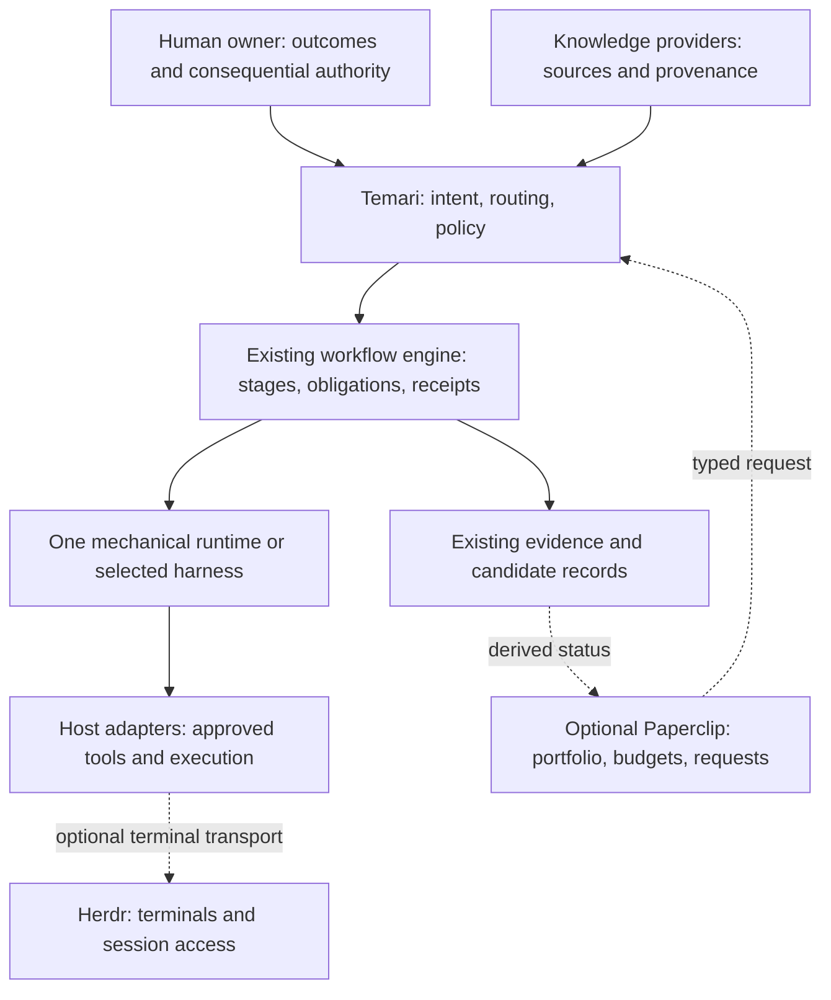

# Temari enhancement recommendations — historical review

Original review: 2026-09-28. Preserved and curated: 2026-10-12.
Audience: the maintainer evaluating future operating and integration improvements.
Status: historical recommendations, not an approved implementation plan or current
capability report. All statements about product versions, implementation status,
sequencing and effort below describe the September 28 review.

The recommendation was to adopt reusable operating principles, adapt selected
Paperclip controls and keep Herdr optional while preserving Temari's ownership of
engineering lifecycle decisions. Current ownership and supported behavior are
documented in the [roles matrix](../system-roles-and-responsibilities.md),
[component guide](../platform-components.md) and
[verification matrix](../verification-matrix.md). Some ideas have since been
adopted; use those current records before proposing duplicate work.

This copy omits private conversation references, host paths, attachment identities,
retrieval diagnostics and the old task-program snapshot. Exact original text and
its digest remain in local custody. Keeping this review does not authorize a pilot,
new service, runtime replacement, installation or publication.

## Decision at a glance

| Candidate | Recommended decision | What we gain | Principal cost | Timing |
| --- | --- | --- | --- | --- |
| Nate's six principles | Adopt as operating requirements; reuse existing implementation | Shared learning, resumability, accountable acceptance, fewer repeated explanations | Maintaining checks and evidence; over-standardization if applied indiscriminately | Apply to existing build and its acceptance now |
| Paperclip concepts | Adapt budgets, goal links, actionable review/decision queues, bounded event-driven wakeups | Better control of cost and work waiting on people | New accounting, event projection, and policy work | Measure after installed execution works; budget enforcement before unattended scale |
| Paperclip product | Defer a production dependency; consider a separate operations-layer pilot | Ready-made shared work UI, organizational administration, costs, routines, and approvals | Second database/service, integration and ownership complexity, policy differences | When multiple people or recurring cross-project operations need a shared control surface |
| Herdr product | Optional operator tool first; adapter only if useful in practice | Persistent CLI sessions, mixed-agent visibility, remote terminal access | Detection/integration maintenance and terminal access exposure | Manual non-production trial can be independent; integration after installed host proof |
| New mandatory agent hierarchy | Reject as a default | No demonstrated benefit over bounded roles for current scope | Coordination tokens, review queues, unclear accountability | Revisit only for a measured organizational need |

These recommendations are conditional on Temari remaining the provider-neutral workflow platform described in its accepted architecture. They are not a conclusion that building every future operations feature ourselves is cheaper. If shared administration becomes a first-release requirement, compare adopting Paperclip above Temari before implementing an entire competing product.

## What to adopt from Nate

| Principle | Temari already has | Adopt or finish | Benefit and tradeoff |
| --- | --- | --- | --- |
| Make agent work reusable by others | Packaged P-stack skills, decision records, source evidence, host projections | Shared, access-appropriate artifacts and reusable checks; named maintenance ownership | Less dependence on the original operator. Curated sharing costs effort; indiscriminate chat sharing exposes private material and noise |
| Separate durable history from execution | Run/child stores, checkpoints, evidence, knowledge-provider boundary | Prove useful fresh-session continuation and later shared artifact recovery | A replaced session need not erase decisions. More retention requires explicit access and deletion policy |
| Keep humans accountable | Authorization rules, review obligations, QA ownership, closeout | Record outcome owner, technical acceptance owner, allowed actions, escalation reason, and acceptance evidence | Agents act autonomously inside known limits. Requiring approval for every routine step would recreate the bottleneck |
| Leave work ready for the next person or agent | Handoff procedure, candidate identities, receipts, feature verification | Current intent, reasons, failed attempts, runnable checks, blockers, next safe action, and artifact links | Faster continuation. A transcript archive alone does not provide a usable handoff |
| Let agents check reality | Verification skills, live control paths, repository checks, QA target | Reproducible scenarios, known-defect checks, observed outputs, stale-evidence rejection, independent review where required | Fewer cycles where the owner explains a failure the agent could observe. Tests must be protected from being weakened merely to obtain a pass |
| Remove obsolete process | Lightweight/full routing with a common lifecycle | Standardize required outputs and evidence; allow different prompts, models, and working methods | Preserves productive operators' freedom. Remove duplicate paperwork, not useful review or human judgment |

P-stack is already Temari's foundation. Nate's endorsement is not a reason to add a second P-stack distribution or overwrite Temari's accepted modifications. His principles mostly reinforce existing decisions; they expose acceptance and operational visibility work more than missing agent roles.

Turn repeated mistakes into a test, validator, fixture, or narrowly scoped skill. For each promoted rule, retain its motivating failure, owner, validation, and rollback. A candidate lesson should not silently rewrite canonical policy; require evaluation and appropriate human review before promotion.

Do not adopt PR count, lines of code, model prestige, or agent count as success measures. The reported productivity anecdotes are not causal evidence for Temari's likely gain. For illustration only, if implementation takes half of end-to-end time, making it ten times faster gives `1 / (0.5 + 0.5/10) = 1.82` times overall speed. That is arithmetic under an assumption, not a forecast. Measure where work waits first.

The supplied text does not include the Faster Factory Kit files, runner, or original five-measure scorecard. This review does not claim to have evaluated them or verified the transcript's third-party statistics. The proposed trial below is our design.

## Paperclip: useful operations product, substantial overlap

Paperclip provides a self-hosted organizational control plane with issues, goals, assignments, routines, budgets, approvals, runtime adapters, and a shared UI. Its issue checkout implementation conditionally claims work using current assignment/status/run identity. That is real coordination code, not just an org-chart mockup. Its company-oriented model also brings concepts Temari may not need for every task. [Product model](https://github.com/paperclipai/paperclip/blob/0f14d261233c545aa6a8a38ec253c498a5130fff/doc/PRODUCT.md), [issue checkout](https://github.com/paperclipai/paperclip/blob/0f14d261233c545aa6a8a38ec253c498a5130fff/server/src/services/issues.ts#L11314).

| Capability | Current Temari owner or gap | Adoption benefit | Cost or conflict | Recommendation |
| --- | --- | --- | --- | --- |
| Goal → project → task links | Intent and plans in Temari; no company-wide portfolio product established | Shows why work matters and enables prioritization | Artificial goal chains can become paperwork | Add optional outcome links to existing records when useful |
| Budget accounting and stop policies | No monetary budget mechanism found in the inspected Nx core/runtime sources; host limits and knowledge retrieval budgets have different purposes | Attribute spend and stop low-value loops | Provider usage can be delayed, incomplete, or subscription-based; cancellation must be defined | Adopt accounting and bounded admission controls before unattended scale |
| Shared approval and attention UI | Existing orchestration status/ledger and domain review gates; limited shared operator experience | Shows who must decide, what evidence exists, and how long work has waited | Duplicate approval authority and status drift | Project existing records into one attention view first |
| Heartbeats, routines, event wakeups | Temari runtime mechanics, host scheduling, optional harnesses | Recurring work without manual initiation | Idle polling costs; repeated or cyclic wakeups; competing schedulers | Reuse one scheduler and the same idempotent dispatch contract |
| Task checkout, sessions, recovery | Existing run/child stores, checkpoints, leases, workspace/evidence handling | Paperclip offers a database-backed implementation and UI | Replacing proven local behavior requires substantial migration and parity proof | Preserve Temari implementation now; assess backend substitution at NX-05 if warranted |
| Agent catalog and roles | Optional specialists, typed assignments, host capabilities | Discover available capabilities and ownership | Mandatory CEOs/managers create token overhead and blur accountability | Use capability-based roles; do not require corporate hierarchy |
| Shared skills and evaluations | Packaged skills, verification, controlled promotion direction | Collaboration and reuse | Paperclip's defaults differ from Temari's promotion rules | Borrow evaluation UX; protect canonical skills explicitly |
| Multi-user/company administration | Host/private-overlay boundaries; no equivalent full team-administration product established | Avoid building a complete administration product later | Auth, backups, upgrades, access policy, tenant and secret operations | Stronger reason to pilot the product if this becomes a real requirement |

Three source findings materially affect integration:

1. **Do not equate Paperclip approvals with Temari acceptance.** Its review policy falls back to `anyone`; `human_only` and `not_creator` are configurable alternatives. A different Paperclip writer is also not proof of a fresh-context, qualified evaluator. Keep Temari's evidence, candidate and review obligations authoritative. [Review-policy implementation](https://github.com/paperclipai/paperclip/blob/0f14d261233c545aa6a8a38ec253c498a5130fff/server/src/services/issue-review-policy.ts).
2. **Do not inherit agent or skill permissions blindly.** The inspected Codex CLI path sets `DEFAULT_CODEX_LOCAL_BYPASS_APPROVALS_AND_SANDBOX = true`; its argument builder uses that default when restrictive overrides are absent and network access is not denied. Nearby CLI documentation says the opposite. This finding is specific to the CLI engine: the adapter documents ACP as its default engine, so it does not show that every default Codex launch bypasses its sandbox. Explicit engine/permission configuration and actual launch verification are prerequisites. Paperclip's product policy also makes company skill operations broadly available unless restrictions are configured. [Default and documentation](https://github.com/paperclipai/paperclip/blob/0f14d261233c545aa6a8a38ec253c498a5130fff/packages/adapters/codex-local/src/index.ts), [argument construction](https://github.com/paperclipai/paperclip/blob/0f14d261233c545aa6a8a38ec253c498a5130fff/packages/adapters/codex-local/src/server/codex-args.ts).
3. **A budget label is not a proof of zero overspend.** The inspected service evaluates observed cost events, pauses scopes, invokes cancellation hooks, and checks before invocation. We have not proven reservation of every concurrent in-flight token charge. An integration must test delayed usage, parallel runs, unknown cost and cancellation. [Budget service](https://github.com/paperclipai/paperclip/blob/0f14d261233c545aa6a8a38ec253c498a5130fff/server/src/services/budgets.ts), [cost event processing](https://github.com/paperclipai/paperclip/blob/0f14d261233c545aa6a8a38ec253c498a5130fff/server/src/services/costs.ts).

The repository carries an MIT license. Self-hosting still requires operating its application, database, storage, credentials, backups and updates, plus paying agent/runtime costs. Local trusted mode is designed for a single local operator; shared deployment has a distinct authenticated configuration. Do not infer organization isolation, complete traces, or enterprise suitability from a feature list alone. [Deployment modes](https://github.com/paperclipai/paperclip/blob/0f14d261233c545aa6a8a38ec253c498a5130fff/doc/DEPLOYMENT-MODES.md), [license](https://github.com/paperclipai/paperclip/blob/0f14d261233c545aa6a8a38ec253c498a5130fff/LICENSE).

**Preferred future integration:** keep Paperclip separate and expose Temari as a worker through an adapter. Paperclip may own a coarse business request, its priority, budget and organizational assignee. Temari owns the engineering plan, stages, QA verdict and completion evidence. Bind the Paperclip issue ID to a stable Temari run/revision and export a receipt link. A Paperclip issue can project Temari acceptance but cannot manufacture it. Make cancellation an explicit request to Temari and show pending versus acknowledged cancellation. Retry the same run identity, not a new anonymous execution.

Paperclip would not own inner stage scheduling while Temporal or another Temari harness simultaneously retries those stages. If Paperclip is selected as the mechanical backend instead, that is a separate replacement decision requiring recovery and cancellation parity. Choose one owner at each level. Prefer the documented adapter/plugin extension boundary over forking the entire upstream product.

## Herdr: session infrastructure and operator convenience

Herdr is a terminal runtime/multiplexer. It hosts ordinary agent CLIs, tracks their visible state, exposes CLI/socket control, and connects local and SSH machines. Its source carries Apache-2.0 licensing. It fits beneath a host integration or beside the operator's existing UI; it does not define Temari's workflow semantics. [Project](https://github.com/herdrdev/herdr/tree/0d5d6f1f317e238c8297076bc6ab5c3a0cd56283), [automation API](https://herdr.dev/docs/agent-automation/).

| Adopt or borrow | Gain | Current alternative/overlap | Limitation and decision |
| --- | --- | --- | --- |
| Persistent terminal server and detach/reattach | Keep CLI work running after the client disconnects | Existing host sessions or terminal tooling | Good optional tool if mixed CLI sessions are a real pain |
| Unified blocked/working view | Find agents waiting for input without inspecting every terminal | Host task UI, orchestration status | Borrow the attention-first view; terminal state remains advisory |
| SSH machine aggregation | Convenient access to an always-on machine | Host remote execution and future shared runtime | Remote terminal access does not provide distributed task failover |
| Structured CLI/socket operations | A possible transport for launch, read, wait, and interruption | Existing host-native tools and harnesses | Wrap behind an optional adapter only after a useful manual trial |
| Plugins | Flexible operator extensions | Temari and host skill/plugin packaging | Do not make Herdr plugins core policy or a security boundary |

Herdr's documented boundaries are especially relevant:

- Detach keeps processes running while the server machine remains running. A server or machine restart loses original processes; layout restore and supported native agent session resume are different mechanisms. Laptop sleep cannot be assumed to preserve active computation. Use an awake remote host for that requirement. [State/restore](https://herdr.dev/docs/session-state/), [remote operation](https://herdr.dev/docs/persistence-remote/).
- `done` is an idle agent whose response has not been marked seen. `blocked` recognizes an approval/question UI. Prompt-and-wait does not identify individual task turns, and a timeout does not prove that no input was sent. Retrying blindly can duplicate a prompt. These are reasons to retain Temari task identity and receipts. [Automation semantics](https://herdr.dev/docs/agent-automation/).
- For Codex and Claude Code, current status classification uses screen manifests. Treat detection changes and false status as adapter concerns. [Agent status authority](https://herdr.dev/docs/agents/).
- Pane history is off by default because terminal contents can contain secrets. Herdr plugins execute as the user and are not sandboxed by Herdr. Preserve Temari's privacy and tool permissions; do not give every agent unrestricted cross-pane access simply because the API permits it. [History retention](https://herdr.dev/docs/session-state/), [plugin trust model](https://github.com/herdrdev/herdr/blob/0d5d6f1f317e238c8297076bc6ab5c3a0cd56283/docs/preview/website/src/content/docs/plugins.mdx).

Compared with a single host app that already manages the user's tasks, Herdr adds another interface and may save little. Compared with many independent terminals across hosts, it may save substantial navigation and reconnection effort. Test that operator problem before building an adapter. Do not fork or reproduce a terminal multiplexer inside Temari.

## Responsibility boundaries and proposed placement

| Responsibility | Owner retained | Where an enhancement belongs |
| --- | --- | --- |
| Intent, route, due checks, acceptance policy | `libs/temari-core` and domain owners | Add policy here only when there is a real requirement |
| Shared neutral identity and event contracts | `libs/contracts` | Optional outcome/owner/cost references; no vendor database types |
| Lifecycle, review and completion | `libs/workflow-engine` | Preserve one lifecycle; never accept a pane badge or external task status as proof |
| Leases, retries, scheduling, cancellation, evidence persistence | `libs/runtime` or one selected `ExecutionHarness` | Extend existing mechanics; backend replacement requires parity proof |
| Host transport, tools and permission translation | `libs/host-adapters`; optional integration package | A Herdr transport must report observed capabilities and link outputs to Temari identity |
| Knowledge retrieval, provenance and source lifecycle | `libs/knowledge` and replaceable providers | Neither Paperclip comments nor Herdr scrollback becomes the canonical knowledge store |
| Shared operator attention and cost display | New optional projection/operations surface | Read current state and submit authorized requests; do not create a second event history with competing truth |
| Paperclip interoperability | Separate upstream adapter/plugin or optional integration | Coarse intake, identity mapping, status projection, budget/cancel requests |

New placement labels are proposals, not directories or integrations claimed to exist. The present `HostAdapter` is principally a capability-report interface; a Herdr execution bridge would need real transport wiring and tests. The existing `ExecutionHarness` has start/status/resume, which alone is not a complete cancellation contract.

## Sequence and decision gates

1. **Protect current completion.** Finish installed engineering, candidate closeout, QA and privacy obligations in the selected dependency order. Use Nate's principles to assess continuation, evidence and ownership outcomes. Do not add an org chart, terminal product or separate scheduler as a prerequisite.
2. **Measure one working journey.** After installed execution works, project existing records into a small attention report: task, owner, current state, time waiting, blocker/decision, evidence link, next action, observed cost and unknown-cost flag. Begin with a report before deciding a dashboard is needed. This is the smallest recommended new increment.
3. **Control unattended volume.** Add attributed cost events, per-run limits, concurrency admission, bounded retries and explicit stop/cancel behavior using current runtime contracts. Prefer event-driven wakes with bounded reconciliation polling. Keep policy in Temari and provider metering in adapters. Account for review capacity so builders do not overwhelm acceptance.
4. **Choose shared-control machinery deliberately.** Compare the existing harness/Temporal direction with alternatives on the required recovery contract. Paperclip's UI and Herdr's reconnection do not close shared-storage or failover evidence gates. Preserve independently selected distributed-work obligations.
5. **Pilot optional products at their actual boundary.** Try Herdr for mixed-CLI operator friction. Try Paperclip if a shared, persistent operations layer is a concrete need. Neither pilot changes cutover authority.

Relative effort estimates are architectural judgments, not delivery commitments. Borrowing a record field or generating a read-only report is small; a trustworthy usage-and-stop path is medium; a Herdr adapter is medium because uncertain submission and recovery matter; production Paperclip interoperability is medium-to-large; replacing Temari's runtime or building team administration is large. Actual staffing, hosted prices, operating burden and savings remain unmeasured.

## Bounded evaluation before adoption

Use a proposed two-week trial after the installed journey is available. Match task type and difficulty to a baseline; keep the same review requirements and account for work still in progress. Do not generalize from a handful of unlike tasks.

| Measure | Definition | Failure it detects |
| --- | --- | --- |
| Accepted useful outcomes | Count outcomes meeting predeclared acceptance, not PRs or agent messages | More output without user value |
| End-to-end lead time | Request to accepted result; split active time from review/decision/blocker waiting; inspect median and slow tail | Moving the bottleneck downstream |
| Quality and rework | Corrections, reopened work, escaped defects, and review effort | Buying speed by lowering the bar |
| Total cost per accepted outcome | Model usage, infrastructure and human review/maintenance effort; unknown cost remains explicit | Hiding costs outside token spend |
| Expert interruption burden | Time spent coaching, reconstructing context, triaging agents and maintaining shared checks | Borrowing the gain from the strongest contributor |

Set acceptable changes in these measures before the pilot; this review does not promise a savings percentage. In a tiny sample, treat outcomes as directional evidence and preserve task-level examples.

For the attention report, verify that a stale candidate is never shown as accepted, a blocked task names the actual decision owner, unknown cost is visibly unknown, and an interrupted session retains its resume point. Compare owner time spent finding the next actionable item with the current status/ledger method.

For Paperclip, run one approved synthetic request through the adapter; duplicate its wakeup and restart the adapter; verify one Temari action identity, correct receipt projection, a stale-evidence rejection, protected skill policy, configured execution restrictions, budget exhaustion and cancellation acknowledgement. Remove Paperclip and prove the Temari record still resumes. Pilot read-only status first, then dispatch. Stop if status reconciliation or policy duplication costs more than the shared UI saves.

For Herdr, exercise two agent CLIs, detach/reconnect, an approval prompt, an ambiguous prompt timeout, a server restart, and an unsupported status signal. Confirm there are no duplicate actions or automatic approval keystrokes, and that Temari only accepts its own verified outputs. If terminal navigation was not a significant bottleneck or detection needs frequent repair, retain the current host interface and borrow only the attention-display idea.

## Historical source scope

The original review inspected the supplied briefing and transcript, selected
Paperclip and Herdr source, and the then-current Temari/Nx code. The briefing and
transcript remain private. Source navigation and reported productivity anecdotes
do not constitute runtime, security, performance or causal productivity evidence.

- [Paperclip at the inspected revision](https://github.com/paperclipai/paperclip/tree/0f14d261233c545aa6a8a38ec253c498a5130fff), version 0.3.1: selected product, deployment, coordination, budget, adapter and license sources.
- [Herdr at the inspected revision](https://github.com/herdrdev/herdr/tree/0d5d6f1f317e238c8297076bc6ab5c3a0cd56283): selected session, automation, remote, API and detection sources; live docs can differ from the preview repository.
- Temari source revision `84b8b0b52c55f34f3f85c1932e27e11b8535d199` and Nx main revision `709480ad845435811427284663ba939ee0d12f7a`: historical implementation context, superseded by current repository records.

Neither external product was installed or load-tested for that review. Actual
productivity gain, recurring maintenance cost and integration effort remain
unmeasured. The bounded evaluations above are proposals for resolving those gaps.
