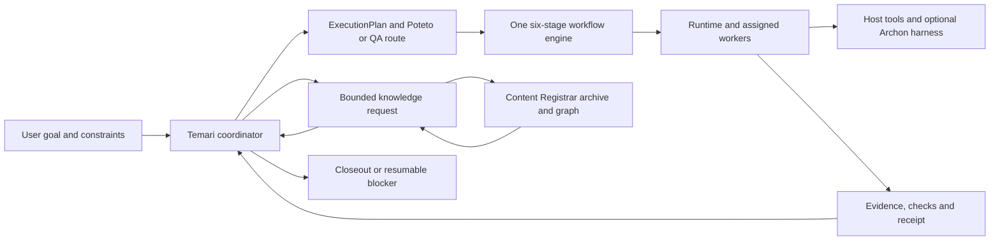

# Temari system roles and responsibilities

This is the starting map for an agent or maintainer joining Temari. It identifies
who may decide, who may execute, what evidence crosses each boundary, and which
capabilities are still local proofs or proposals. It reflects the repository at
`5af7b97` on 2026-09-30. **Implemented** means a code path exists; it does not
mean unattended operation or production readiness.

**Direction approved by the task owner on 2026-09-30:** Temari owns task
continuity and acceptance, Archon is the preferred execution and console
integration, Registrar owns source evidence, and Paperclip supplies selected UX
patterns. The implementation sequence and acceptance cases below are approved
design intent; their execution and verification remain pending.

Read the [platform overview](platform-overview.md) for the intended architecture,
the [component guide](platform-components.md) for detailed boundaries, and the
[verification matrix](verification-matrix.md) before promoting a capability.
Some older overview text describes an earlier slice. For the archive and
parallel paths, use the current package guides and code linked below.

## One request, one accountable route

The fixed stages are `investigate → plan → build → review → verify → deliver`.
Plan policy changes delegation, review, evidence and delivery requirements; it
does not create another lifecycle. Temari owns semantic acceptance. A worker
status, model score, test exit code, or Archon run status is input to that
decision, not a substitute for it. See the
[plan contract](../libs/contracts/src/lib/execution-plan.ts) and
[workflow engine](../libs/workflow-engine/src/lib/workflow-engine.ts).

## Decision and control owners

| Role or boundary                    | Owns and produces                                                                                                                                                                  | Does not own                                                                                         | Current standing and notes                                                                                                                                                                                                                                                                                                                            |
| ----------------------------------- | ---------------------------------------------------------------------------------------------------------------------------------------------------------------------------------- | ---------------------------------------------------------------------------------------------------- | ----------------------------------------------------------------------------------------------------------------------------------------------------------------------------------------------------------------------------------------------------------------------------------------------------------------------------------------------------- |
| User or task owner                  | Goal, constraints, source admission, permissions, acceptance choices and approval of external disclosure or delivery.                                                              | Runtime retries or inferred facts inside a source.                                                   | Temari retains these as explicit task inputs. The owner selected registered-source sharing by default for this knowledge path; a source marked local-only or a query opt-out blocks Jev. A saved key alone never changes that policy.                                                                                                                 |
| Temari coordinator                  | Classifies intent, chooses the Poteto or QA route, reconciles obligations into one `ExecutionPlan`, reviews gaps and decides closeout. Produces the trusted brief and active plan. | Provider credentials, mechanical lease/retry state or automatic rewriting of evidence.               | **Implemented policy boundary** in [temari-core](../libs/temari-core/src/lib/temari-core.ts). The full conversational product experience is still assembled through host and packaged routes.                                                                                                                                                         |
| Poteto engineering method           | Selects lightweight or full engineering playbooks and the depth of investigation, review and verification. Supplies stage obligations to Temari.                                   | A separate scheduler, workflow engine or independent completion authority.                           | **Packaged route** in [Poteto mode](../packages/workflow-runtime/assets/v4.1/skills/poteto-mode/SKILL.md); the Nx [route table](../libs/temari-core/src/lib/temari-core.ts) has lightweight and full entries.                                                                                                                                         |
| QA domain and independent evaluator | Preserves expected behavior, coverage, scenario observations and a QA disposition. The evaluator challenges a frozen review from a different actor.                                | Redefining the expected behavior to match a fix or treating a procedural receipt as product success. | **Typed local boundary** in [QA route and evaluator](../libs/temari-core/src/lib/qa-evaluator.ts). Host execution and a complete live QA journey require separate proof. See the [QA playbook design](qa-playbook-design.md).                                                                                                                         |
| Contracts and workflow engine       | Define stage order, host requirements, worker briefs/results and stable joins. Run serial stages or bounded independent assignments.                                               | Meaning of the user's request or durable external scheduling.                                        | **Implemented** in [contracts](../libs/contracts/src/lib/execution-plan.ts) and [workflow engine](../libs/workflow-engine/src/lib/workflow-engine.ts). Required independent review derives `subagents`; concurrent fan-out derives `parallelism`; PR delivery derives `forge`.                                                                        |
| Mechanical runtime                  | Persists receipts, route events and immutable evidence; claims and fences child work; handles bounded retry, checkpoints, cancellation requests and resume rules.                  | Semantic review or permission to widen a task.                                                       | **Local implementation** in [runtime](../libs/runtime/src/lib/runtime.ts) and [parallel runtime](../libs/runtime/src/lib/parallel-runtime.ts). [Shared control](../libs/shared-control/README.md) adds local service and restart proofs, not a production cross-host control plane.                                                                   |
| Host adapter and execution host     | Reports tools, models, permissions, credentials, worktree and forge facilities; executes an admitted assignment.                                                                   | Reclassifying work or inventing a missing capability.                                                | [Adapters](../libs/host-adapters/src/lib/host-adapters.ts) include a serial generic fallback and Cursor declarations. Declared capabilities are marked unproven until the actual host journey checks them.                                                                                                                                            |
| Archon execution harness            | Starts, observes, resumes and cancels a native workflow; returns its run identity and status. Its run/node logs can support task traceability.                                     | Temari's plan, source authority or canonical six-stage closeout.                                     | **Optional managed adapter** pinned to Archon 0.10.1 in [archon-harness](../libs/archon-harness/src/lib/archon-harness.ts). The canonical bridge produces deterministic six-stage evidence; a native status alone still cannot close a task. Exact-run cancellation is supported. See the [harness decision](decisions/2026-09-22-archon-harness.md). |
| Distribution and initializer        | Package public skills and playbooks; install frozen dependencies and the pinned optional Archon executable; retain install and provenance receipts.                                | Running an agent or silently activating a schedule.                                                  | **Implemented packaging** in [workflow-runtime](../packages/workflow-runtime/README.md) and [initializer](../packages/initializer/README.md).                                                                                                                                                                                                         |

## Assigned worker roles

These names are the [typed `WorkerRole` vocabulary](../libs/contracts/src/lib/worker.ts),
not seven permanent autonomous agents. A stage can remain coordinator-owned.
Every delegated worker receives a bounded brief with scope, acceptance criteria,
verification and forbidden actions, then returns a status plus raw evidence or log
references. The coordinator validates the evidence and decides what follows.

| Assignment role | Expected responsibility                                                           | Handoff and review note                                                                                                                     |
| --------------- | --------------------------------------------------------------------------------- | ------------------------------------------------------------------------------------------------------------------------------------------- |
| `coordinator`   | Own the task route and reconcile stage results.                                   | Only this role should change shared route meaning; its summary is not a replacement for worker evidence.                                    |
| `investigator`  | Resolve a scoped uncertainty using named sources or observations.                 | Report citations, gaps and unanswered questions. Source text remains data.                                                                  |
| `implementer`   | Make the assigned code or artifact change within a named checkout and scope.      | Return changed candidate identity, checks and logs. Do not self-certify independent review.                                                 |
| `reviewer`      | Challenge a frozen candidate or plan independently.                               | Record findings tied to the exact candidate and evidence. Feature build and review need different owners under the packaged Poteto profile. |
| `verifier`      | Run the required behavioral and static checks and retain observed results.        | A passing command supports a narrow claim; it does not prove the entire product outcome.                                                    |
| `judge`         | Supply a bounded judgment when the plan defines criteria and admissible evidence. | The type exists; there is no universal judge service. Jev shadow scores are advisory and cannot replace cited support.                      |
| `integrator`    | Reconcile disjoint worker outputs into one candidate and surface conflicts.       | Preserve each child's evidence and rerun combined checks before accepting the integrated candidate.                                         |

### How granular are the boundaries today?

This matrix makes existing responsibilities explicit. It does not add worker
types, running agents, permissions or enforcement. The seven worker roles describe
assignments; intake and retrieval are domain responsibilities that may use those
assignments. They do not each need a permanent process or another coordinator.

| Boundary             | Existing detail                                                                                                                                                                                                                                                                                          | Recommended next detail                                                                                                                                                                                                                                                                                                                                          |
| -------------------- | -------------------------------------------------------------------------------------------------------------------------------------------------------------------------------------------------------------------------------------------------------------------------------------------------------- | ---------------------------------------------------------------------------------------------------------------------------------------------------------------------------------------------------------------------------------------------------------------------------------------------------------------------------------------------------------------- |
| Assignment authority | `WorkerBrief` carries goal, context, textual scope, acceptance criteria, verification and forbidden actions. Its generic validator checks completeness. The [local write-worker runner](../tools/run-codex-write-workers.mts) additionally checks typed path ownership and rejects out-of-scope changes. | Reuse those checks across supported hosts. Bind each assignment to an actor, admitted tools and sources, writable paths, candidate revision and escalation conditions. A role label alone must not be advertised as a permission boundary.                                                                                                                       |
| Independent judgment | The QA evaluator binds a frozen review and distinguishes evaluator identity; packaged engineering review also has independence requirements.                                                                                                                                                             | Carry actor and candidate identity through the harness result. Verify independence for each admitted route rather than assuming a differently named role proves it.                                                                                                                                                                                              |
| Execution ownership  | The local runtime has child leases, retries and cancellation gates. The [harness port](../libs/contracts/src/lib/execution-harness.ts) exposes `start`, `status`, `resume` and optional `cancel`. The Archon adapter confirms exact-run cancellation; recurring scheduling remains outside this port.    | Name one execution owner for each dispatched unit. In the proposed Archon route, Archon owns its native node execution and recovery; Temari records the result and reconciles acceptance. A nested retry must have an explicit shared attempt bound. Define how cancellation reaches the owner and when it is actually complete.                                 |
| Trace identity       | `HarnessRunRef` already binds Temari run ID, revision and plan digest to the Archon run ID and version. Knowledge work has task bindings and pinned handoffs.                                                                                                                                            | The [local task ledger and inbox](task-continuity.md) now retain one logical task across runs, source/publication references, canonical stage evidence and child-store links. Explicit host/chat links, scoped pickup, and structured task handoffs are implemented. Automatic chat capture and authenticated actor/tool/path enforcement remain follow-up work. |
| Operational limits   | `ExecutionPlan.parallelism` sets concurrent work; local runtime retry policy bounds attempts.                                                                                                                                                                                                            | Add a total child count, elapsed-time limit and provider-supported spend limits. Record whether a limit is enforced or advisory, and report unavailable usage as unknown.                                                                                                                                                                                        |

The useful increase in granularity is an enforceable assignment and handoff
contract. Additional job titles would not resolve the missing host and harness
integration evidence.

## Knowledge and tool responsibilities

| Role or tool                        | Owns and produces                                                                                                                                                  | Current standing and boundary                                                                                                                                                                                                                                                                                         |
| ----------------------------------- | ------------------------------------------------------------------------------------------------------------------------------------------------------------------ | --------------------------------------------------------------------------------------------------------------------------------------------------------------------------------------------------------------------------------------------------------------------------------------------------------------------- |
| Knowledge intake responsibility     | Capture only admitted registered sources, bind task authority and source identity, publish immutable archive handoffs and report unsupported or incomplete assets. | **Operator-run local journey** in [JOURNEY.md](../libs/knowledge/JOURNEY.md) and [ARCHIVE.md](../libs/knowledge/ARCHIVE.md). Optional macOS PNG OCR retains unreviewed-transcription and unavailable-visual-meaning gaps. The intake command is not an autonomous watcher or scheduled agent.                         |
| Search and retrieval responsibility | Accept a pinned handoff, discover exact or BM25 candidates, read bounded excerpts, revalidate, checkpoint progress and return citations and gaps.                  | **Operator-run local journey** in [JOURNEY.md](../libs/knowledge/JOURNEY.md). A top-K hit and verified first excerpt do not establish a complete answer. Eligible handoffs expose pinned graph trials alongside lexical ranking. The sealed retrieval gate is coverage-blocked; exact remains the default.            |
| Content Registrar                   | Own registered source identity, retained original bytes, archive generations, indexes, graph assertions and source-backed citation checks.                         | **Bundled Python authority** in the public knowledge capability, consumed through Temari's [archive adapter](../libs/knowledge/ARCHIVE.md). Temari retains task bindings and assessments; it should not copy Registrar's source lifecycle into the workflow engine.                                                   |
| Nx, Graft, Graphify and OKF         | Nx maps workspace projects and targets. Graft can derive code structure. Graphify and OKF are graph/projection and exchange views.                                 | Bounded Nx/Graft imports now verify retained endpoint bytes and supported relationships, with operator-reviewed graph retraction. Artifact generation remains operator-owned; native Graphify and visual/semantic interpretation remain separate evaluation work. A projection is not source authority.               |
| Jev                                 | Give typed, bounded relevance or support judgments on an admitted shortlist.                                                                                       | **Shadow-only adapter** in the [knowledge journey](../libs/knowledge/JOURNEY.md). The current Registrar sharing setting is checked before each TypeSafe attempt; handoff local-only and case opt-out remain additional denials. It cannot recover a candidate that discovery missed, perform OCR, or write an answer. |
| Evidence and closeout               | Bind plan, revision, stage/worker attempts, host identity, source hashes, logs and checks to a durable result or resumable blocker.                                | **Partial across engine and runtime**. The [component guide](platform-components.md#7-provenance-logs-and-security) lists the needed record. Deterministic source-workspace Archon-to-canonical evidence is tested; installed live routes and provider log capture still need their own proof.                        |

## Useful improvements, in dependency order

The approved sequence extends the existing Temari–Archon integration. Complete
the evidence and control handoff before adding dashboard actions; reuse the
existing run correlation. The table records implementation priorities and the
evidence required to promote each capability.

| Order | Final recommendation                                                                                                                                 | Reuse, owner and observable result                                                                                                                                                                                                                                                                                                                                                                                                                                                                                                                                                     |
| ----- | ---------------------------------------------------------------------------------------------------------------------------------------------------- | -------------------------------------------------------------------------------------------------------------------------------------------------------------------------------------------------------------------------------------------------------------------------------------------------------------------------------------------------------------------------------------------------------------------------------------------------------------------------------------------------------------------------------------------------------------------------------------- |
| 1     | **Complete the Temari–Archon evidence and control handoff.** This is the foundation for trustworthy status and recovery.                             | Extend the existing `HarnessRunRef` binding into stage, child, attempt and source evidence; retain a stable logical task above runs. Temari owns task meaning and closeout. The selected executor owns its execution units. A native success with missing required evidence remains unresolved in Temari. Prove exact-run recovery and cancellation before enabling those actions in a combined task view.                                                                                                                                                                             |
| 2     | **Use Archon's console and add a small Temari task view.** Keep the familiar chat, runs and logs, while making unfinished goals visible across runs. | Archon's [console](https://archon.diy/adapters/web/) already exposes project chat, run events, artifacts and run actions. Begin with a read-only task summary and links to those existing screens. Add only the missing inbox fields: goal, current stage, next action, blocker, last meaningful activity and evidence completeness. If a console extension is needed, keep it small and backed by Temari's API. “Done” requires Temari closeout.                                                                                                                                      |
| 3     | **Prove bounded parallel work and limits on one real host.** Reuse the existing role vocabulary and independent-review policy.                       | Temari supplies assignment scope and acceptance; one selected executor dispatches the batch. Start with two independent workers and retain both outcomes when one fails. Bound total children, concurrency, attempts and time. Capture provider-reported usage and apply supported spend controls before making execution routine.                                                                                                                                                                                                                                                     |
| 4     | **Use the runtime-owned recurrence ledger for fixed checks.** Keep Archon pinned at 0.10.1 and one schedule owner.                                   | The dashboard recurrence ledger retains anchored UTC schedules, due intents, exact task/start identities, coalesced missed slots and skipped overlap. Archon executes each native recipe; it does not own this clock. Any future [native-trigger](https://archon.diy/guides/workflow-triggers/) adoption requires an explicit owner migration and pinned upgrade. Verify duplicate delivery, overlapping starts, restart and stopped-host behavior. `executeScheduledAndPersist` is not a recurring clock. Show last actual run and the applicable queue/skip policy in the task view. |
| 5     | **Add the Registrar knowledge map as a separate view.** This can follow the first useful task dashboard.                                             | Display admitted paths, generations and supported relationships from pinned publications. Every relationship opens its anchors; absent, stale or inferred evidence remains visible. Begin with existing graph reads and source inventory, then add richer projections when their evidence exists.                                                                                                                                                                                                                                                                                      |
| 6     | **Evaluate new extraction only against observed retrieval gaps.** Keep this independent from the dashboard delivery.                                 | Use the existing exact/BM25 journey as the baseline. Evaluate OCR, Graft or Graphify only for an admitted task that needs the missing capability; retain Jev's advisory status. Measure retrieval and answer support separately.                                                                                                                                                                                                                                                                                                                                                       |

Update outdated platform summaries alongside each delivered increment and link
its retained evidence. Documentation repair belongs in each increment's completion
criteria rather than a final standalone project.

Two limits affect the proposed rollout. Archon's [fan-out documentation](https://archon.diy/guides/authoring-workflows/)
states that `max_parallel` limits simultaneous children, not their total count.
Its [provider matrix](https://archon.diy/reference/provider-capabilities/) lists
Codex token reporting, but no `costUsd` reporting or `maxBudgetUsd` enforcement;
inline `agents` and per-call tool restrictions also vary by provider. A hard
dollar ceiling therefore needs a proven enforcement path. Admission caps and
elapsed-time limits should remain available independently of cost reporting.
The [trigger guide](https://archon.diy/guides/workflow-triggers/) also makes macOS
schedules dependent on the user's login session and does not promise replay of
missed intervals. These upstream capabilities must be checked against the exact
release admitted by Temari.

### Patterns worth borrowing from Paperclip

Borrow three interaction patterns without adding a Paperclip service dependency:

| Pattern                                   | How it should fit Temari                                                                                                                                                                                               | Limit to preserve                                                                                                                                                 |
| ----------------------------------------- | ---------------------------------------------------------------------------------------------------------------------------------------------------------------------------------------------------------------------- | ----------------------------------------------------------------------------------------------------------------------------------------------------------------- |
| Open-work inbox and stale-work indicators | Show unfinished tasks, next action and last meaningful progress. Paperclip's [task guide](https://github.com/paperclipai/paperclip/blob/master/docs/guides/board-operator/managing-tasks.md) is a useful UX reference. | Derive status from Temari's task and evidence records. A long-running healthy job or an intentional wait needs its own explanation; age alone is not failure.     |
| Task activity and run drill-down          | Put concise decisions, handoffs and blockers on the task timeline, then link to Archon's existing run events and artifacts.                                                                                            | Preserve native IDs and evidence locations. Avoid maintaining a second run log or agent-management hierarchy.                                                     |
| Visible usage and operational limits      | Adapt Paperclip's [budget visibility and pause pattern](https://github.com/paperclipai/paperclip/blob/master/docs/guides/board-operator/costs-and-budgets.md) to task and host limits.                                 | Show measured, estimated and unavailable values distinctly. Stop admitting more work at a limit; only claim active work is stopped once the executor confirms it. |

Paperclip's company hierarchy, task store and heartbeat orchestration would add
ownership and synchronization work to this design. The selected scope is UX
inspiration. Temari keeps task authority, Archon supplies the preferred execution
and console integration, and Registrar keeps source authority.

## Final recommendation and first proof

Build a **Temari-managed task experience on Archon**, with Registrar supplying
the knowledge evidence. Keep the seven assignment roles and two knowledge
responsibilities. Spend the next increment on enforceable handoffs and one
visible task journey, rather than introducing more autonomous roles.

The desired user flow is: tell Temari the goal, see one task appear, inspect its
plan and workers when useful, respond only to a meaningful blocker, and return
later to the same task with its evidence and next action intact. Project chat
must enter the Temari route for this to work; an ordinary Archon chat is not by
itself proof that Temari owns the resulting plan and closeout.

The lowest-overhead first increment is one local project, the current pinned
harness, existing console links and a read-only task summary. Use synthetic
fixtures for failures before paying for a small live host check. The [first increment guide](task-continuity.md#verification-and-current-limits) now records
implemented behavior and executable checks. The cases below remain the broader
acceptance targets; local fixtures do not prove an unattended live host journey:

1. **One goal to one retained result:** resolve the task, plan revision, Archon
   run, stage evidence and any Registrar citation from either end of the link.
   Missing required evidence leaves the task open.
2. **Two workers, one failure:** retain the successful sibling, show the failed
   assignment and its next action, and require any independent review specified
   by the plan. Confirm the configured concurrency and child-count bounds.
3. **Restart and control:** reload the task without losing its state; resume the
   intended run without repeating accepted work. Verify cancellation against the
   executor, including a crash during dispatch that must remain uncertain until
   reconciled. The current adapter now supports cancellation; model-free macOS smoke tests cover exact-run resume and confirmed cancellation.
4. **Return without searching chats:** a fresh Temari session finds the same open
   task and its next action; the console still opens the original logs and
   artifacts. A new run or replan stays attached to that task.

The dashboard now extends these controls with bounded goal planning, runtime-owned
scheduled verification and a separate Registrar map; see [configuration and
recovery](dashboard-autonomy.md). An Archon trigger upgrade remains a future
owner migration. This recommendation preserves Archon's existing
UI and execution value while targeting the user's actual loss of task continuity.

## Where to go next

- For the implemented inbox, task commands, recovery and proof limits, read
  [task continuity](task-continuity.md).

- For request routing and roles, read [platform components](platform-components.md),
  the [plan and worker contracts](../libs/contracts/src/index.ts), and the
  [packaged Temari entry](../packages/workflow-runtime/assets/v4.1/skills/temari/SKILL.md).
- For engineering method, read [Poteto mode](../packages/workflow-runtime/assets/v4.1/skills/poteto-mode/SKILL.md).
- For evidence intake and search, read [archive handoff](../libs/knowledge/ARCHIVE.md),
  [evaluation journey](../libs/knowledge/JOURNEY.md), and the
  [knowledge design](knowledge-system-design.md).
- For execution, recovery and traceability, read
  [architecture](architecture.md), [runtime](../libs/runtime/src/index.ts),
  [shared-control status](../libs/shared-control/README.md), and the
  [verification matrix](verification-matrix.md).
