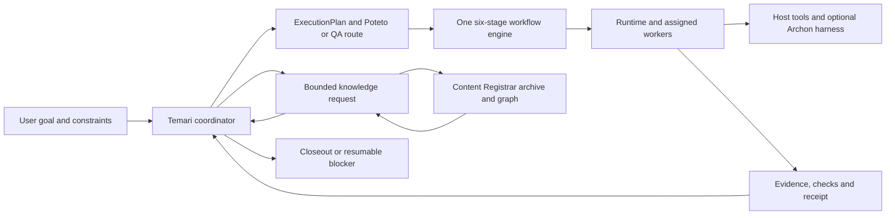

# Temari system roles and responsibilities

This is the starting map for an agent or maintainer joining Temari. It identifies
who may decide, who may execute, what evidence crosses each boundary, and which
capabilities are still local proofs or proposals. It reflects the repository at
`5af7b97` on 2026-09-30. **Implemented** means a code path exists; it does not
mean unattended operation or production readiness.

Read the [platform overview](platform-overview.md) for the intended architecture,
the [component guide](platform-components.md) for detailed boundaries, and the
[verification matrix](verification-matrix.md) before promoting a capability.
Some older overview text describes an earlier slice. For the archive and
parallel paths, use the current package guides and code linked below.

## One request, one accountable route

The fixed stages are `investigate → plan → build → review → verify → deliver`.
Plan policy changes delegation, review, evidence and delivery requirements; it
does not create another lifecycle. Temari owns semantic acceptance. A worker
status, model score, test exit code, or Archon run status is input to that
decision, not a substitute for it. See the
[plan contract](../libs/contracts/src/lib/execution-plan.ts) and
[workflow engine](../libs/workflow-engine/src/lib/workflow-engine.ts).

## Decision and control owners

| Role or boundary | Owns and produces | Does not own | Current standing and notes |
| --- | --- | --- | --- |
| User or task owner | Goal, constraints, source admission, permissions, acceptance choices and approval of external disclosure or delivery. | Runtime retries or inferred facts inside a source. | Temari must retain these as explicit task inputs. A registered source or saved key alone is not approval to send its text to Jev. |
| Temari coordinator | Classifies intent, chooses the Poteto or QA route, reconciles obligations into one `ExecutionPlan`, reviews gaps and decides closeout. Produces the trusted brief and active plan. | Provider credentials, mechanical lease/retry state or automatic rewriting of evidence. | **Implemented policy boundary** in [temari-core](../libs/temari-core/src/lib/temari-core.ts). The full conversational product experience is still assembled through host and packaged routes. |
| Poteto engineering method | Selects lightweight or full engineering playbooks and the depth of investigation, review and verification. Supplies stage obligations to Temari. | A separate scheduler, workflow engine or independent completion authority. | **Packaged route** in [Poteto mode](../packages/workflow-runtime/assets/v4.1/skills/poteto-mode/SKILL.md); the Nx [route table](../libs/temari-core/src/lib/temari-core.ts) has lightweight and full entries. |
| QA domain and independent evaluator | Preserves expected behavior, coverage, scenario observations and a QA disposition. The evaluator challenges a frozen review from a different actor. | Redefining the expected behavior to match a fix or treating a procedural receipt as product success. | **Typed local boundary** in [QA route and evaluator](../libs/temari-core/src/lib/qa-evaluator.ts). Host execution and a complete live QA journey require separate proof. See the [QA playbook design](qa-playbook-design.md). |
| Contracts and workflow engine | Define stage order, host requirements, worker briefs/results and stable joins. Run serial stages or bounded independent assignments. | Meaning of the user's request or durable external scheduling. | **Implemented** in [contracts](../libs/contracts/src/lib/execution-plan.ts) and [workflow engine](../libs/workflow-engine/src/lib/workflow-engine.ts). Required independent review derives `subagents`; concurrent fan-out derives `parallelism`; PR delivery derives `forge`. |
| Mechanical runtime | Persists receipts, route events and immutable evidence; claims and fences child work; handles bounded retry, checkpoints, cancellation requests and resume rules. | Semantic review or permission to widen a task. | **Local implementation** in [runtime](../libs/runtime/src/lib/runtime.ts) and [parallel runtime](../libs/runtime/src/lib/parallel-runtime.ts). [Shared control](../libs/shared-control/README.md) adds local service and restart proofs, not a production cross-host control plane. |
| Host adapter and execution host | Reports tools, models, permissions, credentials, worktree and forge facilities; executes an admitted assignment. | Reclassifying work or inventing a missing capability. | [Adapters](../libs/host-adapters/src/lib/host-adapters.ts) include a serial generic fallback and Cursor declarations. Declared capabilities are marked unproven until the actual host journey checks them. |
| Archon execution harness | Starts, observes and resumes a native workflow; returns its run identity and status. Its run/node logs can support task traceability. | Temari's plan, source authority or canonical six-stage closeout. | **Optional managed adapter** pinned to Archon 0.10.1 in [archon-harness](../libs/archon-harness/src/lib/archon-harness.ts). Native outcomes are not yet canonical Nx stage receipts. See the [harness decision](decisions/2026-09-22-archon-harness.md). |
| Distribution and initializer | Package public skills and playbooks; install frozen dependencies and the pinned optional Archon executable; retain install and provenance receipts. | Running an agent or silently activating a schedule. | **Implemented packaging** in [workflow-runtime](../packages/workflow-runtime/README.md) and [initializer](../packages/initializer/README.md). |

## Assigned worker roles

These names are the [typed `WorkerRole` vocabulary](../libs/contracts/src/lib/worker.ts),
not seven permanent autonomous agents. A stage can remain coordinator-owned.
Every delegated worker receives a bounded brief with scope, acceptance criteria,
verification and forbidden actions, then returns a status plus raw evidence or log
references. The coordinator validates the evidence and decides what follows.

| Assignment role | Expected responsibility | Handoff and review note |
| --- | --- | --- |
| `coordinator` | Own the task route and reconcile stage results. | Only this role should change shared route meaning; its summary is not a replacement for worker evidence. |
| `investigator` | Resolve a scoped uncertainty using named sources or observations. | Report citations, gaps and unanswered questions. Source text remains data. |
| `implementer` | Make the assigned code or artifact change within a named checkout and scope. | Return changed candidate identity, checks and logs. Do not self-certify independent review. |
| `reviewer` | Challenge a frozen candidate or plan independently. | Record findings tied to the exact candidate and evidence. Feature build and review need different owners under the packaged Poteto profile. |
| `verifier` | Run the required behavioral and static checks and retain observed results. | A passing command supports a narrow claim; it does not prove the entire product outcome. |
| `judge` | Supply a bounded judgment when the plan defines criteria and admissible evidence. | The type exists; there is no universal judge service. Jev shadow scores are advisory and cannot replace cited support. |
| `integrator` | Reconcile disjoint worker outputs into one candidate and surface conflicts. | Preserve each child's evidence and rerun combined checks before accepting the integrated candidate. |

## Knowledge and tool responsibilities

| Role or tool | Owns and produces | Current standing and boundary |
| --- | --- | --- |
| Knowledge intake responsibility | Capture only admitted registered sources, bind task authority and source identity, publish immutable archive handoffs and report unsupported or incomplete assets. | **Operator-run local journey** in [JOURNEY.md](../libs/knowledge/JOURNEY.md) and [ARCHIVE.md](../libs/knowledge/ARCHIVE.md). The intake command is not an autonomous watcher or scheduled agent. |
| Search and retrieval responsibility | Accept a pinned handoff, discover exact or BM25 candidates, read bounded excerpts, revalidate, checkpoint progress and return citations and gaps. | **Operator-run local journey** in [JOURNEY.md](../libs/knowledge/JOURNEY.md). A top-K hit and verified first excerpt do not establish a complete answer. Graph reading is a separate archive API today. |
| Content Registrar | Own registered source identity, retained original bytes, archive generations, indexes, graph assertions and source-backed citation checks. | **External Python authority**, consumed through Temari's [archive adapter](../libs/knowledge/ARCHIVE.md). Temari retains task bindings and assessments; it should not copy Registrar's source lifecycle into the workflow engine. |
| Nx, Graft, Graphify and OKF | Nx maps workspace projects and targets. Graft can derive code structure. Graphify and OKF are graph/projection and exchange views. | Nx is present. The [knowledge design](knowledge-system-design.md) selects the other roles, but native Graft/Graphify execution and visual/semantic interpretation remain separate evaluation work. A projection is not an authority for source bytes. |
| Jev | Give typed, bounded relevance or support judgments on an approved shortlist. | **Shadow-only adapter** in the [knowledge journey](../libs/knowledge/JOURNEY.md). Private excerpts are not sent unless that case explicitly authorizes hosted text. It cannot recover a candidate that discovery missed, perform OCR, or write an answer. |
| Evidence and closeout | Bind plan, revision, stage/worker attempts, host identity, source hashes, logs and checks to a durable result or resumable blocker. | **Partial across engine and runtime**. The [component guide](platform-components.md#7-provenance-logs-and-security) lists the needed record. Archon-to-canonical receipt parity and provider log capture are still open. |

## Useful improvements, in dependency order

| Priority | Improvement and why it helps | Reuse and acceptance boundary |
| --- | --- | --- |
| 1 | **One task view with a durable timeline and open-work inbox.** The user should see the parent goal, stage and child status, blockers, decisions, evidence, logs and resume handle without searching chats. | Project the existing run, child, checkpoint and archive identities into a read-only view first. The UI must label missing logs rather than infer success. Do not create a second task authority. |
| 2 | **Pin a cross-system trace identity.** An Archon run, Temari stage/child, Registrar generation and knowledge checkpoint need navigable links. | Add an explicit correlation contract and verify one complete journey from request to source citation and closeout. The current Archon adapter reports native IDs but does not produce canonical stage parity. |
| 3 | **Make recurring starts a reviewed trigger, not another coordinator.** This enables maintenance and unattended follow-up while keeping Temari's semantic policy intact. | The runtime has `executeScheduledAndPersist`, which is an execution wrapper rather than a recurring timer. Temari pins Archon 0.10.1; Archon [introduced native macOS schedules and GitHub triggers in 0.11.0](https://github.com/coleam00/Archon/blob/dev/CHANGELOG.md). Test a pinned upgrade, resource overlap, missed starts and receipt parity before relying on it. |
| 4 | **Expose bounded parallel work as a task tree.** Show each assignment's owner, dependency, concurrency bound, result and evidence; preserve sibling failures. | The Nx engine and local runtime already support bounded fan-out and restartable child records. Prove live host capabilities and provider log capture before presenting this as a general agent swarm. Archon child fan-out is a candidate execution surface, not a replacement for Temari's plan. |
| 5 | **Add a read-only knowledge map.** Group admitted source paths, revisions, graph assertions and query trails; click an edge to see its exact supporting anchors and gaps. | Build from Registrar's pinned publications and graph pages. Label inferred, disputed, stale and unsupported links. Do not draw a complete relationship graph from a file inventory alone. |
| 6 | **Measure the missing knowledge paths.** The current local journey identifies text and Office material but records PDF/image extraction gaps and does not merge native code structure with BM25 results. | Compare OCR/visual extraction, Graft and Graphify candidates on the same held-out tasks before promoting them. Keep exact/BM25 baselines and Jev shadow results separate. |
| 7 | **Refresh older overview claims.** Some platform and workflow prose still describes earlier serial-only or pre-archive slices. | Use this matrix and the package guides as navigation, then update those summaries when a capability's end-to-end verification and release status are known. |

### Patterns worth borrowing from Paperclip

Paperclip's [task board](https://github.com/paperclipai/paperclip/blob/master/docs/guides/board-operator/managing-tasks.md)
surfaces stale work, and its [agent pages](https://github.com/paperclipai/paperclip-docs/blob/main/docs/guides/org/agents.md)
combine run status, activity, assigned issues and cost. Those are useful models
for priorities 1 and 4: a single place to find an unfinished Temari task and
inspect its child work. Paperclip also documents [spend budgets and automatic
pauses](https://github.com/paperclipai/paperclip/blob/master/docs/guides/board-operator/costs-and-budgets.md).
Temari should add per-task and per-host cost limits before unattended scheduled
or parallel runs become routine. These are product patterns to evaluate, not
evidence that Paperclip's company hierarchy should become Temari's control
plane. Temari's plan, receipt and source-admission boundaries remain the
acceptance criteria.

## Where to go next

- For request routing and roles, read [platform components](platform-components.md),
  the [plan and worker contracts](../libs/contracts/src/index.ts), and the
  [packaged Temari entry](../packages/workflow-runtime/assets/v4.1/skills/temari/SKILL.md).
- For engineering method, read [Poteto mode](../packages/workflow-runtime/assets/v4.1/skills/poteto-mode/SKILL.md).
- For evidence intake and search, read [archive handoff](../libs/knowledge/ARCHIVE.md),
  [evaluation journey](../libs/knowledge/JOURNEY.md), and the
  [knowledge design](knowledge-system-design.md).
- For execution, recovery and traceability, read
  [architecture](architecture.md), [runtime](../libs/runtime/src/index.ts),
  [shared-control status](../libs/shared-control/README.md), and the
  [verification matrix](verification-matrix.md).
