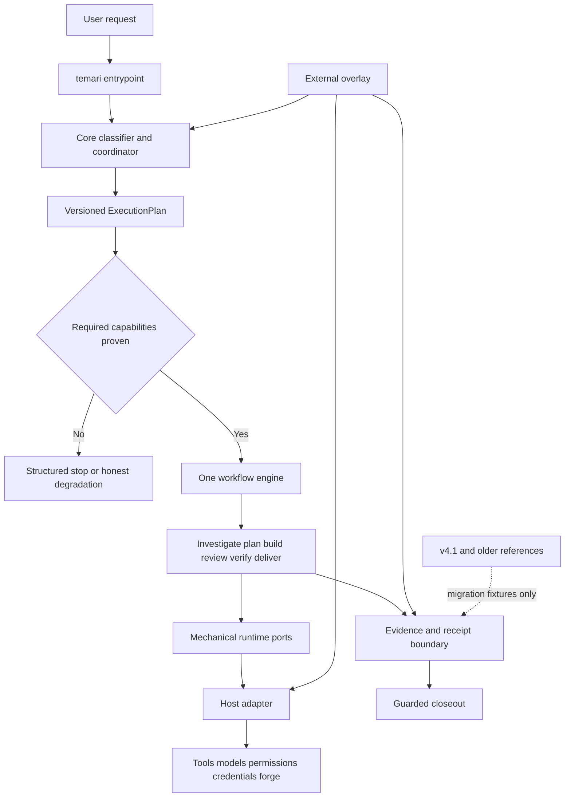
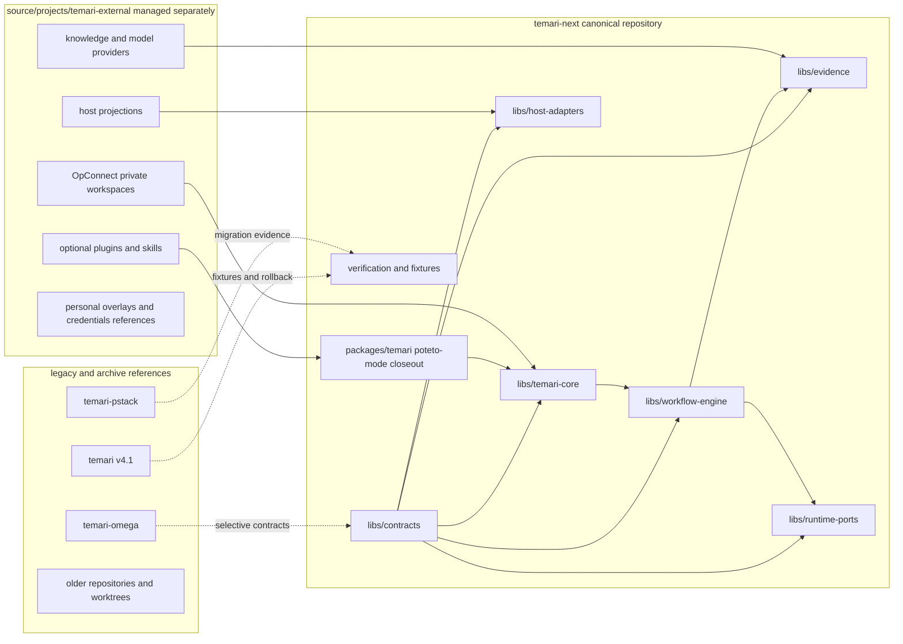
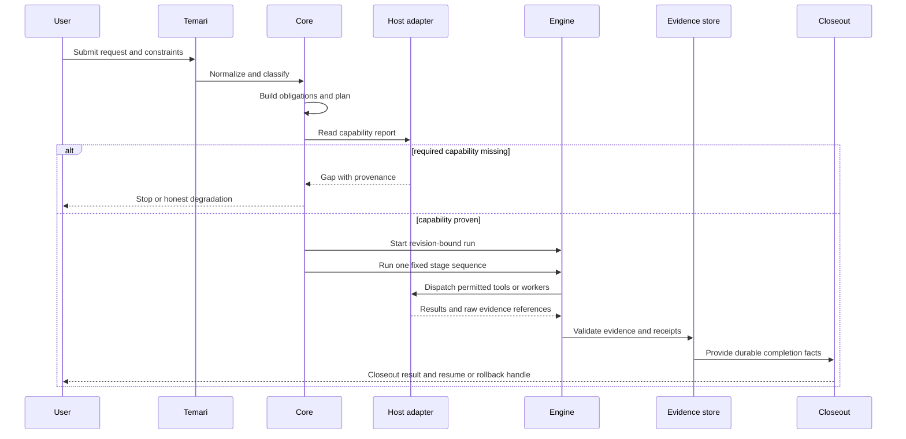

# Temari Nx cutover plan

This plan turns `temari-next` into the canonical Temari control plane.
It keeps one workflow engine, treats host capabilities as explicit, and keeps
personal, provider, and OpConnect material outside the shared repository.
It is the living roadmap for implementation, not a waterfall schedule. The
current candidate is a typed foundation with bounded local restartable worker
execution and durable local evidence. The cutover gate remains on hold until
the compatibility, packaging, shared-service, and rollback gates below have
evidence.

## How to read this

One box is one unit of work. Every box names the evidence that checks it. A nested box is a sub-step of the box above it. Check a box only when its evidence exists, a file, a log line, a screenshot, a test run, or a SHA. The body is a how-to. The appendices explain and record.

The program runs `pstack/skills/poteto-mode/playbooks/autopilot-stack.md`. The
owner starts execution only after an explicit go, and the operator reviews any
interaction-changing work before merge.

Tests alone are not sufficient verification. A PR is verified only when its unit, live, and perf boxes are all checked.

## Program checklist

### Arm the program

- [ ] State this protocol and plan to the operator, then stop. Start execution only on the operator's explicit go.
- [ ] On the operator's go, arm a `/goal` with the plan path, work package order, verification rule, merge owner, and done condition.
- [ ] Read these from trunk at program start and at every tick.
  - [ ] `git show origin/main:pstack/skills/poteto-mode/playbooks/autopilot-stack.md`
  - [ ] `git show origin/main:pstack/skills/swarm/SKILL.md`
  - [ ] `git show origin/main:pstack/skills/poteto-mode/playbooks/opening-a-pr.md`
  - [ ] `git show origin/main:pstack/skills/poteto-mode/playbooks/shipping.md`
- [ ] Arm the 30-minute audit tick with a real terminal loop or an equivalent wake chain.
- [ ] Use a status message at every tick with work package, owner, state, head SHA, evidence, open operator gates, and blockers.
- [ ] On hold or stand-down, send every owner a zero-writes order.

### Spawn owners

- [ ] Assign one owner to each work package. The packages are `WP1`, `WP2`, `WP3`, and `WP4`.
- [ ] Start `WP1` first. Start `WP2` after `WP1` merges. Start `WP2P` after `WP2` merges. Start `WP3` after `WP2P` merges. Start `WP4` after `WP3` merges.
- [ ] Keep file boundaries. Contract work stays in `libs/contracts` and migration records. Core workflow work stays in its own libraries and fixtures. Packaging work stays in public package paths and overlay documentation. Cutover work stays in verification, install, and rollback records.
- [ ] Do not delete legacy repositories, worktrees, symlinks, or external folders as part of a work package. Deletion requires a separate owner check and a durable archive record.

### PR mechanics

- [ ] Resolve the forge once and record the selected command. Use the repository's configured forge for every work package.
- [ ] Open each implementation PR ready for review with a dependency on the previous work package.
- [ ] Run the workspace typecheck and focused tests before each PR-facing push.
- [ ] Re-read the plan and run the plan checker before reporting merge readiness.
- [ ] Rebase onto current trunk before the final verdict. Record the exact head SHA and patch identity.

### Verdict and merge

- [ ] Run the swarm at each merge-ready head. Include the ten live lanes, the perf lane, and an audit lane that reads the diff and evidence.
- [ ] Accept a work package only when every lane is `PASS`. A new head requires a fresh verdict.
- [ ] The operator merges only after the review-gated screenshots, video, evidence paths, and rollback notes are available.

### Boot recipe

- [ ] Each live lane uses an isolated checkout at the PR head and a fresh fixture directory.
- [ ] Run the workspace setup, the named Nx targets, the package or host journey, and the read-only diagnostics for that lane.
- [ ] Save terminal captures or screenshots under `/tmp/swarm-<work-package>/worker-<n>/` and return the paths with the lane report.

## Establish the compatibility contract (WP1)

**Depends on.** None. This work package establishes the source-of-truth map before new runtime code is imported.

**Files.**

- [x] Create `docs/migrations/v4.1-to-nx-matrix.md`.
- [ ] Extend `libs/contracts` with versioned request, route, capability, evidence, receipt, and overlay contracts only after the matrix names their consumers.
- [x] Add the first versioned v4.1 profile and route parser under `libs/contracts`, with sanitized fixtures and no implicit `ExecutionPlan` conversion.
- [ ] Add sanitized v4.1 fixtures under `fixtures/v4.1/` or the accepted equivalent.

**Build.**

- [x] Map each carried behavior to source revision, target package, external boundary, omitted behavior, verification, and rollback in `docs/migrations/v4.1-to-nx-matrix.md`.
- [x] Define the compatibility boundary between the verified v4.1 feature profile and Nx `ExecutionPlan` version 1. Preserve source stages, verify canonical playbook text, and block unresolved publish gates.
- [x] Define the route-event replay boundary. Match route and profile versions and profile identity, preserve source assignments and invalidation IDs, and fail closed on ambiguous history.
- [x] Project an accepted route event into the durable runtime event log with idempotent replay and no legacy-checkout read.
- [x] Make the workflow stage sequence canonical instead of caller-controlled. The engine rejects reordered, partial, or empty stage lists; plan-draft is migrated to the canonical order and the knowledge demo uses its explicit investigation operation. Preserve explicit optional, required, and blocked capability outcomes.
- [ ] Apply capability provenance to the strict workflow execution gate after a host journey supplies proof.
- [x] Add capability provenance to host reports and a strict migration helper; keep legacy execution gates unchanged until live proof exists.

**You see.**

- [ ] A reviewer can trace every proposed core feature to a source record and a target consumer.
- [ ] A malformed or stale v4.1 record is rejected or marked unsupported without being treated as a passing Nx record.
- [ ] The matrix identifies the current Cursor capability report as unproven until a host journey validates it.

**Verify, unit.** Tests alone are not sufficient verification. A PR is verified only when its unit, live, and perf boxes are all checked.

- [ ] Add contract tests for version dispatch, fixed stages, capability provenance, missing capability outcomes, and credential-reference redaction. Run `pnpm exec nx run-many -t typecheck test --parallel=1`.

**Verify, live.** Tests alone are not sufficient verification. A PR is verified only when its unit, live, and perf boxes are all checked. Ten lanes on `grok-4.6-fast-xhigh` at the PR head, per the boot recipe.

- [ ] Lane 1. Regression lane against trunk. Run the contract fixture audit at trunk and head. Save `wp1-regression.png`. Pass when the head adds only the declared versioned boundary.
- [ ] Lane 2. Parse a valid v4.1 profile fixture. Save `wp1-profile-valid.png`. Pass when the record is accepted with its source revision.
- [ ] Lane 3. Parse a stale profile fixture. Save `wp1-profile-stale.png`. Pass when the record is rejected or marked unsupported.
- [ ] Lane 4. Parse a valid route event fixture. Save `wp1-route-valid.png`. Pass when the event preserves its version and parent linkage.
- [ ] Lane 5. Parse a malformed route event. Save `wp1-route-invalid.png`. Pass when the parser fails closed.
- [ ] Lane 6. Evaluate a declared but unproven capability. Save `wp1-capability-provenance.png`. Pass when strict work does not treat it as available.
- [ ] Lane 7. Evaluate a serial generic capability report. Save `wp1-serial-fallback.png`. Pass when serial work remains executable.
- [ ] Lane 8. Inspect a credential reference. Save `wp1-credential-reference.png`. Pass when the secret value is absent.
- [ ] Lane 9. Compare the source and target matrix. Save `wp1-migration-matrix.png`. Pass when every accepted row has a target and a gate.
- [ ] Lane 10. Replay a fixture from a clean checkout. Save `wp1-clean-replay.png`. Pass when no legacy checkout is required.

**Verify, perf.** Tests alone are not sufficient verification. A PR is verified only when its unit, live, and perf boxes are all checked.

- [ ] Metric. Measure fixture parse time and matrix audit time at trunk and head.
- [ ] Probe. Run the same sanitized fixture set interleaved at trunk and head.
- [ ] Baseline. Record the trunk values first.
- [ ] Rule. Fail on any parser regression above 20 percent or any clean replay that reads a legacy path.

**Review gate.** The operator reviews before merge.

- [ ] Copy the regression, capability, and clean replay screenshots into `docs/reviews/wp1/`.
- [ ] Record a 30 to 60 second video of the matrix audit and one rejected stale fixture. Save it as `docs/reviews/wp1/review.mp4`.
- [ ] Post the screenshots and video in chat. Stop at merge-ready and wait for the operator's review.

**Merge.**

- [ ] Root records a clean verdict at the exact head SHA.
- [ ] Every compatibility row has an owner, evidence path, and rollback note.
- [ ] The owner merges `WP1` after the operator review.

## Build the first vertical workflow slice (WP2)

**Depends on.** `WP1`. This work package proves one request from the public entry through routing, planning, execution, evidence, and closeout.

**Files.**

- [ ] Create the accepted `libs/temari-core` or equivalent classifier and coordinator library.
- [ ] Extend `libs/workflow-engine` and create the smallest evidence and receipt library needed by the journey.
- [ ] Add sanitized routing, capability, evidence, and closeout fixtures.

**Build.**

- [x] Implement one explicit route table with a `qa-review` domain entry and existing playbook entries. `libs/temari-core` keeps a closed table for the existing lightweight/full playbook routes and the package-relative QA owner; structured QA responsibility takes domain precedence, while exclusions and bounded callbacks remain on the playbook path.
- [x] Add a typed Poteto route boundary that requires every lightweight condition and leaves full-playbook selection explicit.
- [ ] Convert a request into one `ExecutionPlan` and run the fixed six-stage lifecycle. The pure coordinator now returns the route, obligations, and canonical plan; invoking that plan through the existing engine remains open.
- [ ] Preserve worker brief and worker result boundaries. A worker summary never becomes the only proof.
- [ ] Record revision-bound evidence, blocked outcomes, and a guarded closeout result without adding a second workflow engine.

**You see.**

- [ ] A serial engineering request completes with a structured plan, ordered stages, evidence references, and closeout.
- [ ] A required missing capability stops before execution with an actionable gap.
- [ ] A QA-shaped request uses the domain route and returns `Passed`, `Failed`, or `BlockedOrIncomplete` without rematching as a generic playbook.

**Verify, unit.** Tests alone are not sufficient verification. A PR is verified only when its unit, live, and perf boxes are all checked.

- [ ] Add tests for routing, fixed stage order, missing capability stop, optional degradation, malformed worker results, evidence revision binding, and closeout derivation. Run `pnpm exec nx run-many -t typecheck test --parallel=1`.

**Verify, live.** Tests alone are not sufficient verification. A PR is verified only when its unit, live, and perf boxes are all checked. Ten lanes on `grok-4.6-fast-xhigh` at the PR head, per the boot recipe.

- [ ] Lane 1. Regression lane against trunk. Run the serial request at trunk and head. Save `wp2-regression.png`. Pass when head proves the new end state and trunk limitations are recorded.
- [ ] Lane 2. Run a serial bug request. Save `wp2-serial.png`. Pass when all six stages are ordered and the result is closeout-ready.
- [ ] Lane 3. Run a feature request with optional delegation. Save `wp2-optional-delegation.png`. Pass when the host can degrade honestly.
- [ ] Lane 4. Run a feature request with required delegation on a generic host. Save `wp2-required-delegation.png`. Pass when execution stops before pretending to delegate.
- [ ] Lane 5. Run a QA review that passes. Save `wp2-qa-pass.png`. Pass when the domain route and product disposition are distinct.
- [ ] Lane 6. Run a QA review with an unmapped outcome. Save `wp2-qa-revise.png`. Pass when the evaluator reaches `REVISE`.
- [ ] Lane 7. Run a QA review without fresh-context evaluation. Save `wp2-qa-blocked.png`. Pass when the result is `BlockedOrIncomplete`.
- [ ] Lane 8. Tamper with evidence after completion. Save `wp2-tamper.png`. Pass when closeout refuses the stale or altered record.
- [ ] Lane 9. Resume a blocked run. Save `wp2-resume.png`. Pass when acknowledged work is not repeated.
- [ ] Lane 10. Replay the full journey from a clean fixture. Save `wp2-replay.png`. Pass when no v4.1 runtime path is read.

**Verify, perf.** Tests alone are not sufficient verification. A PR is verified only when its unit, live, and perf boxes are all checked.

- [ ] Metric. Measure local plan creation, stage execution, evidence validation, and closeout time.
- [ ] Probe. Run the same serial and blocked journeys interleaved at trunk and head.
- [ ] Baseline. Record trunk timing for the comparable serial path first.
- [ ] Rule. Fail if deterministic operations exceed the agreed local budget or if a blocked path waits for an unavailable capability.

**Review gate.** The operator reviews before merge.

- [ ] Copy the serial, QA, blocked, and tamper screenshots into `docs/reviews/wp2/`.
- [ ] Record a 30 to 60 second video showing a serial completion, a precise block, and a rejected tampered receipt. Save it as `docs/reviews/wp2/review.mp4`.
- [ ] Post the screenshots and video in chat. Stop at merge-ready and wait for the operator's review.

**Merge.**

- [ ] Root records a clean verdict at the exact head SHA.
- [ ] The journey report distinguishes procedural workflow proof from product correctness.
- [ ] The owner merges `WP2` after the operator review.

## Add bounded parallel worker execution (WP2P)

**Depends on.** `WP2`. This work package made parallelism executable without
allowing workers to mutate shared semantic state. The local durable slice is
implemented; shared-service recovery remains a later gate.

**Current evidence.** The contracts already define worker briefs and typed
worker results, and host capability reports already distinguish
`parallelism`. The workflow engine provides `runParallelWorkers`: it validates
assignments, refuses a missing capability before starting work, limits fan-out
to the declared maximum, continues collecting sibling results, and joins them
in declaration order. `FileChildTaskStore` and the restartable executor now
provide a local durable slice for parent-bound child records, dependency-aware
claims, leases, fencing epochs, result persistence, idempotent completion,
ready-frontier reconstruction, bounded mechanical retry, cancellation gating,
crash-boundary reconciliation, and restartable replay. Workspace manifests,
provider-neutral evidence publication and replay verification, and durable
execution-concurrency evidence are also implemented when callers provide
explicit local bindings. This remains a local proof; shared control/artifact
storage, provider-specific capture, and cross-machine recovery are not
claimed.

**Files.**

- [x] Extend `PlanObligations` and `ExecutionPlan` with an explicit bounded
      `parallelism.maxConcurrency` policy.
- [x] Add a typed `WorkerAssignment` boundary.
- [x] Add bounded fan-out and stable join behavior to `libs/workflow-engine`.
- [x] Add capability-gap, concurrency-bound, ordering, and failure-join tests.
- [x] Add local durable child-task records, ownership, leases, fencing epochs,
      dependency-aware claims, result persistence, and idempotent completion.
- [x] Integrate child-task persistence with the executor and add explicit
      retry, cancellation, crash-reconciliation, and local restart recovery.

**Build next.**

- [x] Give each child task a stable ID, parent run ID, revision, dependency
      set, attempt, owner, lease, status, fencing epoch, and idempotent
      completion key.
- [x] Persist child results and evidence manifests separately from coordinator
      state; only the coordinator may publish the joined semantic result.
- [ ] Define join policy for `PASS`, `ISSUES`, `BLOCKED`, and `DROPPED`, plus
      required-task failure and optional-task degradation.
- [x] Add fencing epochs so an expired worker cannot publish after takeover.
- [x] Prove interruption, retry, duplicate delivery, and partial completion in
      the local runtime; shared-store manual takeover remains open.

**You see.**

- [x] Two independent assignments overlap when the host proves parallelism.
- [x] A serial host blocks required parallel work before any child starts.
- [x] A failed child does not erase sibling evidence or cause duplicate work on
      replay.
- [x] A local coordinator restart can reconstruct the child frontier and join
      state; cross-machine takeover remains open.

**Verify.**

- [x] Unit tests cover fan-out bounds, stable joins, malformed results, worker
      errors, capability gaps, replay, child-task fencing, retry, cancellation,
      manifests, evidence replay, and durable concurrency evidence.
- [ ] Live proof runs two independent tasks with separate workspaces and
      retained evidence, then interrupts and resumes one child.
- [ ] Perf proof records peak concurrency and confirms no shared-state race or
      unbounded process creation.

**Ordering.** `WP2P` precedes `WP3` because public packaging must expose the
same bounded execution contract that the cutover journey verifies. Durable
parallel execution precedes automatic failover; automatic failover remains
out of scope until fencing, idempotency, and reconciliation are proven.

## Package public surfaces and external overlays (WP3)

**Depends on.** `WP2P`. This work package exposes the public entries and makes the external folder boundary usable without importing private material.

**Files.**

- [ ] Create the public package surfaces for `temari`, `poteto-mode`, and `closeout`.
- [ ] Add host-neutral package metadata and install checks under the Nx workspace.
- [ ] Document the managed external root as `/Users/randydinh/source/projects/temari-external/` or record a reviewed replacement before implementation.

**Build.**

- [ ] Keep public packages thin. They call core contracts and the one engine rather than defining a second lifecycle.
- [ ] Add a static, reviewed overlay manifest contract for optional plugins, host projections, and provider adapters.
- [ ] Require overlay version, digest, compatibility range, capability requirements, and credential references. An overlay cannot grant authority or add engine stages.
- [ ] Keep OpConnect, personal skills, Graphify, Registrar, Archon, provider SDKs, and customer data outside the shared package by default.

**You see.**

- [ ] An isolated install exposes the three public entries without reading v1 through v4.1 checkouts.
- [ ] A missing optional overlay is reported as unavailable and does not change the core package behavior.
- [ ] A private overlay can provide context references without placing secrets or private records in the Nx repository.

**Verify, unit.** Tests alone are not sufficient verification. A PR is verified only when its unit, live, and perf boxes are all checked.

- [ ] Add package manifest, overlay schema, dependency-boundary, and hermetic path-audit tests. Run the repository package checks and `pnpm exec nx run-many -t typecheck test --parallel=1`.

**Verify, live.** Tests alone are not sufficient verification. A PR is verified only when its unit, live, and perf boxes are all checked. Ten lanes on `grok-4.6-fast-xhigh` at the PR head, per the boot recipe.

- [ ] Lane 1. Regression lane against trunk. Install the public surface at trunk and head. Save `wp3-regression.png`. Pass when the head package is isolated and the trunk limitation is recorded.
- [ ] Lane 2. Install `temari` into a fresh host root. Save `wp3-temari-install.png`. Pass when metadata and entry files validate.
- [ ] Lane 3. Install `poteto-mode` into a fresh host root. Save `wp3-poteto-install.png`. Pass when the planning entry loads.
- [ ] Lane 4. Install `closeout` into a fresh host root. Save `wp3-closeout-install.png`. Pass when guarded closeout loads.
- [ ] Lane 5. Load a valid optional overlay. Save `wp3-overlay-valid.png`. Pass when its digest and compatibility range validate.
- [ ] Lane 6. Load an incompatible overlay. Save `wp3-overlay-invalid.png`. Pass when installation refuses it.
- [ ] Lane 7. Run with no optional overlay. Save `wp3-overlay-absent.png`. Pass when the core remains usable.
- [ ] Lane 8. Run the path audit with v4.1 unreadable. Save `wp3-hermetic.png`. Pass when imports, links, discovery, and fallbacks are absent.
- [ ] Lane 9. Inspect a private credential reference. Save `wp3-private-reference.png`. Pass when the value and customer data stay outside the package.
- [ ] Lane 10. Run a clean host entry journey. Save `wp3-host-journey.png`. Pass when the public entry reaches the WP2 workflow.

**Verify, perf.** Tests alone are not sufficient verification. A PR is verified only when its unit, live, and perf boxes are all checked.

- [ ] Metric. Measure isolated install time, package size, and public entry startup time.
- [ ] Probe. Run fresh installs and public entry startups interleaved at trunk and head.
- [ ] Baseline. Record trunk package and startup values first.
- [ ] Rule. Fail on an unexplained dependency on a legacy checkout or an agreed package size and startup regression.

**Review gate.** The operator reviews before merge.

- [ ] Copy the install, overlay rejection, and hermetic screenshots into `docs/reviews/wp3/`.
- [ ] Record a 30 to 60 second video showing an isolated install, an optional overlay rejection, and the public entry journey. Save it as `docs/reviews/wp3/review.mp4`.
- [ ] Post the screenshots and video in chat. Stop at merge-ready and wait for the operator's review.

**Merge.**

- [ ] Root records a clean verdict at the exact head SHA.
- [ ] The external root and ownership policy are written before any private migration begins.
- [ ] The owner merges `WP3` after the operator review.

## Prove cutover and rollback (WP4)

**Depends on.** `WP3`. This work package is the release gate. It does not delete v4.1 or historical folders.

**Files.**

- [ ] Create the cutover matrix and retained evidence under `docs/migrations/` and `verification/`.
- [ ] Add isolated install, clean host journey, compatibility, and rollback fixtures.
- [ ] Add a disposition record for every source folder that remains, moves to the external root, archives, or needs owner confirmation.

**Build.**

- [ ] Run one conversational-to-engineering journey for every declared host, including serial fallback.
- [ ] Prove v4.1 coexistence, explicit rollback, retained-record readability or a migration boundary, and an observation period.
- [ ] Keep Nx Cloud disabled until local affected execution demonstrates a CI benefit. Never cache live host journeys.
- [ ] Archive only after the cutover gates pass and the owner confirms each target. The likely cleanup candidates are the empty `second-brain` repo, the placeholder `temari-adapter-e2e`, duplicate registrar worktrees, duplicate sports symlink, and the transfer worktree after unique handoff records are preserved.

**You see.**

- [ ] The successor package installs hermetically and completes a real journey.
- [ ] A missing capability produces an honest stop or documented degradation.
- [ ] Rollback restores the known-good v4.1 installation without sharing mutable state or credentials.
- [ ] The cleanup report names what was retained, externalized, archived, or left open and includes owner evidence for any destructive action.

**Verify, unit.** Tests alone are not sufficient verification. A PR is verified only when its unit, live, and perf boxes are all checked.

- [ ] Add cutover checklist, rollback, retained-record, package audit, and folder-disposition tests. Run the complete Nx and package verification commands.

**Verify, live.** Tests alone are not sufficient verification. A PR is verified only when its unit, live, and perf boxes are all checked. Ten lanes on `grok-4.6-fast-xhigh` at the PR head, per the boot recipe.

- [ ] Lane 1. Regression lane against trunk. Run the leading installed journey at trunk and head. Save `wp4-regression.png`. Pass when the head result and trunk limitation are explicit.
- [ ] Lane 2. Run a serial host journey. Save `wp4-serial-host.png`. Pass when the final result and receipt are durable.
- [ ] Lane 3. Run the primary host journey. Save `wp4-primary-host.png`. Pass when the public entry reaches the expected workflow.
- [ ] Lane 4. Run a second declared host journey. Save `wp4-second-host.png`. Pass when its adapter reports only proven capabilities.
- [ ] Lane 5. Run the missing-capability journey. Save `wp4-capability-gap.png`. Pass when the system stops or degrades according to the plan.
- [ ] Lane 6. Run the retained-record replay. Save `wp4-retained-record.png`. Pass when the record is readable or the incompatibility boundary is explicit.
- [ ] Lane 7. Run the rollback installation. Save `wp4-rollback.png`. Pass when the known-good v4.1 installation returns.
- [ ] Lane 8. Run the observation-period incident check. Save `wp4-observation.png`. Pass when the incident criteria are actionable.
- [ ] Lane 9. Run the source-folder disposition audit. Save `wp4-folder-disposition.png`. Pass when no folder is deleted without ownership evidence.
- [ ] Lane 10. Run the final hermetic audit after rollback. Save `wp4-final-hermetic.png`. Pass when the successor and rollback states remain isolated.

**Verify, perf.** Tests alone are not sufficient verification. A PR is verified only when its unit, live, and perf boxes are all checked.

- [ ] Metric. Measure clean install, end-to-end journey, deterministic audit, and rollback times.
- [ ] Probe. Run the same bounded scenarios interleaved at trunk and head and retain raw timing records.
- [ ] Baseline. Record the known-good v4.1 install and journey values first.
- [ ] Rule. Fail on missing final user-visible results, rollback failure, or any timing over the approved absolute budgets.

**Review gate.** The operator reviews before merge.

- [ ] Copy the primary journey, rollback, and folder-disposition screenshots into `docs/reviews/wp4/`.
- [ ] Record a 30 to 60 second video showing installation, one journey, the capability block, and rollback. Save it as `docs/reviews/wp4/review.mp4`.
- [ ] Post the screenshots and video in chat. Stop at merge-ready and wait for the operator's review.

**Merge.**

- [ ] Root records a clean verdict at the exact head SHA.
- [ ] The owner confirms the observation period and rollback-class incident criteria.
- [ ] The operator authorizes the cutover separately from any archive or deletion action.

## Close the program

- [ ] Every box above is checked with its evidence.
- [ ] The final report includes package identity, host journeys, capability gaps, compatibility result, rollback result, and unresolved risks.
- [ ] The owner decides whether v4.1 remains the rollback installation or whether a later cutover task may retire it.

## Appendix A. Prototype evidence

The current candidate was inspected at commit `057e65e`. Its resolved Nx
projects include `contracts`, `workflow-engine`, `host-adapters`, `runtime`,
`temari-core`, `plan-draft`, `knowledge`, `archon-harness`, `initializer`, and
`workflow-runtime`. Repository checks prove only repository behavior. They do
not prove a clean host journey, shared-service recovery, or final cutover.

The previous local `.audit/` and `graphify-out/` directories are ignored local
artifacts. They are not migration inputs or runtime dependencies.

The architecture comparison tested two candidates. Candidate A keeps the Nx repository as a core-first control plane and manages hosts, providers, plugins, and OpConnect as external overlays. Candidate B promotes runtime, QA, host implementations, and providers to first-class Nx projects. Candidate A is selected for the first increments. Candidate B remains a gated expansion after an unattended journey and a second real consumer earn the shared runtime cost.

Unproven items remain the public package install, host journeys, the remaining v4.1 lightweight and route-replay mappings, durable runtime semantics, rollback, and external folder management.

## Appendix B. Architecture and folder structure

The target system architecture is:

The proposed managed folder split is:

The main user flow is:

## Appendix C. Incomplete behavior, folder dispositions, and unknowns

### v4.1 and P-stack gaps

The current records distinguish incomplete behavior from behavior that exists only in a bounded or source-specific path.

| Area                                | Current state                                                                                                            | Nx expectation                                                        |
| ----------------------------------- | ------------------------------------------------------------------------------------------------------------------------ | --------------------------------------------------------------------- |
| Conversation classification         | Evidenced in v4.1 workflows, absent in the current Nx libraries                                                          | Add `temari-core` with compatibility fixtures                         |
| Versioned routes and profile events | Evidenced in v4.1, no Nx compatibility reader                                                                            | Map explicitly or record an incompatibility boundary                  |
| Evidence, gates, and receipts       | Rich v4.1 behavior, current Nx worker results are only paths and status                                                  | Add revision, producer, requirement, and freshness references         |
| Durable runtime                     | Resume, leases, retries, remote cancellation, and post-host execution remain incomplete or bounded in older lineages     | Defer until an unattended journey requires them, then add ports first |
| Host control                        | Live worker control, host closure, evaluator identity, and cancellation remain bounded                                   | Prove each host adapter instead of copying capability claims          |
| Public packaging                    | v4.1 has public entries, current Nx has private libraries only                                                           | Add isolated install and drift checks                                 |
| QA domain route                     | v4.1 QA contract is documented and tested in its own route, Nx has no QA route                                           | Add one reviewed domain route over the same engine                    |
| Provider and knowledge features     | Registrar, Graphify, Archon, dashboards, model switching, and calibration are optional or incomplete                     | Keep external until a contract and journey justify promotion          |
| Cutover                             | Package installation, clean host journeys, compatibility mapping, stable CI evidence, and rollback are unexecuted for Nx | Treat all as release gates                                            |
| Open reference tasks                | Chase sandbox payment fixture, API-suite publication, and duplicate-settings coverage have unresolved follow-ups         | Keep them as reference and closeout records, not as Nx dependencies   |

### Source folder disposition

The complete assessment is recorded in [the project boundary audit](../.audit/project-boundary-assessment-2026-09-19.tsv).

| Disposition           | Examples                                                                                                                                             | Plan                                                                                       |
| --------------------- | ---------------------------------------------------------------------------------------------------------------------------------------------------- | ------------------------------------------------------------------------------------------ |
| Canonical Nx          | `temari-next`                                                                                                                                        | Add only verified contracts, core behavior, engine behavior, fixtures, and package sources |
| External managed      | `plugins`, `knowledge-agent`, `content-registrar*`, `information-knowledge-extractor`, `agent-privacy`, `codex`, `product-foundry`, `sports-analyst` | Keep separate and connect through reviewed manifests or adapter ports                      |
| OpConnect external    | `core-api-suite*`, `qa-review-*`, `qa-skills-library`, `AgentIndex`, and OpConnect application trees                                                 | Keep in the owning work account and never import customer data or credentials              |
| Historical reference  | v1 through v4, `temari-design`, and transfer snapshots                                                                                               | Extract evidence selectively and preserve source provenance                                |
| Archive candidate     | `second-brain`, `temari-adapter-e2e`, duplicate registrar worktrees, duplicate sports symlink, transfer worktree                                     | Confirm ownership, preserve unique records, then handle in a separate cleanup task         |
| Cache or archive data | `.pnpm-store`, `.content-registrar-sources`, unrelated guides                                                                                        | Keep outside product scope and manage independently                                        |

### Ambiguities with redesign impact

- The compatibility meaning of version 1 is not the same in the Nx plan and the v4.1 profile and event schemas.
- Required delegation may stop or degrade depending on the obligation. The plan must choose one rule and encode it in tests.
- The current `cursorAdapter` declares broad capabilities without a live proof source.
- Runtime ownership is open. Persistence, dispatch, leases, retries, idempotency, and closeout may need a shared store earlier than current code assumes.
- Archon could be a host capability, a dispatcher implementation, or a separate executor. The selected owner must be one layer.
- The QA route needs a stable domain owner, route event shape, evaluator boundary, and mutation receipt policy.
- Host instruction loading could use pointers, generated projections, or copied files. Install and drift checks depend on this choice.
- The external root path, package versioning, overlay trust, and rollback behavior are not yet implemented.
- Graphify, Graft, Registrar, provider SDKs, and personal skill repositories have no measured first-slice need in the current Nx workspace.
- The public surface may be one package with subcommands or three independently installed entries. The cutover gate assumes the existing three names remain visible.

## Appendix D. Alternatives and reading list

Candidate A wins the first stage because it matches the accepted decisions, minimizes irreversible dependency expansion, and allows the current serial path to become useful before runtime semantics are settled.

Candidate B remains valid when two independent consumers need the same durable runtime, three or more hosts or providers must evolve together, or an unattended journey proves persistence, retries, and receipts are product requirements. At that point the runtime, evidence, QA, and provider packages can be promoted into Nx with module-boundary tags.

Wholesale migration of the v1 through v4 repositories is rejected. It would import conflicting authorities, private state, unverified behavior, and duplicate lifecycle implementations.

Read before implementation:

- [Nx architecture](architecture.md)
- [Repository lineage](lineage.md)
- [Overlay boundary](overlays.md)
- [Workflow](workflow.md)
- [v4.1 cutover handover](../../temari/docs/cutover-handover/README.md)
- [v4.1 legacy implementation record](../../temari/docs/legacy-implementations.md)
- [v4.1 QA migration plan](../../temari/docs/qa-workflow-migration.md)
- [Linked behavior coverage task](codex://threads/01a0bb30-0f2b-7530-8230-c588cb9bffee)
- [Linked design follow-up](codex://threads/01a0b54a-01f2-7a72-9db3-ad43df15c402)
- [Linked Nx cutover follow-up](codex://threads/01a0bc1d-c68e-7993-8e62-e9aa5f95d5e2)
