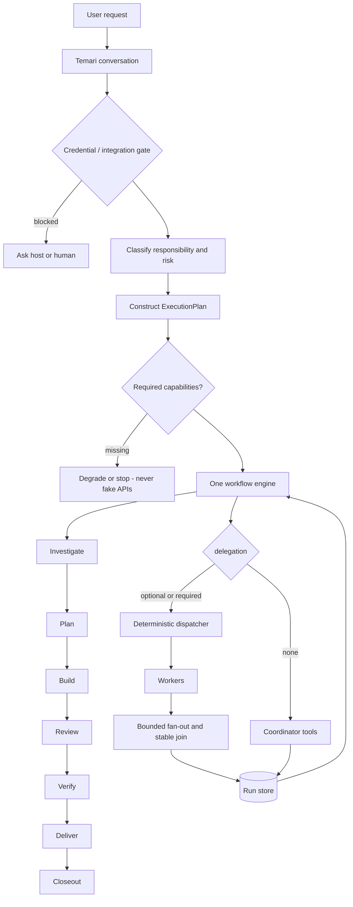

# Workflow

The current vertical slice makes the plan boundary executable: semantic
obligations are reconciled into one `ExecutionPlan`, then the engine runs the
declared stages serially by default or performs bounded fan-out for explicitly
independent worker assignments. It stops before execution when required
capabilities are missing. A generic host is therefore a valid serial fallback,
not a pretend subagent provider. The current fan-out is in-memory; durable
child-task recovery and automatic failover remain roadmap work.

Temari owns the semantic decision to classify a request and dispatch a skill.
The host adapter only translates that typed intent into host-native tools.
Before verification begins, the coordinator may apply the provider-neutral
daily maintenance guard; a scheduler and a host adapter may persist or
execute the resulting intent, but neither decides whether it is due.
