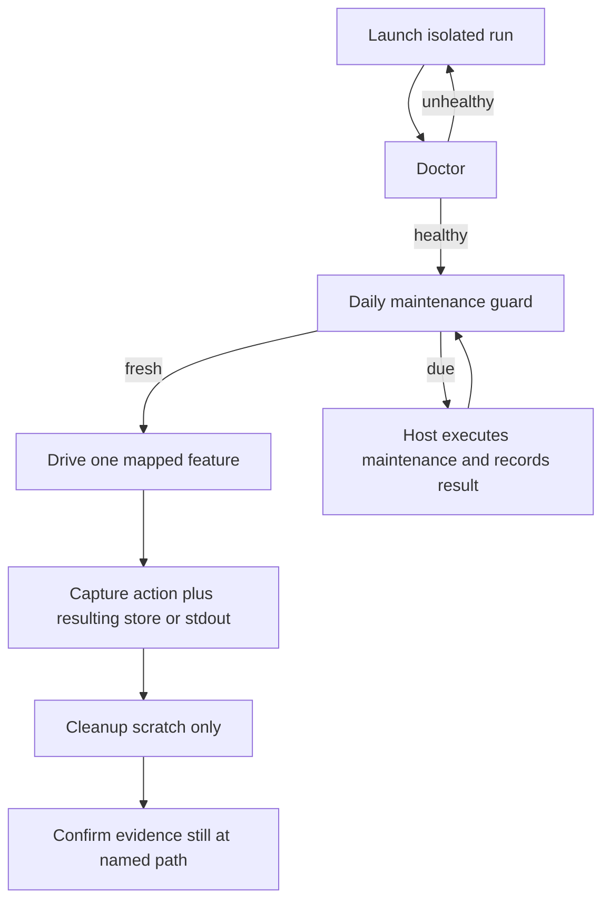

# Verify Temari

Temari is a plugin package with a repository manifest and command-line workflows. A user installs the package through the host's normal skill or plugin mechanism. The driveable artifacts in this checkout are the package catalog and the bundled CLIs:

- `bun skills/poteto-mode/scripts/orch/orch.ts` for orchestrate bookkeeping.
- `skills/poteto-mode/scripts/watch-pr/watch-pr` for the GitHub watcher.
- `skills/show-me-your-work/scripts/log.sh` for decision-log rows.

Host-native slash-command routing is out of band for this harness. Whether a session actually handed an engineering request to poteto-mode shows up in that transcript, not here. Prove the files and CLIs those commands use. `control-temari routing` covers the delegation text and installed host skill root. Historical repository routing evaluations and adapter evidence are not shipped in this distribution. Run fresh isolated copy-install and plugin checks. Do not treat a host API or `bun test` as a substitute for a mapped user path.

Read `features/README.md` before driving. Drive from the matching feature file.



## Launch

There is no long-lived app process. Launch means: a resolved bun, CLI deps installed from `skills/poteto-mode/scripts/bun.lock`, one isolated orch store under `/tmp/temari-verify/<run-id>/store`.

From the Temari package root (the repository checkout or an installed bundle):

```bash
verification/verify-temari/scripts/control-temari launch --run-id <run-id>
```

If Bun is missing, the helper installs it under `TEMARI_BUN_ROOT` or the writable temporary default `${TMPDIR}/temari-bun`, then prepends its `bin` directory. It does not require writing to the user's home directory. That bun is on the helper's `PATH`, not yours, so reach it with `control-temari bun -- <args>` instead of a bare `bun`. `launch` and `doctor` print the resolved binary as `bun_bin=`, and `run.env` records it as `BUN_BIN`. Deps install through orch's own bootstrap (`ensureDependenciesInstalled` in `skills/poteto-mode/scripts/bootstrap.ts`) the first time `orch --help` runs.

Ready when stdout includes `ready: run control-temari doctor next` and a `store=` path under `/tmp/temari-verify/`. Launch does **not** run `orch init`. That is a user action in the orch feature.

Teardown is `control-temari cleanup` (see Cleanup). Launch records no daemon PID.

## Doctor

Run this first, and again after any failed drive:

```bash
verification/verify-temari/scripts/control-temari doctor
```

Worth driving only when the last line is `healthy=yes`. Doctor does not execute maintenance or update its receipt. It can bootstrap Bun and CLI dependencies when missing. It confirms:

- the resolved package manifest has `name=temari`, `skills=./skills/`, and, when declared by the host manifest, `agents=./agents/`
- `skills/poteto-mode/SKILL.md`, `skills/setup-pstack/SKILL.md`, `agents/poteto-agent.md`, `agents/comment-sicko.md` exist. Other `agents/*.md` files (currently `dr-eggbot`) are listed by `plugin-catalog`, not this required-file check.
- `verification/verify-temari/scripts/journey-evidence.py` exists (`check_journey_evidence`)
- `bun orch/orch.ts --help` contains `Plain-file orchestrate bookkeeping`
- `bun watch-pr/watch-pr --help` contains `Watch one pull request`
- if a run is active, `store` is under `/tmp/temari-verify/` (or `TEMARI_VERIFY_ROOT`) and, once initialized, `units.tsv` starts with `id	track	state	branch	pr	sha	brief`

Refuse to drive an orch store outside that scratch root. A shared coordinator store in an agent transcript directory is not a verification instance.

## Drive

Use `control-temari drive -- <command...>` for ordinary verification. Set the owning repository explicitly before the first drive:

```bash
export TEMARI_MAINTENANCE_REPO=/absolute/path/to/owning/repository
verification/verify-temari/scripts/control-temari maintenance-status
```

The helper validates that this is a Git repository root. An installed package's cache and `TEMARI_VERIFY_ROOT` do not select maintenance state. You can instead pass `--repo <root>` to `maintenance-status`, `maintenance-record`, or `drive` before its `--` separator.

Temari checks this path under the owning repository on every guarded entry:

```text
.temari/runs/verification-maintenance/last-success.json
```

A successful receipt is fresh for less than 24 hours. Exactly 24 hours is due, clarifying D-2026-09-19-01's boundary to match the existing pure policy. Missing, malformed, unknown, future, blocked, or evidence-invalid receipts stay due. Status only reports a decision and writes nothing.

When due, `drive` exits 3 before invoking the requested command and selects `maintain-verification-skill`. This is an obligation for the current host coordinator. The CLI does not load or execute the skill. The coordinator reads its host mapping and [`maintain-verification-skill`](../../skills/maintain-verification-skill/SKILL.md), performs the required source wave and live pass, and retains its run notes and evidence. During that pass, use the raw helper subcommands so maintenance does not recursively enter its own guard. If any required coverage cannot finish, report blocked and leave success unchanged.

After an actual completed pass, the coordinator records its observed result:

```bash
verification/verify-temari/scripts/control-temari maintenance-record \
  --run-id <completed-run-id> --outcome clean \
  --completed-at <actual-completion-UTC> --evidence <retained-run-notes> \
  --attest-completed
```

Use `changed` only when that skill's corrections and shipping requirements completed. `blocked` and `failed` outcomes never create or refresh success. Clean/changed require a nonempty UTF-8 evidence file and an explicit completion attestation. The stored reference and SHA-256 detect missing or changed evidence; they do not authenticate the coordinator or prove semantic coverage. Reading source, printing an intent, writing JSON, a procedural workflow receipt, or a successful callback is not a completed maintenance pass. No callback executor or automatic host dispatcher is provided.

Record the actual UTC completion time, such as `2026-09-21T09:00:00.000Z`, even when recording later. Future timestamps are refused. Identical replay of the retained run preserves its timestamp and bytes; changed outcome, evidence, or completion time for that run ID is refused. Older or equally dated results cannot replace the known newer completion, even if its evidence has changed or disappeared. Use one trusted coordinator to write receipts. This bounded helper keeps one last-success record, so it recognizes only the current record's run ID, not every historical ID after replacement. Historical reports must keep their original completion time. Keep evidence outside cleanup scratch and do not reuse run IDs.

After recording success, retry the guarded drive. Existing raw controls remain available for maintenance, diagnostics, and harness regression tests. This is cooperative enforcement; calling a raw command directly bypasses the guard. Help, status, doctor, and cleanup never manufacture maintenance freshness.

`drive` preserves the requested command's output and exit status when fresh. The underlying orch command still injects `--store` from the active verifier run.

```bash
verification/verify-temari/scripts/control-temari orch -- --help
verification/verify-temari/scripts/control-temari workflow -- --help
verification/verify-temari/scripts/control-temari drive -- workflow-open <handle> <route> <repo> <coordinator> [capability...]
verification/verify-temari/scripts/control-temari drive -- workflow-drive <handle> <actor> -- <workflow-command>
verification/verify-temari/scripts/control-temari drive -- workflow-snapshot <handle> <label>
verification/verify-temari/scripts/control-temari drive -- journey-capture <stem> <timeout-seconds> <cwd> -- <command>
verification/verify-temari/scripts/control-temari drive -- journey-score <journey-directory> --expected-revision <sha>
verification/verify-temari/scripts/control-temari drive -- orch -- init
verification/verify-temari/scripts/control-temari drive -- orch -- unit add verify-u1 --track verify
verification/verify-temari/scripts/control-temari drive -- orch -- unit get verify-u1
verification/verify-temari/scripts/control-temari orch -- status
verification/verify-temari/scripts/control-temari drive -- plugin-catalog
verification/verify-temari/scripts/control-temari drive -- playbooks
verification/verify-temari/scripts/control-temari drive -- routing --dest ~/.claude/skills
verification/verify-temari/scripts/control-temari watch-pr -- --help
verification/verify-temari/scripts/control-temari drive -- watch-pr -- --status-only --pretty --owner <owner> --repo <repo> --pr <n>
verification/verify-temari/scripts/control-temari drive -- bun -- skills/poteto-mode/scripts/watch-pr/watch-pr --unknown
verification/verify-temari/scripts/control-temari drive -- log -- "$EVIDENCE/decisions.tsv" verify "chose isolated store" "scratch must not share coordinator state" "$EVIDENCE/01-doctor.stdout.txt" "row appended"
```

Stable handles (use these, not coordinates or tab order):

| Surface | Handle |
|---|---|
| Plugin identity | `name=temari` from `plugin-catalog` / `plugin.json` |
| Orch help | usage line `orch [--store <dir>] [--json] [--force] <command>` |
| Orch init | stdout `initialized <store-path>` |
| Unit row | TSV `id track state branch pr sha brief`; compact stdout is tab-separated |
| Unit JSON | `control-temari orch -- --json unit get <id>` |
| Status compact | `counts:`, `changed:`, `gates open:` |
| Status file | `$STORE/status.md` heading `Orchestrate status` |
| Watch-pr help | `Watch one pull request, a connected stack, or an immutable queued stack.` |
| Watch-pr pretty table | `\| PR \| CI \| Review \| Merge \|` |
| Watch-pr usage failure | exit `64` |
| Decision log header | `ts	phase	decision	why	evidence	result` |
| Playbook coverage | `coverage=exact` from `playbooks` |
| Routing contract | `temari_delegates=yes`, `poteto_classifies=yes`, `routing_ok=yes` |
| Install drift | `install_mode=symlink\|copy`, `install_comparison=independent-reference` with `install_drift=none` on equality; `install_drift=unknown` when no independent comparison ran |

Bare `watch-pr` polls forever. The helper refuses that. Pass `--status-only` (Babysit `check` mode) or `--timeout` greater than 0. Do not start a second polling watcher against the same `--owner --repo --pr`.

Do not write `units.tsv` by hand. The user path is `orch unit add` / `orch unit set`.

## Evidence

Named location (survives cleanup):

```text
verification/verify-temari/evidence/<run-id>/
```

Absolute form: `$REPO_ROOT/verification/verify-temari/evidence/<run-id>/`. Override the parent with `TEMARI_VERIFY_EVIDENCE` only for throwaway local runs. Proof that ships in a PR uses the path above.

Capture:

```bash
verification/verify-temari/scripts/control-temari capture 02-orch-init -- drive -- orch -- init
verification/verify-temari/scripts/control-temari snapshot 03-after-unit-add
```

`capture` writes `<stem>.cmd.txt`, `<stem>.stdout.txt`, `<stem>.stderr.txt`, `<stem>.exit.txt`. `snapshot` copies `units.tsv`, `ledger.tsv`, `status.md`, `preferences.md`, `gates.md`, `frontier.json`, and `inbox/` into `evidence/<run-id>/<label>/`.

Proof standards:

- Exercise the real user path (`orch` commands, `watch-pr` flags, `log.sh` argv, and package catalog files). Do not insert TSV rows, poke GitHub with test doubles, or treat `bun test orch watch-pr` as the proof.
- Capture the action and the resulting state. For orch, that is the command transcript **and** a second view (`unit get`, `status`, or the store files). For the catalog, that is `plugin-catalog` stdout **and** the `plugin.json` fields it mirrors.
- Verify side effects: `units.tsv` / `status.md` / `ledger.tsv` / `decisions.tsv` bytes, not only stdout.
- Mocks only where the product already isolates a boundary. `watch-pr` talks to GitHub through `gh`. A `--help` or `--status-only` run against a real PR is in bounds. Do not wire the unit-test `fakeReader` into a verification drive.
- `--status-only` really exits after one snapshot. Confirm the process is gone and that you did not leave a poller. `--json` on orch prints complete rows; compact mode truncates lists after 4 lines with `... N more; use --json`.

## Cleanup

```bash
verification/verify-temari/scripts/control-temari cleanup
```

This removes `/tmp/temari-verify/<run-id>/` (the store and `run.env`) and signals only PIDs listed in that run's `pids` file (from `start-watch-pr`). It never `pkill bun`, never kills by process name, and never deletes `verification/verify-temari/evidence/`.

After cleanup, confirm the evidence directory still exists at the path printed as `evidence_kept=`.

Run cleanup after every failed iteration too, then launch a fresh run-id.

## Helpers

All helpers live in `verification/verify-temari/scripts/` and must be executable.

| Invoke | What it does |
|---|---|
| `control-temari launch --run-id <id>` | bun + deps, isolated store, evidence dir, `run.env` |
| `control-temari doctor` | health line `healthy=yes\|no`; may bootstrap dependencies, never records maintenance |
| `control-temari maintenance-status [--repo <root>]` | read-only due/fresh decision |
| `control-temari maintenance-record [--repo <root>] --outcome <outcome> [result options]` | explicitly caller-attested completion storage; see Drive |
| `control-temari drive [--repo <root>] -- <command...>` | checks maintenance before ordinary verification; exits 3 when due |
| `control-temari current` | dump `run.env` |
| `control-temari orch -- <args>` | `bun orch.ts --store $STORE <args>` |
| `control-temari workflow -- <args>` | `bun workflow.ts <args>` |
| `control-temari workflow-open <handle> <route> <repo> <coordinator> [capability...]` | start a named workflow below the isolated verifier run |
| `control-temari workflow-drive <handle> <actor> -- <args>` | drive the named workflow without repeating its run path |
| `control-temari workflow-snapshot <handle> <label>` | retain an immutable copy of the named workflow tree |
| `control-temari watch-pr -- <args>` | bounded `watch-pr` |
| `control-temari start-watch-pr -- <args>` | same, records PID |
| `control-temari log -- <logfile> <phase> <decision> <why> <evidence> <result>` | `skills/show-me-your-work/scripts/log.sh` |
| `control-temari bun -- <args>` | the resolved bun, run from the package root; no args prints its path |
| `control-temari routing [--dest <root>]` | temari-to-poteto-mode chain and optional host-install drift |
| `control-temari plugin-catalog` | identity, skill list, agent list, playbook list |
| `control-temari playbooks` | files vs links in `skills/poteto-mode/SKILL.md` |
| `control-temari capture <stem> -- <cmd>` | save cmd/stdout/stderr/exit under evidence |
| `control-temari snapshot <label>` | copy orch store into evidence |
| `control-temari journey-capture <stem> <timeout> <cwd> -- <command>` | run one bounded journey command and retain its raw capture |
| `control-temari journey-score <dir> [args]` | validate a sanitized revision-bound journey manifest |
| `control-temari cleanup` | drop scratch + recorded PIDs; keep evidence |
| `control-temari-test.sh` | smoke-tests launch/doctor/help/cleanup of the helper itself |
| `node --test verification/verify-temari/scripts/verification-maintenance-test.mjs` | synthetic storage/replay fixtures and actual guarded CLI subprocess regression; not full maintenance coverage |

Isolation: each run-id has its own store. Two orch drives may run side by side with different `--run-id` values. `watch-pr` is not isolated on GitHub; do not double-drive the same PR with a poller. The plugin catalog is read-only and safe to inspect concurrently.

## Feature map

Index: [`features/README.md`](features/README.md)

Start here:

- [`features/plugin-catalog.md`](features/plugin-catalog.md)
- [`features/orch-bookkeeping.md`](features/orch-bookkeeping.md) (the feature this skill was proven with)
- [`features/watch-pr.md`](features/watch-pr.md)
- [`features/decision-log.md`](features/decision-log.md)
- [`features/poteto-mode-playbooks.md`](features/poteto-mode-playbooks.md)
- [`features/seq-log-review.md`](features/seq-log-review.md)
- [`features/integration-discovery.md`](features/integration-discovery.md)
- [`features/merge-reconciliation.md`](features/merge-reconciliation.md)
- [`features/routing-chain.md`](features/routing-chain.md)
- [`features/workflow-conformance.md`](features/workflow-conformance.md)
- [`features/closeout.md`](features/closeout.md)
- [`features/credential-profiles.md`](features/credential-profiles.md)
- [`features/verification-maintenance.md`](features/verification-maintenance.md)
